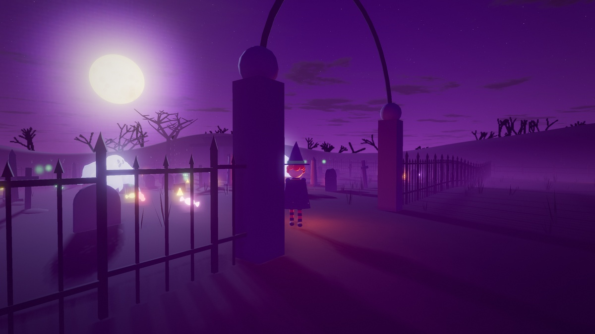

# web-engine

A game engine for the web browser, built on Three.js and WebGL2. It gives you physics, lighting, animation, sound
and phone touch controls as plain JavaScript modules (`@vibe/engine`).

<a href="https://brandeispatrick.github.io/web-engine/halloween/"></a>

### 🎃 [Play the Halloween game](https://brandeispatrick.github.io/web-engine/halloween/)

**Midnight Candy Run:** grab candy before midnight, smash jack-o'-lanterns, scare off the ghosts. It runs in the
browser on a phone or a computer, with nothing to install. [About the game](samples/halloween/README.md)

Both the engine and the game were built with Claude (AI agents).

## Live samples

All of them are at **[brandeispatrick.github.io/web-engine](https://brandeispatrick.github.io/web-engine/)**.

| Sample | What it shows |
|---|---|
| [Night NYC walk](https://brandeispatrick.github.io/web-engine/nyc-night/) | A walk through Manhattan after dark: buildings, street lamps and night lighting |
| [Miami drive](https://brandeispatrick.github.io/web-engine/miami-drive/) | A drive along the Miami waterfront: assets, driving feel and vehicle physics |
| [Midnight Candy Run](https://brandeispatrick.github.io/web-engine/halloween/) | The Halloween game: cloth ghosts, fracture, synth audio, touch controls |

What the samples look like, and what changed in the latest release: **[before and after](docs/BEFORE-AFTER.md)**. The live
site is deployed separately (`npm run deploy`) and may trail this branch.

Each sample has a graphics quality setting (the gear button): **Mac / desktop** (full lighting) or **Phone / tablet**
(lighter, saves battery). It picks one for your device, remembers your choice, and `?quality=desktop|mobile` forces one.

## What's inside

- **Physics:** deterministic and pure JS. Rigid bodies, joints, cloth, ropes, soft bodies, buoyancy and fracture share
  one XPBD solver. Vehicle and character controllers sit on top.
- **Rendering:** forward MSAA or G-buffer + TAA, clustered lights, cascaded shadows, screen-space reflections,
  volumetric light, water, motion blur, depth of field, GPU particles.
- **Animation:** state machine with blend trees, IK, ragdolls.
- **Input and camera:** keyboard, mouse, gamepad and touch (floating sticks, safe-area aware); chase, orbit, free-fly,
  third- and first-person rigs.
- **Audio and UI:** synth music and effects, positional sound, DOM HUD widgets.
- **Core:** 120 Hz fixed step with render interpolation, adaptive resolution, a CPU / GPU profiler.
- **Worlds:** city worlds baked from OpenStreetMap and terrain data, with traffic.

Plain ES modules with JSDoc types. The only (peer) dependency is `three`. MIT licensed.

## Quick start

Run the samples on your machine (Node 20.19 or newer):

```sh
git clone https://github.com/BrandeisPatrick/web-engine.git
cd web-engine
npm install
npm run dev     # samples at http://localhost:5190
npm test        # 35 headless test suites
```

Use it in your own game:

```sh
npm install three github:BrandeisPatrick/web-engine
```

```js
import { Engine, Atmosphere, PostFX, CharacterController } from '@vibe/engine';
import { Cloth, FracturedBody } from '@vibe/engine/physics'; // also core, render, anim, input, camera, audio, ui, world
```

A minimal setup is in [ENGINE.md, "Engine API"](ENGINE.md#engine-api). Each sample's `main.js` is a full example.

## Learn more

- [ENGINE.md](ENGINE.md): design notes, the API, measurements and the record of decisions.
- [CHANGELOG.md](CHANGELOG.md): what changed in each release.
- [tools/README.md](tools/README.md): the map, terrain and texture bakers.

<details>
<summary><b>Developer notes:</b> scripts, sample flags, tests, source layout</summary>

### Scripts
- `npm run build` builds every sample into `dist/`; `npm run preview` serves it at http://localhost:5191.
- `npm run types` emits TypeScript declarations into `types/`; `npm run types:check` compiles a strict TypeScript
  consumer against them.
- `npm run smoke` and `npm run bench` drive the samples in Chrome with Playwright (ENGINE.md, "Measurement protocol").
- `npm run perf` reduces graphics performance to one score (100 = every pose on its frame budget), compares it with
  the committed baseline and guards the picture; `bench/README.md` explains the score, the guards and the ratchet,
  and `bench/LOOP.md` is the runbook for an unattended optimisation loop.
- `npm run pack:check` lists the package tarball.
- Installed as a git submodule listed in a game's `workspaces`, the engine resolves as `@vibe/engine`
  (`node_modules/@vibe/engine -> engine`).

### Sample flags
Every sample takes `?quality=desktop|mobile` (the Halloween game also reads the old `low|high`): it overrides the tier
the gear menu stored and the device's recommendation for that page load (`resolveQuality` in `src/core/Quality.js`,
the menu is `QualityMenu` in `src/ui/`). The NYC and Miami demos expose `window.__sample` (poses, settings,
`run(plan)`) under `?bench=1&size=WxH` (the Halloween game exposes `window.__game` instead). Render flags shared by
the samples are in `samples/shared/fx-flags.js`: `?gbuffer=1`, `?aa=taa|fxaa|msaa`, `?shadows=pcf|fast|pcss`,
`?cascades=2|3|4`, `?ssr=1`, `?volumetric=1`, `?motionblur=1`, `?dof=1`, `?lut=warm|bleach`, `?aonormals=gbuffer`,
`?fps=60`.
- **Halloween:** see [its README](samples/halloween/README.md).
- The earlier test samples (Canyon Run, the procedural city, Character, the physics sandbox) were removed in favour of
  the two demos; they are in git history (`git show fc73161:samples/<name>/main.js`).

### Tests (`npm test`, 35 suites)
- `test/car-sim.mjs`: the vehicle model (`ROADSTER_SPEC`) and the PhysicsWorld queries, the determinism gate (bit-identical
  since 0.4.0).
- `test/world-build.mjs`, `world-lights`: the procedural city built headless, its stats, queries and 10 s of traffic.
- `test/core.mjs`, `quality`, `assets`, `rigs`, `character-input`, `anim`, `character-sim`: core services, the quality
  tiers, loaders, camera rigs, input, animation and the character controller.
- `test/dyn-*.mjs`, `character-dyn`, `ragdoll`: the dynamics, from shapes and joints to cloth, soft bodies, buoyancy
  and fracture.
- `test/gpu-particles.mjs`, `clustered`, `shadows`, `postfx-options`, `gbuffer-chunks`, `ssr-ao`, `volumetric`,
  `blur-dof-lut`, `water`: the render pipeline's shaders, options and defaults.
- `test/halloween-enemies.mjs`, `halloween-depth`: the Halloween game's rules.
- `test/browser/` (`smoke`, `bench`, `halloween`) needs Chrome and runs locally; `smoke` and `bench` also take the
  `-mobile` pages (`nyc-night-mobile`, `miami-drive-mobile`: the same demo on the mobile tier). CI (`.github/workflows/ci.yml`,
  Node 26) runs `npm test`, the build and `types:check`.

### Source layout
- `src/core/`: `Engine`, `Profiler`, `Assets`, `Events`, `Clock`, `Entity`, deterministic math, the bench harness,
  the quality tiers (`Quality.js`).
- `src/physics/`: `PhysicsWorld`, `VehicleController`, `CharacterController`, and `dynamics/` (the XPBD solver,
  `Cloth`, `Rope`, `SoftBody`, `Buoyancy`, `FracturedBody`, a Worker client).
- `src/render/`: `Atmosphere`, `PostFX`, `ClusteredLights`, shadows, `GpuParticleSystem`, instancing / LOD /
  impostors, `TextureSets` (KTX2), `SoftMeshes`, `FractureMesh`, `PhysicsDebug`.
- `src/anim/`: `AnimationController`, `TwoBoneIK`, `CCDIK`, `Ragdoll`.
- `src/input/`, `src/camera/`, `src/audio/`, `src/ui/`: input maps and touch controls, camera rigs, `AudioBus` and
  synth voices, HUD widgets.
- `src/world/`: `MapWorld` and its systems (terrain, roads, buildings, props, traffic, vegetation, water). The data
  contracts are in ENGINE.md, "World layer".
- `tools/`: the data bakers, see [tools/README.md](tools/README.md).

</details>
