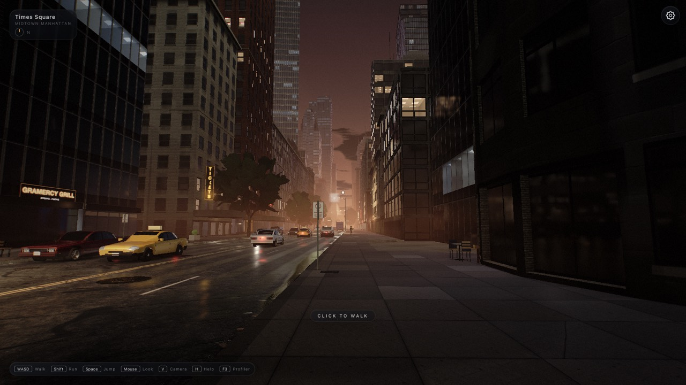
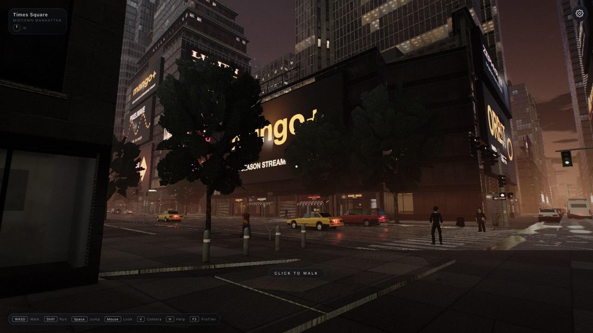
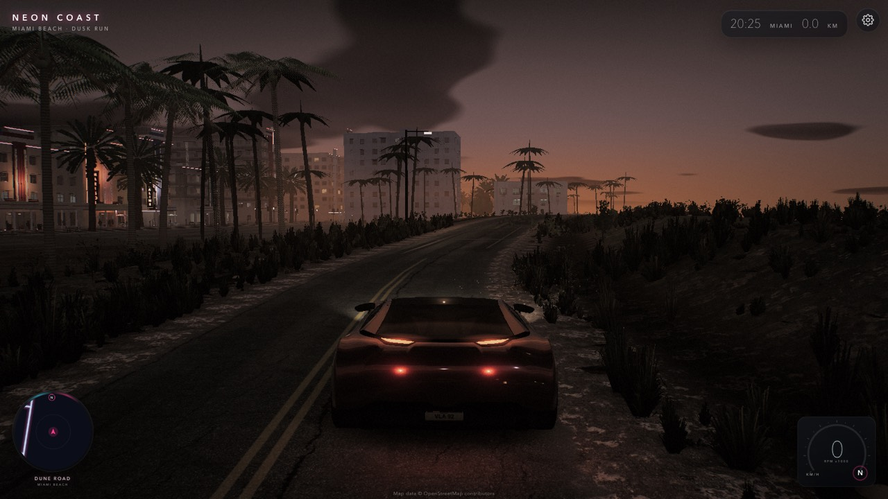
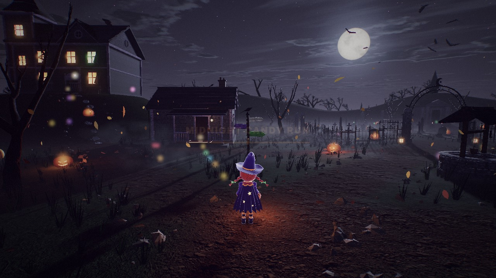

# web-engine

[](https://github.com/BrandeisPatrick/web-engine/actions/workflows/ci.yml)
[](https://github.com/BrandeisPatrick/web-engine/releases)
[](LICENSE)
[](https://threejs.org)

A game engine for the web browser, built on Three.js and WebGL2. Physics, rendering, animation, input, audio and
city-scale worlds come as plain JavaScript modules in one package, `@vibe/engine`. Its only dependency is `three`.

**[Live demos](https://brandeispatrick.github.io/web-engine/)** ·
**[Documentation](ENGINE.md)** ·
**[Changelog](CHANGELOG.md)** ·
**[Releases](https://github.com/BrandeisPatrick/web-engine/releases)**

<a href="https://brandeispatrick.github.io/web-engine/nyc-night/"></a>

## Demos

Each demo runs in the browser on a computer or a phone, with nothing to install.

<table>
  <tr>
    <td width="33%"><a href="https://brandeispatrick.github.io/web-engine/nyc-night/"></a></td>
    <td width="33%"><a href="https://brandeispatrick.github.io/web-engine/miami-drive/"></a></td>
    <td width="33%"><a href="https://brandeispatrick.github.io/web-engine/halloween/"></a></td>
  </tr>
  <tr>
    <td valign="top"><b><a href="https://brandeispatrick.github.io/web-engine/nyc-night/">Night NYC walk</a></b><br>Midtown Manhattan at dusk, on foot. Buildings baked from OpenStreetMap, street lamps and signs as clustered lights, wet-street reflections, traffic and pedestrians.</td>
    <td valign="top"><b><a href="https://brandeispatrick.github.io/web-engine/miami-drive/">Miami drive</a></b><br>South Beach at dusk, behind the wheel. Vehicle physics and driving feel, a detailed hero car, palms, hotels and a dune road.</td>
    <td valign="top"><b><a href="https://brandeispatrick.github.io/web-engine/halloween/">Midnight Candy Run</a></b><br>The Halloween game: collect candy before midnight. Cloth ghosts, fracture, synthesised audio and touch controls. <a href="samples/halloween/README.md">About the game</a></td>
  </tr>
</table>

Every demo has a graphics setting behind the gear button: **Mac / desktop** (full lighting) or **Phone / tablet**
(lighter, saves battery). The demo recommends one for the device and remembers the choice; `?quality=desktop|mobile`
in the URL forces one.

[Before and after](docs/BEFORE-AFTER.md) shows what changed on screen in the latest release.

## Features

| Area | What it provides |
|---|---|
| **Core** | 120 Hz fixed step with render interpolation, a systems registry, adaptive resolution, asset loading (glTF with KTX2, Draco and meshopt), a CPU / GPU profiler and quality tiers |
| **Physics** | Deterministic and pure JavaScript. Rigid bodies, joints, cloth, ropes, soft bodies, buoyancy and fracture share one XPBD solver; vehicle and character controllers sit on top |
| **Rendering** | Forward MSAA or G-buffer + TAA, clustered lights, cascaded shadows, ambient occlusion, screen-space reflections, volumetric light, water, bloom, motion blur, depth of field, colour LUTs and GPU particles |
| **Animation** | State machine with blend trees, two-bone and CCD inverse kinematics, ragdolls |
| **Input and camera** | Keyboard, mouse, gamepad and touch (floating sticks, safe-area aware); chase, orbit, free-fly, third-person and first-person rigs |
| **Audio and UI** | Synthesised music and effects, positional sound, sample playback; DOM HUD widgets and a settings menu |
| **Worlds** | City worlds baked from OpenStreetMap and terrain data: roads, buildings, props, vegetation, water, tile streaming and traffic. Built for map-scale cities; a small track or arena uses `PhysicsWorld` with a heightfield and its own meshes |

The source is plain ES modules with JSDoc types. TypeScript declarations ship with the package.

## Getting started

### Run the demos locally

Requires Node 20.19 or newer.

```sh
git clone https://github.com/BrandeisPatrick/web-engine.git
cd web-engine
npm install
npm run dev     # the demos at http://localhost:5190
npm test        # the headless test suites (Node, no browser)
```

### Use the engine in a project

The package installs from GitHub; it is not on the npm registry.

```sh
npm install three github:BrandeisPatrick/web-engine
```

```js
import { Engine, Atmosphere, PostFX, PhysicsWorld } from '@vibe/engine';

const physics = new PhysicsWorld();
const engine = new Engine({ container: document.body, fixedHz: 120, physics });
const { scene, camera, renderer } = engine;

const atmosphere = new Atmosphere({ scene, renderer, camera, timeOfDay: 'noon' });
const postfx = new PostFX(renderer, scene, camera, {
  atmosphere,
  width: innerWidth,
  height: innerHeight,
  pixelRatio: engine.pixelRatio,
  gbuffer: true, // every render feature is an option, off by default
  aa: 'taa',
});
engine.renderFn = (sc, cam, dt) => postfx.render(dt);
engine.onResize = (w, h, pr) => postfx.setSize(w, h, pr); // keep PostFX at the window size

engine.addSystem({ lateUpdate: (dt) => atmosphere.update(camera.position, dt) }, 'world');
await engine.load();
engine.start();
```

The API, layer by layer, is in [ENGINE.md](ENGINE.md). The demos under `samples/` are full games spread over many
modules each; read them for one technique at a time rather than as a template.

### Entry points

Import everything from `@vibe/engine`, or one layer at a time:

| Import | Contents |
|---|---|
| `@vibe/engine/core` | `Engine`, `Profiler`, `Assets`, `Events`, `Clock`, deterministic math, quality tiers (`resolveQuality`), the bench harness |
| `@vibe/engine/physics` | `PhysicsWorld`, `VehicleController`, `CharacterController`, `DynamicsWorld`, `Cloth`, `Rope`, `SoftBody`, `Buoyancy`, `FracturedBody` |
| `@vibe/engine/render` | `Atmosphere`, `PostFX`, `ClusteredLights`, `GpuParticleSystem`, `TextureSets`, shadows, instancing and LOD |
| `@vibe/engine/anim` | `AnimationController`, `TwoBoneIK`, `CCDIK`, `Ragdoll` |
| `@vibe/engine/input` | `InputMap`, `TouchControls`, `VehicleInput`, `CharacterInput`, `PointerLock` |
| `@vibe/engine/camera` | `ChaseRig`, `OrbitRig`, `FreeFlyRig`, `ThirdPersonRig`, `FirstPersonRig` |
| `@vibe/engine/audio` | `AudioBus`, synth voices (`playTone`, ...), `PositionalAudio`, `SamplePlayer`, `VehicleAudio`, `CityAmbience` |
| `@vibe/engine/ui` | HUD widgets (`UILayer`, `Panel`, `Readout`, `Gauge`, ...), `QualityMenu` |
| `@vibe/engine/world` | `MapWorld` and its systems: terrain, roads, buildings, props, traffic, vegetation, water, `TileStreamer`; `NearestLights` (a pool of real point lights for any set of lamps) |

## Performance

Graphics performance is measured, not estimated. `npm run perf` renders fixed camera poses of every demo on both
quality tiers and reduces the result to one score (100 means every pose meets its frame budget). A change counts as
an improvement only if the score rises and the picture, the draw counters and the memory use stay inside their
guards. [bench/README.md](bench/README.md) describes the score, the guards and the baseline.

## Requirements

| Needs | Version |
|---|---|
| **Browser** | WebGL2. The demos are developed and measured in Chrome, with a lighter tier for phones and tablets |
| **three** | 0.170 or newer (peer dependency); developed against 0.180 |
| **Node** | 20.19 or newer, to run the demos, the tests and the build |

## Project status

The current release is **1.1.0-beta.1**, a pre-release; **1.0.0** is the latest stable release. Both are on the
[releases page](https://github.com/BrandeisPatrick/web-engine/releases), and [CHANGELOG.md](CHANGELOG.md) lists what
changed in each.

## Documentation

- [ENGINE.md](ENGINE.md): the reference: what the engine provides today, layer by layer.
- [docs/DESIGN-NOTES.md](docs/DESIGN-NOTES.md): design history, measurements and the record of decisions.
- [CHANGELOG.md](CHANGELOG.md): what changed in each release.
- [docs/BEFORE-AFTER.md](docs/BEFORE-AFTER.md): captures of the demos before and after the latest release.
- [bench/README.md](bench/README.md): how performance is scored and guarded.
- [tools/README.md](tools/README.md): the map, terrain and texture bakers.

## Development

<details>
<summary><b>Scripts, demo flags, tests and source layout</b></summary>

### Scripts

| Command | What it does |
|---|---|
| `npm run dev` | Serves the demos at http://localhost:5190 |
| `npm run build` | Builds every demo into `dist/`; `npm run preview` serves the build at http://localhost:5191 |
| `npm test` | Runs every headless suite listed in `test/all.mjs` |
| `npm run types` | Emits TypeScript declarations into `types/`; `npm run types:check` compiles a strict TypeScript consumer against them |
| `npm run smoke` | Drives the demos in Chrome with Playwright and checks stability and the look limits |
| `npm run bench` | Measures frame times per pose ([design notes, "Measurement protocol"](docs/DESIGN-NOTES.md#measurement-protocol)) |
| `npm run perf` | Computes the performance score and compares it with the committed baseline; `bench/LOOP.md` is the runbook for an unattended optimisation loop |
| `npm run deploy` | Builds and publishes the live site. It is deployed separately and may trail `main` |
| `npm run pack:check` | Lists the package tarball |

Installed as a git submodule listed in a game's `workspaces`, the engine resolves as `@vibe/engine`
(`node_modules/@vibe/engine -> engine`).

### Demo flags

- `?quality=desktop|mobile` overrides the stored tier and the device's recommendation for that page load
  (`resolveQuality` in `src/core/Quality.js`; the menu is `QualityMenu` in `src/ui/`). The Halloween game also reads
  the old `low|high`.
- `window.__sample` is the bench harness (poses, settings, `run(plan)`; `createBenchHarness` in `src/core/Bench.js`):
  always on in the NYC and Miami demos, only under `?bench=1` in the Halloween game, which also exposes its round
  state as `window.__game`. `?bench=1&size=WxH` freezes the loop at load and pins the drawing buffer size.
- Render flags shared by the demos are in `samples/shared/fx-flags.js`: `?gbuffer=1`, `?aa=taa|fxaa|msaa`,
  `?shadows=pcf|fast|pcss`, `?cascades=2|3|4`, `?ssr=1`, `?volumetric=1`, `?motionblur=1`, `?dof=1`,
  `?lut=warm|bleach`, `?aonormals=gbuffer`, `?fps=60`.
- The Halloween game's own flags are in [its README](samples/halloween/README.md).
- The earlier test samples (Canyon Run, the procedural city, Character, the physics sandbox) were removed in favour
  of the current demos; they are in git history (`git show fc73161:samples/<name>/main.js`).

### Tests

`npm test` runs the suites listed in `test/all.mjs` in Node, with no browser:

- `test/car-sim.mjs`: the vehicle model (`ROADSTER_SPEC`) and the PhysicsWorld queries; the determinism gate
  (bit-identical since 0.4.0).
- `test/world-build.mjs`, `world-lights`, `vehicles-hd`: the procedural city built headless, its stats, queries and
  10 s of traffic; the vehicle detail levels.
- `test/core.mjs`, `quality`, `look-stats`, `memory`, `texture-manifest`, `assets`, `rigs`, `character-input`, `anim`,
  `character-sim`: core services, the quality tiers, the look statistics, memory trimming, loaders, camera rigs,
  input, animation and the character controller.
- `test/dyn-*.mjs`, `cloth-mesh`, `character-dyn`, `ragdoll`: the dynamics, from shapes and joints to cloth, soft
  bodies, buoyancy and fracture.
- `test/gpu-particles.mjs`, `clustered`, `shadows`, `skip-unlit`, `postfx-options`, `render-scale`, `gbuffer-chunks`,
  `ssr-ao`, `volumetric`, `blur-dof-lut`, `water`: the render pipeline's shaders, options and defaults.
- `test/halloween-enemies.mjs`, `halloween-depth`, `miami-car`, `nyc-traffic-mix`: the demos' rules and engine
  options.
- `test/docs.mjs`: the docs name only paths, links and `@vibe/engine` imports that exist.

`test/browser/` (`smoke`, `bench`, `perf`, `halloween`, `halloween-media`) needs Chrome and runs locally; `smoke`
also takes `nyc-night-mobile`, `miami-drive-mobile` and `halloween-mobile`, and `bench` the first two (the same demo
on the mobile tier). The scripts share `test/browser/playwright.config.mjs` (`startVite`, `launchChrome`,
`loadSample`, `watchErrors`) and wait for the page to set `window.__sample.ready` (`createBenchHarness(...)
.setReady()`); a page without it fails after the timeout. CI (`.github/workflows/ci.yml`, Node 26) runs `npm test`,
the build and `types:check`.

### Adding a sample page

Put it in `samples/<name>/index.html`; the dev server serves it at `/<name>/` at once. Add `<name>` to `SAMPLES` in
`vite.config.js` so `npm run build` includes it, and a link in `samples/index.html`.

### Source layout

- `src/core/`: `Engine`, `Profiler`, `Assets`, `Events`, `Clock`, `Entity`, deterministic math, the bench harness,
  the quality tiers (`Quality.js`).
- `src/physics/`: `PhysicsWorld`, `VehicleController`, `CharacterController`, and `dynamics/` (the XPBD solver,
  `Cloth`, `Rope`, `SoftBody`, `Buoyancy`, `FracturedBody`, a Worker client).
- `src/render/`: `Atmosphere`, `PostFX`, `ClusteredLights`, shadows, `GpuParticleSystem`, instancing / LOD /
  impostors, `TextureSets` (KTX2), `SoftMeshes`, `FractureMesh`, `PhysicsDebug`.
- `src/anim/`: `AnimationController`, `TwoBoneIK`, `CCDIK`, `Ragdoll`.
- `src/input/`, `src/camera/`, `src/audio/`, `src/ui/`: input maps and touch controls, camera rigs, `AudioBus` and
  synth voices, HUD widgets.
- `src/world/`: `MapWorld` and its systems (terrain, roads, buildings, props, traffic, vegetation, water) and
  `NearestLights`. The data contracts are in [ENGINE.md, "World"](ENGINE.md#world).
- `samples/`: the demos; `tools/`: the data bakers ([tools/README.md](tools/README.md)); `bench/`: the performance
  budgets and runbook.

</details>

## Credits

- **Map data** in the city demos is © [OpenStreetMap](https://www.openstreetmap.org/copyright) contributors (ODbL).
- **Textures and models** are from [Poly Haven](https://polyhaven.com) and [Quaternius](https://quaternius.com)
  (CC0), and the Miami hero car is the Khronos glTF sample "Car Concept" (CC-BY 4.0, logos removed).
- Each demo lists every file, author and licence in its own credits:
  [NYC](samples/public/nyc/CREDITS.md), [Miami](samples/public/miami/CREDITS.md),
  [Halloween](samples/public/halloween/CREDITS.md).

The engine and its demos were built with Claude (AI agents).

## Licence

The engine's code is released under the [MIT licence](LICENSE). Assets under `samples/public/` keep the licences
listed in their credits files.
