# Asset catalogue

Generated by `tools/catalog-assets.mjs` from `tools/asset-registry.mjs`, the texture manifests and the `CREDITS.md` files; do not edit by hand. The same data is in [`samples/public/catalog/catalog.json`](../samples/public/catalog/catalog.json); the samples site shows it as the Asset library page (`samples/assets/`).

Each table's "Use" column shows the snippet line that makes the asset; the description (for engine models: which way it faces, where its origin is, its size) and the whole snippet (imports, material, mesh, what to call per frame) follow the table, folded under the asset's name. Every snippet was run to render its thumbnail.

194 entries: 59 downloaded files, 135 made in code; 68 in the engine package, 126 inside a demo (12 of them not reusable as is).

Snippets assume a THREE `scene`, `renderer` and `camera`, and are written for a page in `samples/<name>/` (Vite: `import.meta.env.BASE_URL` is the site root; demo modules import as `../<demo>/<file>.js`). A line `// every frame: ...` is code to run once per frame (`dt`, `t` in seconds).

## Sources

| Source | Licences | Entries |
|---|---|---|
| [Poly Haven](https://polyhaven.com) | CC0 1.0 | 50 |
| [Quaternius via poly.pizza](https://poly.pizza) | CC0 1.0 | 3 |
| [OpenStreetMap](https://www.openstreetmap.org/copyright) | ODbL 1.0 | 2 |
| [Khronos glTF Sample Assets](https://github.com/KhronosGroup/glTF-Sample-Assets) | CC-BY 4.0 | 1 |

Everything else is made in code in this repository (MIT).

## Contents

- [Vehicle](#vehicle) (12)
- [Character](#character) (7)
- [Building](#building) (12)
- [Prop](#prop) (57)
- [Vegetation](#vegetation) (13)
- [Boat](#boat) (5)
- [Texture set](#texture-set) (33)
- [Texture](#texture) (9)
- [Road and ground](#road-and-ground) (2)
- [Water](#water) (2)
- [Sign](#sign) (6)
- [Sky](#sky) (11)
- [Environment](#environment) (10)
- [Effect](#effect) (4)
- [Colour grade](#colour-grade) (5)
- [Map data](#map-data) (2)
- [Sound](#sound) (4)

## Vehicle

| | Asset | Where | Credit | Use |
|---|---|---|---|---|
| 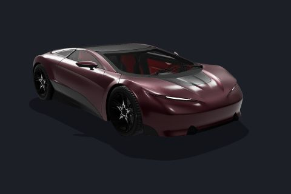 | **Car Concept (hero car)**<br>file, demo: miami-drive<br><sub>`miami-car-concept`</sub> | `miami/models/car-concept.glb` | Eric Chadwick (Darmstadt Graphics Group); based on a CC0 model by Unity Fan, CC-BY 4.0 (attribution required) ([source](https://github.com/KhronosGroup/glTF-Sample-Assets/tree/main/Models/CarConcept)) | `const car = await loadCarGlb({ url: import.meta.env.BASE_URL + 'miami/models/car-concept.glb', paint: 0x4c0a20 });`<br>[full snippet](#snippet-miami-car-concept) |
| 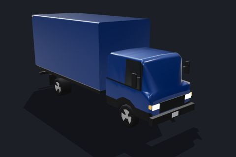 | **Box truck**<br>code, engine<br><sub>`engine-vehicle-boxtruck`</sub> | `src/world/Vehicles.js`<br>`makeVehicleGeometry` | made in code | `const geometry = makeVehicleGeometry('boxtruck', { lod: 0 });`<br>[full snippet](#snippet-engine-vehicle-boxtruck) |
| 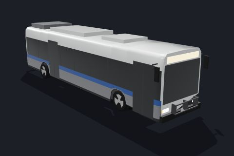 | **City bus**<br>code, engine<br><sub>`engine-vehicle-bus`</sub> | `src/world/Vehicles.js`<br>`makeVehicleGeometry` | made in code | `const geometry = makeVehicleGeometry('bus', { lod: 0 });`<br>[full snippet](#snippet-engine-vehicle-bus) |
| 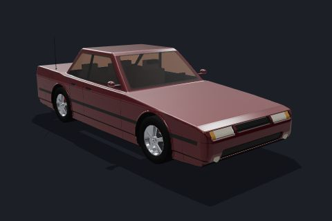 | **Corsa Vela sedan**<br>code, demo: miami-drive<br><sub>`miami-sedan`</sub> | `samples/miami-drive/car-model.js`<br>`buildCarModel` | made in code | `const car = buildCarModel({ lod: 'high', paint: 0x5c0c18 });`<br>[full snippet](#snippet-miami-sedan) |
| 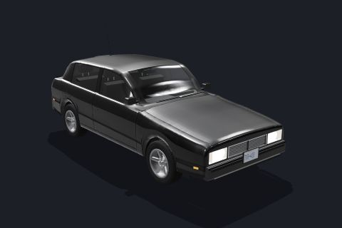 | **Hatchback**<br>code, engine<br><sub>`engine-vehicle-hatchback`</sub> | `src/world/Vehicles.js`<br>`makeVehicleGeometry` | made in code | `const geometry = makeVehicleGeometry('hatchback', { lod: 'hd' });`<br>[full snippet](#snippet-engine-vehicle-hatchback) |
| 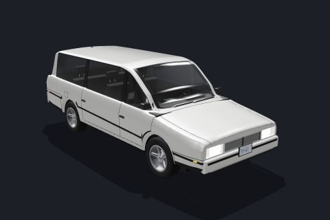 | **Minivan**<br>code, engine<br><sub>`engine-vehicle-minivan`</sub> | `src/world/Vehicles.js`<br>`makeVehicleGeometry` | made in code | `const geometry = makeVehicleGeometry('minivan', { lod: 'hd' });`<br>[full snippet](#snippet-engine-vehicle-minivan) |
| 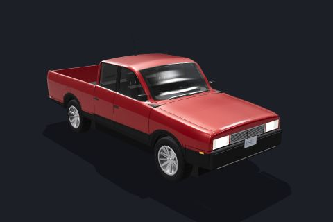 | **Pickup truck**<br>code, engine<br><sub>`engine-vehicle-pickup`</sub> | `src/world/Vehicles.js`<br>`makeVehicleGeometry` | made in code | `const geometry = makeVehicleGeometry('pickup', { lod: 'hd' });`<br>[full snippet](#snippet-engine-vehicle-pickup) |
| 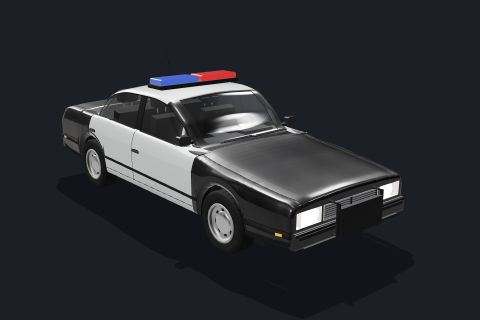 | **Police sedan**<br>code, engine<br><sub>`engine-vehicle-police_sedan`</sub> | `src/world/Vehicles.js`<br>`makeVehicleGeometry` | made in code | `const geometry = makeVehicleGeometry('police_sedan', { lod: 'hd' });`<br>[full snippet](#snippet-engine-vehicle-police_sedan) |
| 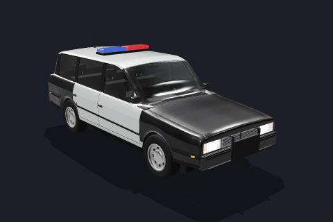 | **Police SUV**<br>code, engine<br><sub>`engine-vehicle-police`</sub> | `src/world/Vehicles.js`<br>`makeVehicleGeometry` | made in code | `const geometry = makeVehicleGeometry('police', { lod: 'hd' });`<br>[full snippet](#snippet-engine-vehicle-police) |
| 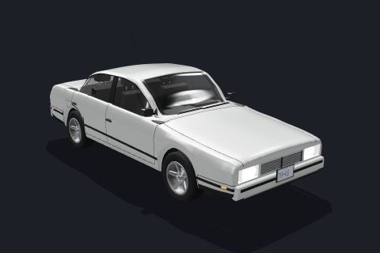 | **Sedan**<br>code, engine<br><sub>`engine-vehicle-sedan`</sub> | `src/world/Vehicles.js`<br>`makeVehicleGeometry` | made in code | `const geometry = makeVehicleGeometry('sedan', { lod: 'hd' });`<br>[full snippet](#snippet-engine-vehicle-sedan) |
| 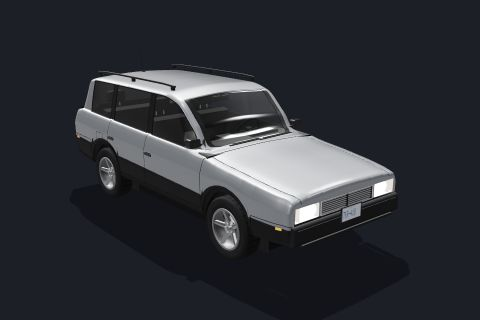 | **SUV**<br>code, engine<br><sub>`engine-vehicle-suv`</sub> | `src/world/Vehicles.js`<br>`makeVehicleGeometry` | made in code | `const geometry = makeVehicleGeometry('suv', { lod: 'hd' });`<br>[full snippet](#snippet-engine-vehicle-suv) |
| 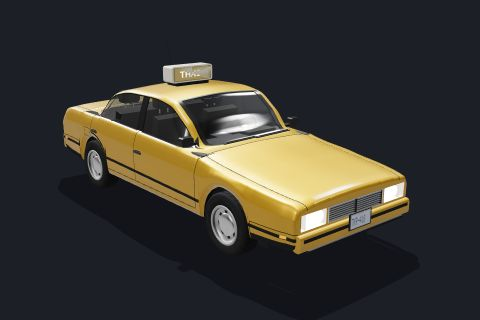 | **Taxi**<br>code, engine<br><sub>`engine-vehicle-taxi`</sub> | `src/world/Vehicles.js`<br>`makeVehicleGeometry` | made in code | `const geometry = makeVehicleGeometry('taxi', { lod: 'hd' });`<br>[full snippet](#snippet-engine-vehicle-taxi) |

Snippets (vehicle):

<details id="snippet-miami-car-concept"><summary><b>Car Concept (hero car)</b> <code>miami-car-concept</code></summary>

The Miami drive's desktop hero car. CC-BY 4.0: credit "Car Concept by Eric Chadwick, © 2024 Darmstadt Graphics Group GmbH" wherever it is shown. The Khronos and 3D Commerce logos were removed from the file. loadCarGlb (samples/miami-drive/car-glb.js) re-rigs it: wheels split out, tinted glass, paint colour, lamps as uniforms.

```js
import { loadCarGlb } from '../miami-drive/car-glb.js';
const car = await loadCarGlb({ url: import.meta.env.BASE_URL + 'miami/models/car-concept.glb', paint: 0x4c0a20 });
scene.add(car.root);
for (const w of car.wheels) scene.add(w.root);   // the wheels are not children of root
car.lamps.uHead.value = 1;
```

</details>

<details id="snippet-engine-vehicle-boxtruck"><summary><b>Box truck</b> <code>engine-vehicle-boxtruck</code></summary>

Box truck built in code by the engine (src/world/Vehicles.js). Faces -Z like VehicleController, with its origin on the ground between the axles, so it goes on a controller's body with no flip or offset; 7.4 x 2.44 x 3.42 m long x wide x high (VEHICLE\_SPECS.boxtruck, wheelbase 4.3 m). MapWorld's traffic and parked cars use it; samples/dev/vehicles.html shows every type. Paint comes from the instance colour; the lamps glow with the material's userData.u.uDark uniform (0 day .. 1 night, set in the snippet).

```js
import * as THREE from 'three';
import { makeVehicleGeometry, createVehicleMaterial, pickVehicleColor } from '@vibe/engine/world';
const geometry = makeVehicleGeometry('boxtruck', { lod: 0 });
const material = createVehicleMaterial({ brake: false });
material.userData.u.uDark.value = 1;                                     // lamps on: 0 day .. 1 night
const car = new THREE.InstancedMesh(geometry, material, 1);
car.setMatrixAt(0, new THREE.Matrix4());
car.setColorAt(0, pickVehicleColor(Math.random, 'truck', new THREE.Color()));
scene.add(car);
```

</details>

<details id="snippet-engine-vehicle-bus"><summary><b>City bus</b> <code>engine-vehicle-bus</code></summary>

City bus built in code by the engine (src/world/Vehicles.js). Faces -Z like VehicleController, with its origin on the ground between the axles, so it goes on a controller's body with no flip or offset; 12.2 x 2.59 x 3.02 m long x wide x high (VEHICLE\_SPECS.bus, wheelbase 7 m). MapWorld's traffic and parked cars use it; samples/dev/vehicles.html shows every type. Paint comes from the instance colour; the lamps glow with the material's userData.u.uDark uniform (0 day .. 1 night, set in the snippet).

```js
import * as THREE from 'three';
import { makeVehicleGeometry, createVehicleMaterial, pickVehicleColor } from '@vibe/engine/world';
const geometry = makeVehicleGeometry('bus', { lod: 0 });
const material = createVehicleMaterial({ brake: false });
material.userData.u.uDark.value = 1;                                     // lamps on: 0 day .. 1 night
const car = new THREE.InstancedMesh(geometry, material, 1);
car.setMatrixAt(0, new THREE.Matrix4());
car.setColorAt(0, pickVehicleColor(Math.random, 'bus', new THREE.Color()));
scene.add(car);
```

</details>

<details id="snippet-miami-sedan"><summary><b>Corsa Vela sedan</b> <code>miami-sedan</code></summary>

An early-90s three-box sedan meshed in code from a signed distance field, with one shader that draws glass, lamps, grille, plate and panel gaps. The Miami drive's hero car on phones (and with ?car=sedan). Lamps are uniforms: model.lamps.uHead.value = 1.

```js
import { buildCarModel } from '../miami-drive/car-model.js';
const car = buildCarModel({ lod: 'high', paint: 0x5c0c18 });
scene.add(car.root);
for (const w of car.wheels) scene.add(w.root);   // the wheels are not children of root
```

</details>

<details id="snippet-engine-vehicle-hatchback"><summary><b>Hatchback</b> <code>engine-vehicle-hatchback</code></summary>

Hatchback built in code by the engine (src/world/Vehicles.js). Faces -Z like VehicleController, with its origin on the ground between the axles, so it goes on a controller's body with no flip or offset; 4.26 x 1.79 x 1.47 m long x wide x high (VEHICLE\_SPECS.hatchback, wheelbase 2.63 m); for wheels that roll and steer, makeVehicleParts gives body, glass and wheels apart. MapWorld's traffic and parked cars use it; samples/dev/vehicles.html shows every type. Paint comes from the instance colour; the lamps glow with the material's userData.u.uDark uniform (0 day .. 1 night, set in the snippet).

```js
import * as THREE from 'three';
import { makeVehicleGeometry, createVehicleMaterial, pickVehicleColor } from '@vibe/engine/world';
const geometry = makeVehicleGeometry('hatchback', { lod: 'hd' });          // shared and cached: do not modify
const body = createVehicleMaterial({ hd: true, brake: false }), glass = createVehicleMaterial({ hd: true, glass: true, brake: false });
const car = new THREE.InstancedMesh(geometry, [body, glass], 1);
car.setMatrixAt(0, new THREE.Matrix4());
car.setColorAt(0, pickVehicleColor(Math.random, 'car', new THREE.Color()));
for (const m of [body, glass]) m.userData.u.uDark.value = 1;          // lamps on: 0 day .. 1 night
scene.add(car);
```

</details>

<details id="snippet-engine-vehicle-minivan"><summary><b>Minivan</b> <code>engine-vehicle-minivan</code></summary>

Minivan built in code by the engine (src/world/Vehicles.js). Faces -Z like VehicleController, with its origin on the ground between the axles, so it goes on a controller's body with no flip or offset; 5.16 x 1.99 x 1.74 m long x wide x high (VEHICLE\_SPECS.minivan, wheelbase 3 m); for wheels that roll and steer, makeVehicleParts gives body, glass and wheels apart. MapWorld's traffic and parked cars use it; samples/dev/vehicles.html shows every type. Paint comes from the instance colour; the lamps glow with the material's userData.u.uDark uniform (0 day .. 1 night, set in the snippet).

```js
import * as THREE from 'three';
import { makeVehicleGeometry, createVehicleMaterial, pickVehicleColor } from '@vibe/engine/world';
const geometry = makeVehicleGeometry('minivan', { lod: 'hd' });          // shared and cached: do not modify
const body = createVehicleMaterial({ hd: true, brake: false }), glass = createVehicleMaterial({ hd: true, glass: true, brake: false });
const car = new THREE.InstancedMesh(geometry, [body, glass], 1);
car.setMatrixAt(0, new THREE.Matrix4());
car.setColorAt(0, pickVehicleColor(Math.random, 'car', new THREE.Color()));
for (const m of [body, glass]) m.userData.u.uDark.value = 1;          // lamps on: 0 day .. 1 night
scene.add(car);
```

</details>

<details id="snippet-engine-vehicle-pickup"><summary><b>Pickup truck</b> <code>engine-vehicle-pickup</code></summary>

Pickup truck built in code by the engine (src/world/Vehicles.js). Faces -Z like VehicleController, with its origin on the ground between the axles, so it goes on a controller's body with no flip or offset; 5.4 x 1.91 x 1.79 m long x wide x high (VEHICLE\_SPECS.pickup, wheelbase 3.24 m); for wheels that roll and steer, makeVehicleParts gives body, glass and wheels apart. MapWorld's traffic and parked cars use it; samples/dev/vehicles.html shows every type. Paint comes from the instance colour; the lamps glow with the material's userData.u.uDark uniform (0 day .. 1 night, set in the snippet).

```js
import * as THREE from 'three';
import { makeVehicleGeometry, createVehicleMaterial, pickVehicleColor } from '@vibe/engine/world';
const geometry = makeVehicleGeometry('pickup', { lod: 'hd' });          // shared and cached: do not modify
const body = createVehicleMaterial({ hd: true, brake: false }), glass = createVehicleMaterial({ hd: true, glass: true, brake: false });
const car = new THREE.InstancedMesh(geometry, [body, glass], 1);
car.setMatrixAt(0, new THREE.Matrix4());
car.setColorAt(0, pickVehicleColor(Math.random, 'car', new THREE.Color()));
for (const m of [body, glass]) m.userData.u.uDark.value = 1;          // lamps on: 0 day .. 1 night
scene.add(car);
```

</details>

<details id="snippet-engine-vehicle-police_sedan"><summary><b>Police sedan</b> <code>engine-vehicle-police_sedan</code></summary>

Police sedan built in code by the engine (src/world/Vehicles.js). Faces -Z like VehicleController, with its origin on the ground between the axles, so it goes on a controller's body with no flip or offset; 4.72 x 1.83 x 1.45 m long x wide x high (VEHICLE\_SPECS.police\_sedan, wheelbase 2.8 m); for wheels that roll and steer, makeVehicleParts gives body, glass and wheels apart. MapWorld's traffic and parked cars use it (this type is not in the traffic mix: TrafficSim leaves it out); samples/dev/vehicles.html shows every type. Paint comes from the instance colour; the lamps glow with the material's userData.u.uDark uniform (0 day .. 1 night, set in the snippet).

```js
import * as THREE from 'three';
import { makeVehicleGeometry, createVehicleMaterial, pickVehicleColor } from '@vibe/engine/world';
const geometry = makeVehicleGeometry('police_sedan', { lod: 'hd' });          // shared and cached: do not modify
const body = createVehicleMaterial({ hd: true, brake: false }), glass = createVehicleMaterial({ hd: true, glass: true, brake: false });
const car = new THREE.InstancedMesh(geometry, [body, glass], 1);
car.setMatrixAt(0, new THREE.Matrix4());
car.setColorAt(0, pickVehicleColor(Math.random, 'police', new THREE.Color()));
for (const m of [body, glass]) m.userData.u.uDark.value = 1;          // lamps on: 0 day .. 1 night
scene.add(car);
```

</details>

<details id="snippet-engine-vehicle-police"><summary><b>Police SUV</b> <code>engine-vehicle-police</code></summary>

Police SUV built in code by the engine (src/world/Vehicles.js). Faces -Z like VehicleController, with its origin on the ground between the axles, so it goes on a controller's body with no flip or offset; 5.05 x 2 x 1.78 m long x wide x high (VEHICLE\_SPECS.police, wheelbase 3.03 m); for wheels that roll and steer, makeVehicleParts gives body, glass and wheels apart. MapWorld's traffic and parked cars use it; samples/dev/vehicles.html shows every type. Paint comes from the instance colour; the lamps glow with the material's userData.u.uDark uniform (0 day .. 1 night, set in the snippet).

```js
import * as THREE from 'three';
import { makeVehicleGeometry, createVehicleMaterial, pickVehicleColor } from '@vibe/engine/world';
const geometry = makeVehicleGeometry('police', { lod: 'hd' });          // shared and cached: do not modify
const body = createVehicleMaterial({ hd: true, brake: false }), glass = createVehicleMaterial({ hd: true, glass: true, brake: false });
const car = new THREE.InstancedMesh(geometry, [body, glass], 1);
car.setMatrixAt(0, new THREE.Matrix4());
car.setColorAt(0, pickVehicleColor(Math.random, 'police', new THREE.Color()));
for (const m of [body, glass]) m.userData.u.uDark.value = 1;          // lamps on: 0 day .. 1 night
scene.add(car);
```

</details>

<details id="snippet-engine-vehicle-sedan"><summary><b>Sedan</b> <code>engine-vehicle-sedan</code></summary>

Sedan built in code by the engine (src/world/Vehicles.js). Faces -Z like VehicleController, with its origin on the ground between the axles, so it goes on a controller's body with no flip or offset; 4.72 x 1.83 x 1.45 m long x wide x high (VEHICLE\_SPECS.sedan, wheelbase 2.8 m); for wheels that roll and steer, makeVehicleParts gives body, glass and wheels apart. MapWorld's traffic and parked cars use it; samples/dev/vehicles.html shows every type. Paint comes from the instance colour; the lamps glow with the material's userData.u.uDark uniform (0 day .. 1 night, set in the snippet).

```js
import * as THREE from 'three';
import { makeVehicleGeometry, createVehicleMaterial, pickVehicleColor } from '@vibe/engine/world';
const geometry = makeVehicleGeometry('sedan', { lod: 'hd' });          // shared and cached: do not modify
const body = createVehicleMaterial({ hd: true, brake: false }), glass = createVehicleMaterial({ hd: true, glass: true, brake: false });
const car = new THREE.InstancedMesh(geometry, [body, glass], 1);
car.setMatrixAt(0, new THREE.Matrix4());
car.setColorAt(0, pickVehicleColor(Math.random, 'car', new THREE.Color()));
for (const m of [body, glass]) m.userData.u.uDark.value = 1;          // lamps on: 0 day .. 1 night
scene.add(car);
```

</details>

<details id="snippet-engine-vehicle-suv"><summary><b>SUV</b> <code>engine-vehicle-suv</code></summary>

SUV built in code by the engine (src/world/Vehicles.js). Faces -Z like VehicleController, with its origin on the ground between the axles, so it goes on a controller's body with no flip or offset; 4.6 x 1.86 x 1.69 m long x wide x high (VEHICLE\_SPECS.suv, wheelbase 2.69 m); for wheels that roll and steer, makeVehicleParts gives body, glass and wheels apart. MapWorld's traffic and parked cars use it; samples/dev/vehicles.html shows every type. Paint comes from the instance colour; the lamps glow with the material's userData.u.uDark uniform (0 day .. 1 night, set in the snippet).

```js
import * as THREE from 'three';
import { makeVehicleGeometry, createVehicleMaterial, pickVehicleColor } from '@vibe/engine/world';
const geometry = makeVehicleGeometry('suv', { lod: 'hd' });          // shared and cached: do not modify
const body = createVehicleMaterial({ hd: true, brake: false }), glass = createVehicleMaterial({ hd: true, glass: true, brake: false });
const car = new THREE.InstancedMesh(geometry, [body, glass], 1);
car.setMatrixAt(0, new THREE.Matrix4());
car.setColorAt(0, pickVehicleColor(Math.random, 'car', new THREE.Color()));
for (const m of [body, glass]) m.userData.u.uDark.value = 1;          // lamps on: 0 day .. 1 night
scene.add(car);
```

</details>

<details id="snippet-engine-vehicle-taxi"><summary><b>Taxi</b> <code>engine-vehicle-taxi</code></summary>

Taxi built in code by the engine (src/world/Vehicles.js). Faces -Z like VehicleController, with its origin on the ground between the axles, so it goes on a controller's body with no flip or offset; 4.72 x 1.83 x 1.45 m long x wide x high (VEHICLE\_SPECS.taxi, wheelbase 2.8 m); for wheels that roll and steer, makeVehicleParts gives body, glass and wheels apart. MapWorld's traffic and parked cars use it; samples/dev/vehicles.html shows every type. Paint comes from the instance colour; the lamps glow with the material's userData.u.uDark uniform (0 day .. 1 night, set in the snippet).

```js
import * as THREE from 'three';
import { makeVehicleGeometry, createVehicleMaterial, pickVehicleColor } from '@vibe/engine/world';
const geometry = makeVehicleGeometry('taxi', { lod: 'hd' });          // shared and cached: do not modify
const body = createVehicleMaterial({ hd: true, brake: false }), glass = createVehicleMaterial({ hd: true, glass: true, brake: false });
const car = new THREE.InstancedMesh(geometry, [body, glass], 1);
car.setMatrixAt(0, new THREE.Matrix4());
car.setColorAt(0, pickVehicleColor(Math.random, 'taxi', new THREE.Color()));
for (const m of [body, glass]) m.userData.u.uDark.value = 1;          // lamps on: 0 day .. 1 night
scene.add(car);
```

</details>

## Character

| | Asset | Where | Credit | Use |
|---|---|---|---|---|
| 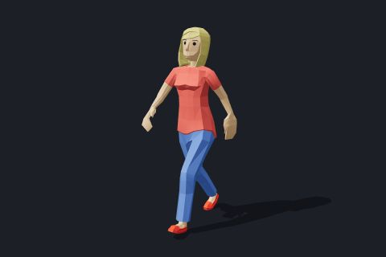 | **Animated Woman**<br>file, demo: nyc-night<br><sub>`nyc-Woman`</sub> | `nyc/models/Woman.glb` | Quaternius, CC0 1.0 ([source](https://poly.pizza/m/9kF7eTDbhO)) | `assets.add('woman', { type: 'gltf', url: 'models/Woman.glb' });`<br>[full snippet](#snippet-nyc-Woman) |
| 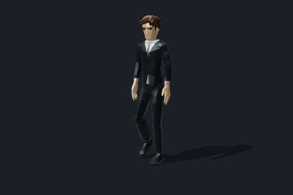 | **Business Man**<br>file, demo: nyc-night<br><sub>`nyc-BusinessMan`</sub> | `nyc/models/BusinessMan.glb` | Quaternius, CC0 1.0 ([source](https://poly.pizza/m/JFrLIKqvCH)) | `assets.add('business', { type: 'gltf', url: 'models/BusinessMan.glb' });`<br>[full snippet](#snippet-nyc-BusinessMan) |
| 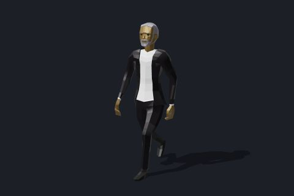 | **Man in Suit**<br>file, demo: nyc-night<br><sub>`nyc-ManInSuit`</sub> | `nyc/models/ManInSuit.glb` | Quaternius, CC0 1.0 ([source](https://poly.pizza/m/mQnGoME1ez)) | `assets.add('suit', { type: 'gltf', url: 'models/ManInSuit.glb' });`<br>[full snippet](#snippet-nyc-ManInSuit) |
| 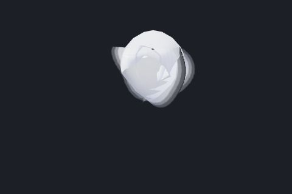 | **Bedsheet ghosts (cloth)**<br>code, demo: halloween<br><sub>`halloween-ghosts`</sub> | `samples/halloween/ghosts.js`<br>`Ghosts` | made in code | `const ghosts = new Ghosts({ scene, dyn, heightAt: () => 0, spawns: [[0, 0]], count: 1 });`<br>[full snippet](#snippet-halloween-ghosts) |
| 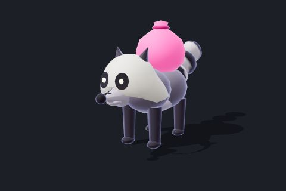 | **Candy thief (raccoon)**<br>code, demo: halloween<br><sub>`halloween-thief`</sub> | `samples/halloween/thief.js`<br>`Thief` | made in code | `const thief = new Thief({ scene, heightAt: () => 0, physics: {}, candy: {} });`<br>[full snippet](#snippet-halloween-thief) |
| 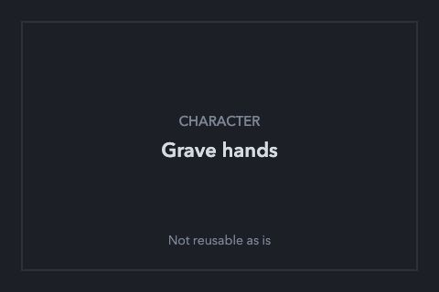 | **Grave hands**<br>code, demo: halloween<br><sub>`halloween-hands`</sub> | `samples/halloween/hands.js`<br>`Hands` | made in code | Not reusable as is: the hands only appear through the game's state machine (they rise when the player comes near); the geometry is private (handGeometry) |
|  | **Witch kid (animated)**<br>code, demo: halloween<br><sub>`halloween-kid`</sub> | `samples/halloween/kid.js`<br>`buildKid` | made in code | `const kid = buildKid({ detail: true });`<br>[full snippet](#snippet-halloween-kid) |

Snippets (character):

<details id="snippet-nyc-Woman"><summary><b>Animated Woman</b> <code>nyc-Woman</code></summary>

Rigged, animated low-poly character by Quaternius (CC0). One of the Night NYC walk's pedestrians (tinted per person). The demo plays its clips through the engine's AnimationController (player.js) and AnimationMixer (pedestrians.js).

```js
import * as THREE from 'three';
import { Assets } from '@vibe/engine/core';
import { registerRenderLoaders } from '@vibe/engine/render';
const assets = new Assets({ base: import.meta.env.BASE_URL + 'nyc/' });
registerRenderLoaders(assets, renderer, { ktx2: false, meshopt: false });
assets.add('woman', { type: 'gltf', url: 'models/Woman.glb' });
await assets.load();
const gltf = assets.get('woman');
const person = gltf.instantiate();                  // a skinning-safe clone (geometry and materials shared)
scene.add(person);
const mixer = new THREE.AnimationMixer(person);
mixer.clipAction(gltf.animations.find((c) => c.name === 'Armature|Walking')).play();
// every frame: mixer.update(dt);
```

</details>

<details id="snippet-nyc-BusinessMan"><summary><b>Business Man</b> <code>nyc-BusinessMan</code></summary>

Rigged, animated low-poly character by Quaternius (CC0). The Night NYC walk's player character (suit colour set in code) and one of its pedestrians. The demo plays its clips through the engine's AnimationController (player.js) and AnimationMixer (pedestrians.js).

```js
import * as THREE from 'three';
import { Assets } from '@vibe/engine/core';
import { registerRenderLoaders } from '@vibe/engine/render';
const assets = new Assets({ base: import.meta.env.BASE_URL + 'nyc/' });
registerRenderLoaders(assets, renderer, { ktx2: false, meshopt: false });
assets.add('business', { type: 'gltf', url: 'models/BusinessMan.glb' });
await assets.load();
const gltf = assets.get('business');
const person = gltf.instantiate();                  // a skinning-safe clone (geometry and materials shared)
scene.add(person);
const mixer = new THREE.AnimationMixer(person);
mixer.clipAction(gltf.animations.find((c) => c.name === 'CharacterArmature|Walk')).play();
// every frame: mixer.update(dt);
```

</details>

<details id="snippet-nyc-ManInSuit"><summary><b>Man in Suit</b> <code>nyc-ManInSuit</code></summary>

Rigged, animated low-poly character by Quaternius (CC0). One of the Night NYC walk's pedestrians. The demo plays its clips through the engine's AnimationController (player.js) and AnimationMixer (pedestrians.js).

```js
import * as THREE from 'three';
import { Assets } from '@vibe/engine/core';
import { registerRenderLoaders } from '@vibe/engine/render';
const assets = new Assets({ base: import.meta.env.BASE_URL + 'nyc/' });
registerRenderLoaders(assets, renderer, { ktx2: false, meshopt: false });
assets.add('suit', { type: 'gltf', url: 'models/ManInSuit.glb' });
await assets.load();
const gltf = assets.get('suit');
const person = gltf.instantiate();                  // a skinning-safe clone (geometry and materials shared)
scene.add(person);
const mixer = new THREE.AnimationMixer(person);
mixer.clipAction(gltf.animations.find((c) => c.name === 'HumanArmature|Man_Walk')).play();
// every frame: mixer.update(dt);
```

</details>

<details id="snippet-halloween-ghosts"><summary><b>Bedsheet ghosts (cloth)</b> <code>halloween-ghosts</code></summary>

Bedsheet ghosts simulated as engine XPBD cloth (13 x 13 particles) with painted faces and a scalloped hem.

```js
import { PhysicsWorld, DynamicsWorld } from '@vibe/engine/physics';
import { Ghosts } from '../halloween/ghosts.js';
const physics = new PhysicsWorld();
const dyn = new DynamicsWorld({ physics, maxParticles: 400 });
const ghosts = new Ghosts({ scene, dyn, heightAt: () => 0, spawns: [[0, 0]], count: 1 });
ghosts.summon(0, 1.6, 0);
ghosts.settle(150);                         // hang the sheet from its head (the game does this at load)
const glows = { set() {} };                 // the game's halo batch: not needed alone
// every frame: ghosts.settle(2, dt / 2); ghosts.update(dt, 1, glows, 0);
```

</details>

<details id="snippet-halloween-thief"><summary><b>Candy thief (raccoon)</b> <code>halloween-thief</code></summary>

A raccoon in a bedsheet with a pink candy sack, modelled and rigged in code. The Thief class runs its game AI; it starts hidden in its den until the game wakes it.

```js
import { Thief } from '../halloween/thief.js';
const thief = new Thief({ scene, heightAt: () => 0, physics: {}, candy: {} });
thief.root.visible = true;              // the game shows it when it emerges
thief.root.position.set(0, 0, 0);
```

</details>

<details id="snippet-halloween-kid"><summary><b>Witch kid (animated)</b> <code>halloween-kid</code></summary>

Midnight Candy Run's player: a kid in a witch costume with a candy pail, modelled, rigged and animated entirely in code (Idle, Walking, Running, Jump clips).

```js
import { AnimationController } from '@vibe/engine/anim';
import { buildKid } from '../halloween/kid.js';
const kid = buildKid({ detail: true });
scene.add(kid.root);
const anim = new AnimationController(kid.root, kid.clips, { states: { idle: { clip: 'Idle' }, walk: { clip: 'Walking' } } });
anim.play('walk');
// every frame: anim.update(dt);
```

</details>

## Building

| | Asset | Where | Credit | Use |
|---|---|---|---|---|
| 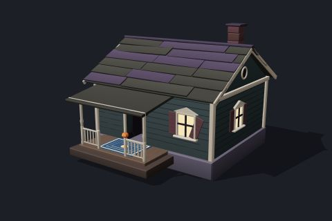 | **Cottage with porch**<br>code, demo: halloween<br><sub>`halloween-cottage`</sub> | `samples/halloween/props.js`<br>`cottage` | made in code | `cottage(solid, glow, ctx, { x: 0, y: 0, z: 0, palette: 1 });`<br>[full snippet](#snippet-halloween-cottage) |
| 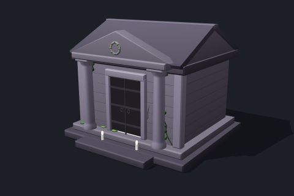 | **Crypt (mausoleum)**<br>code, demo: halloween<br><sub>`halloween-crypt`</sub> | `samples/halloween/props.js`<br>`crypt` | made in code | `crypt(solid, glow, ctx, { x: 0, y: 0, z: 0, door: true });`<br>[full snippet](#snippet-halloween-crypt) |
| 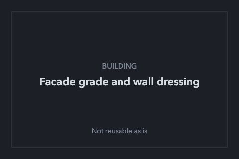 | **Facade grade and wall dressing**<br>code, demo: nyc-night<br><sub>`nyc-facade-grade`</sub> | `samples/nyc-night/facades.js`<br>`gradeFacades` | made in code | Not reusable as is: string-patches the engine's facade shader of a loaded MapWorld (gradeFacades, dressWalls in walls.js, quietBuildingSigns in signage.js) |
| 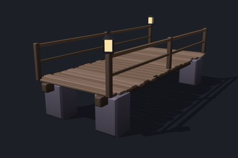 | **Footbridge**<br>code, demo: halloween<br><sub>`halloween-bridge`</sub> | `samples/halloween/props.js`<br>`bridge` | made in code | `bridge(solid, glow, ctx, { x: 0, y: 0.6, z0: -3, z1: 3, w: 2.6, bedY: -0.4 });`<br>[full snippet](#snippet-halloween-bridge) |
| 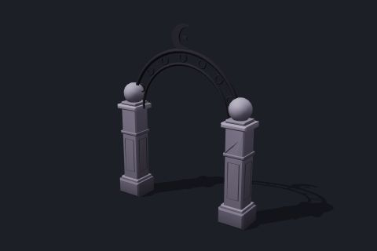 | **Graveyard gate arch**<br>code, demo: halloween<br><sub>`halloween-gate-arch`</sub> | `samples/halloween/props.js`<br>`gateArch` | made in code | `gatePost(solid, -1.6, 0, 0); gatePost(solid, 1.6, 0, 0); gateArch(solid, -1.6, 1.6, 0, 0);`<br>[full snippet](#snippet-halloween-gate-arch) |
| 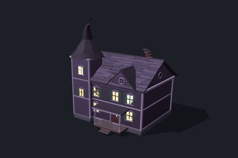 | **Haunted house**<br>code, demo: halloween<br><sub>`halloween-haunted-house`</sub> | `samples/halloween/props.js`<br>`hauntedHouse` | made in code | `hauntedHouse(solid, glow, ctx, { x: 0, y: 0, z: 0, w: 11, d: 9, yaw: 0, door: true, lamp: 'lamp', tower: 0.6 });`<br>[full snippet](#snippet-halloween-haunted-house) |
| 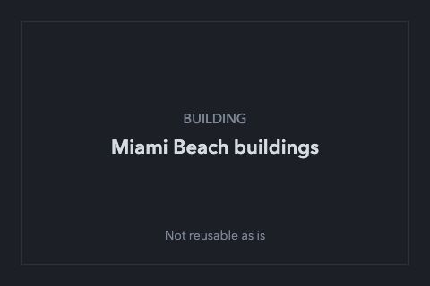 | **Miami Beach buildings**<br>code, demo: miami-drive<br><sub>`miami-buildings`</sub> | `samples/miami-drive/buildings.js`<br>`miamiBuildingsPlugin` | made in code | Not reusable as is: a MapWorld plugin: needs the world context, city.json and the world's facade texture arrays |
| 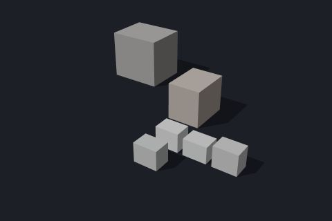 | **Rooftop plant**<br>code, demo: nyc-night<br><sub>`nyc-rooftops`</sub> | `samples/nyc-night/rooftops.js`<br>`buildRooftops` | made in code | `const roofs = buildRooftops({ world, scene, center: { x: 0, z: 0 }, radius: 100, ac: 0 });`<br>[full snippet](#snippet-nyc-rooftops) |
| 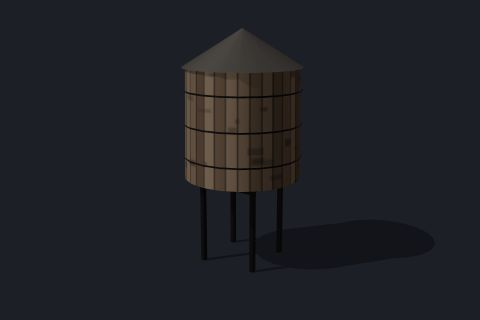 | **Rooftop water tank**<br>code, demo: nyc-night<br><sub>`nyc-water-tower`</sub> | `samples/nyc-night/structures.js`<br>`buildStructures` | made in code | `buildStructures({ world, scene, square: { x: 165, z: 7 }, radius: 400, towers: 1, sheds: 0 });`<br>[full snippet](#snippet-nyc-water-tower) |
| 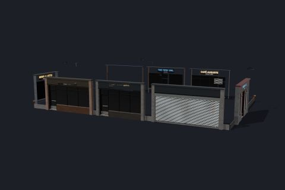 | **Shop fronts and lobbies**<br>code, demo: nyc-night<br><sub>`nyc-shop-fronts`</sub> | `samples/nyc-night/groundfloors.js`<br>`buildGroundFloors` | made in code | `const ground = buildGroundFloors({ world, scene, signs, center: { x: 0, z: 0 }, radius: 100 });`<br>[full snippet](#snippet-nyc-shop-fronts) |
| 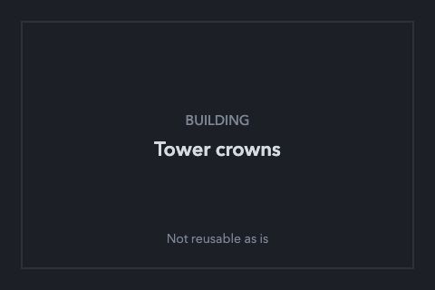 | **Tower crowns**<br>code, demo: nyc-night<br><sub>`nyc-crowns`</sub> | `samples/nyc-night/crowns.js`<br>`buildCrowns` | made in code | Not reusable as is: reads a loaded MapWorld's footprints and draws with its facade material set (world._footprints, world.mat.facadeSet) |
| 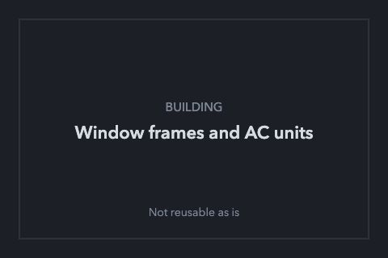 | **Window frames and AC units**<br>code, demo: nyc-night<br><sub>`nyc-window-kit`</sub> | `samples/nyc-night/windowkit.js`<br>`buildWindowKit` | made in code | Not reusable as is: reads a loaded MapWorld's private building footprints and style (world._footprints, world._bopts) |

Snippets (building):

<details id="snippet-halloween-cottage"><summary><b>Cottage with porch</b> <code>halloween-cottage</code></summary>

Cottage with porch from Midnight Candy Run, built in code: a village cottage with a porch deck, railing jack-o'-lantern, doormat and hanging lamp; 5 palettes and a stone variant. The builders append painted, placed parts to a Batch (solid parts and glowing parts), which the level merges into a few meshes; the variant follows the position.

```js
import * as THREE from 'three';
import { Batch, cottage } from '../halloween/props.js';
const solid = new Batch(), glow = new Batch();
const ctx = { glow: () => 0, use: () => {}, spot: () => 0 };   // the level's light bookkeeping: not needed alone
cottage(solid, glow, ctx, { x: 0, y: 0, z: 0, palette: 1 });
scene.add(solid.build(new THREE.MeshStandardMaterial({ vertexColors: true, roughness: 0.9 }), 'solid'));
const glowing = glow.build(new THREE.MeshBasicMaterial({ vertexColors: true }), 'glow');
if (glowing) scene.add(glowing);
```

</details>

<details id="snippet-halloween-crypt"><summary><b>Crypt (mausoleum)</b> <code>halloween-crypt</code></summary>

Crypt (mausoleum) from Midnight Candy Run, built in code: a stone mausoleum with a glowing crack. The builders append painted, placed parts to a Batch (solid parts and glowing parts), which the level merges into a few meshes; the variant follows the position.

```js
import * as THREE from 'three';
import { Batch, crypt } from '../halloween/props.js';
const solid = new Batch(), glow = new Batch();
const ctx = { glow: () => 0, use: () => {}, spot: () => 0 };   // the level's light bookkeeping: not needed alone
crypt(solid, glow, ctx, { x: 0, y: 0, z: 0, door: true });
scene.add(solid.build(new THREE.MeshStandardMaterial({ vertexColors: true, roughness: 0.9 }), 'solid'));
const glowing = glow.build(new THREE.MeshBasicMaterial({ vertexColors: true }), 'glow');
if (glowing) scene.add(glowing);
```

</details>

<details id="snippet-halloween-bridge"><summary><b>Footbridge</b> <code>halloween-bridge</code></summary>

Footbridge from Midnight Candy Run, built in code: a plank footbridge with candle lanterns. The builders append painted, placed parts to a Batch (solid parts and glowing parts), which the level merges into a few meshes; the variant follows the position.

```js
import * as THREE from 'three';
import { Batch, bridge } from '../halloween/props.js';
const solid = new Batch(), glow = new Batch();
const ctx = { glow: () => 0, use: () => {}, spot: () => 0 };   // the level's light bookkeeping: not needed alone
bridge(solid, glow, ctx, { x: 0, y: 0.6, z0: -3, z1: 3, w: 2.6, bedY: -0.4 });
scene.add(solid.build(new THREE.MeshStandardMaterial({ vertexColors: true, roughness: 0.9 }), 'solid'));
const glowing = glow.build(new THREE.MeshBasicMaterial({ vertexColors: true }), 'glow');
if (glowing) scene.add(glowing);
```

</details>

<details id="snippet-halloween-gate-arch"><summary><b>Graveyard gate arch</b> <code>halloween-gate-arch</code></summary>

Graveyard gate arch from Midnight Candy Run, built in code: two stone gate posts and the iron arch with a crescent moon. The builders append painted, placed parts to a Batch (solid parts and glowing parts), which the level merges into a few meshes; the variant follows the position.

```js
import * as THREE from 'three';
import { Batch, gatePost, gateArch } from '../halloween/props.js';
const solid = new Batch();
gatePost(solid, -1.6, 0, 0); gatePost(solid, 1.6, 0, 0); gateArch(solid, -1.6, 1.6, 0, 0);
scene.add(solid.build(new THREE.MeshStandardMaterial({ vertexColors: true, roughness: 0.9 }), 'solid'));
```

</details>

<details id="snippet-halloween-haunted-house"><summary><b>Haunted house</b> <code>halloween-haunted-house</code></summary>

Haunted house from Midnight Candy Run, built in code: a crooked two-storey house with a tower, porch, shutters and a lamp. The builders append painted, placed parts to a Batch (solid parts and glowing parts), which the level merges into a few meshes; the variant follows the position.

```js
import * as THREE from 'three';
import { Batch, hauntedHouse } from '../halloween/props.js';
const solid = new Batch(), glow = new Batch();
const ctx = { glow: () => 0, use: () => {}, spot: () => 0 };   // the level's light bookkeeping: not needed alone
hauntedHouse(solid, glow, ctx, { x: 0, y: 0, z: 0, w: 11, d: 9, yaw: 0, door: true, lamp: 'lamp', tower: 0.6 });
scene.add(solid.build(new THREE.MeshStandardMaterial({ vertexColors: true, roughness: 0.9 }), 'solid'));
const glowing = glow.build(new THREE.MeshBasicMaterial({ vertexColors: true }), 'glow');
if (glowing) scene.add(glowing);
```

</details>

<details id="snippet-nyc-rooftops"><summary><b>Rooftop plant</b> <code>nyc-rooftops</code></summary>

Rooftop clutter built in code for the buildings it is given: mechanical penthouses, stair bulkheads, HVAC boxes, parapets, antenna masts with beacons, satellite dishes and sign frames (two instanced draws).

```js
import { buildRooftops } from '../nyc-night/rooftops.js';
const world = {                      // the bits of a MapWorld this builder reads
  data: { buildings: [{ p: [[-12, -8], [12, -8], [12, 8], [-12, 8]], h: 48 }] },
  raster: { any: () => true }, getGroundHeight: () => 0, colliders: { add() {} },
};
const roofs = buildRooftops({ world, scene, center: { x: 0, z: 0 }, radius: 100, ac: 0 });
```

</details>

<details id="snippet-nyc-water-tower"><summary><b>Rooftop water tank</b> <code>nyc-water-tower</code></summary>

New York wooden water tanks on steel legs (and green sidewalk sheds, given street facades), built in code and placed on 30 % of the mid-rise roofs it is given.

```js
import { buildStructures } from '../nyc-night/structures.js';
const world = { data: { buildings: [] }, getGroundHeight: () => 0, colliders: { add() {} } };
for (let i = 0; i < 12; i++) world.data.buildings.push({ p: [[i * 30, 0], [i * 30 + 14, 0], [i * 30 + 14, 14], [i * 30, 14]], h: 30 });
buildStructures({ world, scene, square: { x: 165, z: 7 }, radius: 400, towers: 1, sheds: 0 });
```

</details>

<details id="snippet-nyc-shop-fronts"><summary><b>Shop fronts and lobbies</b> <code>nyc-shop-fronts</code></summary>

Ground floors built in code along the shop bays that buildSignage finds: open shop fronts with recessed doors and awnings, roller shutters, service doors, loading docks, lobbies with canopies and revolving doors, and wall clutter (standpipes, drainpipes, cameras, wall lights).

```js
import { buildSignage } from '../nyc-night/signage.js';
import { buildGroundFloors } from '../nyc-night/groundfloors.js';
const world = {                      // the bits of a MapWorld this builder reads
  data: { buildings: [{ p: [[-12, -8], [12, -8], [12, 8], [-12, 8]], h: 48 }] },
  raster: { any: () => true }, getGroundHeight: () => 0, colliders: { add() {} },
};
const signs = buildSignage({ world, square: { x: 0, z: 0 }, squareRadius: 60, shopRadius: 60 });
const ground = buildGroundFloors({ world, scene, signs, center: { x: 0, z: 0 }, radius: 100 });
```

</details>

## Prop

| | Asset | Where | Credit | Use |
|---|---|---|---|---|
| 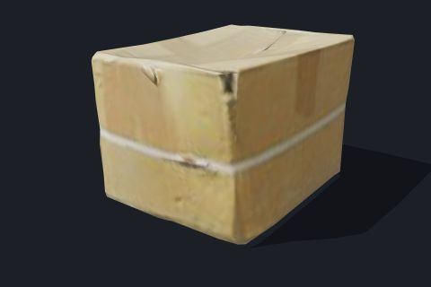 | **Cardboard box**<br>file, demo: nyc-night<br><sub>`nyc-street-box`</sub> | `nyc/street/street.gltf`<br>`nyc/street/street.bin`<br>`nyc/street/atlas_diff.jpg`<br>+5 more | Rahul Chaudhary, CC0 1.0 ([source](https://polyhaven.com/a/cardboard_box_01)) | `const gltf = await new GLTFLoader().loadAsync(dir + 'street.gltf');`<br>[full snippet](#snippet-nyc-street-box) |
| 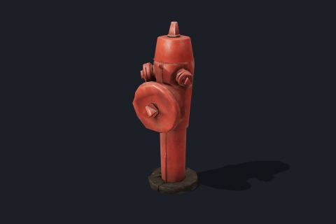 | **Fire hydrant**<br>file, demo: nyc-night<br><sub>`nyc-street-hydrant`</sub> | `nyc/street/street.gltf`<br>`nyc/street/street.bin`<br>`nyc/street/atlas_diff.jpg`<br>+5 more | Gonçalo Felício, CC0 1.0 ([source](https://polyhaven.com/a/fire_hydrant)) | `const gltf = await new GLTFLoader().loadAsync(dir + 'street.gltf');`<br>[full snippet](#snippet-nyc-street-hydrant) |
| 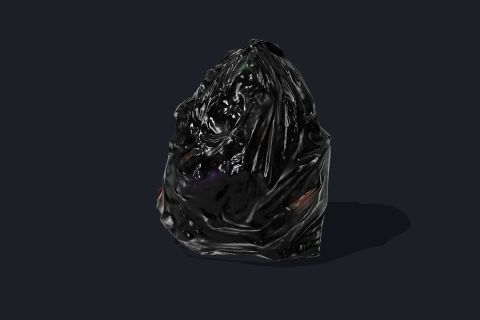 | **Garbage bag**<br>file, demo: nyc-night<br><sub>`nyc-street-bag`</sub> | `nyc/street/street.gltf`<br>`nyc/street/street.bin`<br>`nyc/street/atlas_diff.jpg`<br>+5 more | Benny Weimer, CC0 1.0 ([source](https://polyhaven.com/a/trashbag)) | `const gltf = await new GLTFLoader().loadAsync(dir + 'street.gltf');`<br>[full snippet](#snippet-nyc-street-bag) |
| 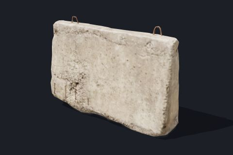 | **Jersey barrier**<br>file, demo: nyc-night<br><sub>`nyc-street-barrier`</sub> | `nyc/street/street.gltf`<br>`nyc/street/street.bin`<br>`nyc/street/atlas_diff.jpg`<br>+5 more | Amal Kumar, CC0 1.0 ([source](https://polyhaven.com/a/concrete_road_barrier_02)) | `const gltf = await new GLTFLoader().loadAsync(dir + 'street.gltf');`<br>[full snippet](#snippet-nyc-street-barrier) |
| 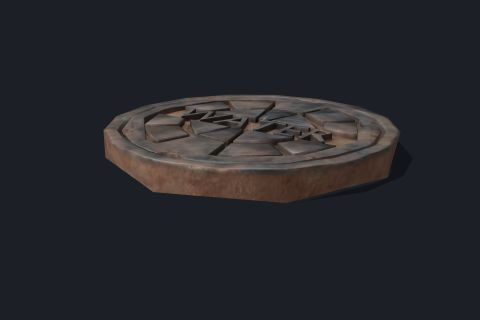 | **Manhole cover (scan)**<br>file, demo: nyc-night<br><sub>`nyc-street-manhole`</sub> | `nyc/street/street.gltf`<br>`nyc/street/street.bin`<br>`nyc/street/atlas_diff.jpg`<br>+5 more | Raunox, CC0 1.0 ([source](https://polyhaven.com/a/water_manhole_cover)) | `const gltf = await new GLTFLoader().loadAsync(dir + 'street.gltf');`<br>[full snippet](#snippet-nyc-street-manhole) |
| 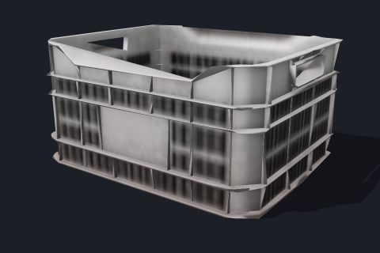 | **Milk crate**<br>file, demo: nyc-night<br><sub>`nyc-street-crate`</sub> | `nyc/street/street.gltf`<br>`nyc/street/street.bin`<br>`nyc/street/atlas_diff.jpg`<br>+5 more | Fabi_G, CC0 1.0 ([source](https://polyhaven.com/a/plastic_crate_02)) | `const gltf = await new GLTFLoader().loadAsync(dir + 'street.gltf');`<br>[full snippet](#snippet-nyc-street-crate) |
| 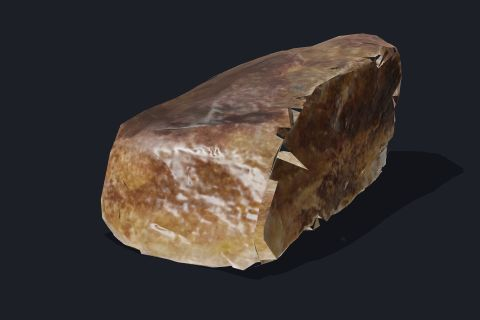 | **Rock 07 (two LODs)**<br>file, demo: miami-drive<br><sub>`miami-rock_07`</sub> | `miami/roadside/rock_07_lo.glb`<br>`miami/roadside/rock_07_hi.glb` | Jenelle van Heerden, CC0 1.0 ([source](https://polyhaven.com/a/rock_07)) | `const gltf = await new GLTFLoader().loadAsync(import.meta.env.BASE_URL + 'miami/roadside/rock_07_hi.glb');`<br>[full snippet](#snippet-miami-rock_07) |
| 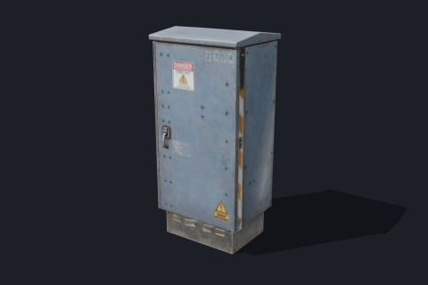 | **Signal controller box**<br>file, demo: nyc-night<br><sub>`nyc-street-ubox`</sub> | `nyc/street/street.gltf`<br>`nyc/street/street.bin`<br>`nyc/street/atlas_diff.jpg`<br>+5 more | James Ray Cock, CC0 1.0 ([source](https://polyhaven.com/a/utility_box_01)) | `const gltf = await new GLTFLoader().loadAsync(dir + 'street.gltf');`<br>[full snippet](#snippet-nyc-street-ubox) |
| 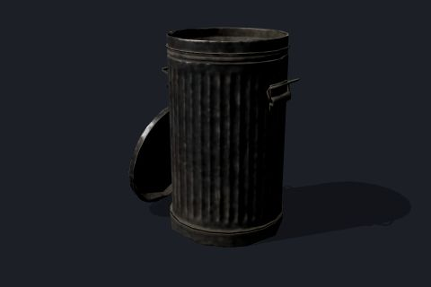 | **Trash can**<br>file, demo: nyc-night<br><sub>`nyc-street-can`</sub> | `nyc/street/street.gltf`<br>`nyc/street/street.bin`<br>`nyc/street/atlas_diff.jpg`<br>+5 more | GurJas Studios, CC0 1.0 ([source](https://polyhaven.com/a/metal_trash_can)) | `const gltf = await new GLTFLoader().loadAsync(dir + 'street.gltf');`<br>[full snippet](#snippet-nyc-street-can) |
|  | **A-frame sandwich board**<br>code, engine<br><sub>`engine-furniture-aframe`</sub> | `src/world/Furniture.js`<br>`makeFurnitureGeometry` | made in code | `const geometry = makeFurnitureGeometry('aframe');`<br>[full snippet](#snippet-engine-furniture-aframe) |
| 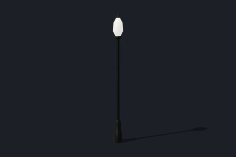 | **Acorn lamp**<br>code, engine<br><sub>`engine-furniture-acorn`</sub> | `src/world/Furniture.js`<br>`makeFurnitureGeometry` | made in code | `const geometry = makeFurnitureGeometry('acorn');`<br>[full snippet](#snippet-engine-furniture-acorn) |
| 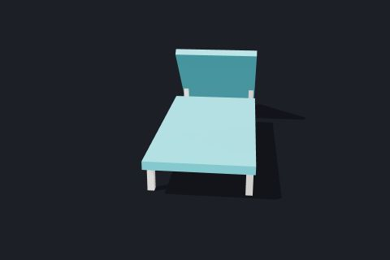 | **Beach lounger**<br>code, demo: miami-drive<br><sub>`miami-prop-lounger`</sub> | `samples/miami-drive/props.js`<br>`Props` | made in code | `const props = new Props({ scene, physics, spots: [{ type: 'lounger', x: 0, z: 0, yaw: 0.5 }], lod: 'high' });`<br>[full snippet](#snippet-miami-prop-lounger) |
| 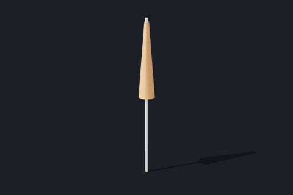 | **Beach umbrella**<br>code, demo: miami-drive<br><sub>`miami-prop-parasol`</sub> | `samples/miami-drive/props.js`<br>`Props` | made in code | `const props = new Props({ scene, physics, spots: [{ type: 'parasol', x: 0, z: 0, yaw: 0.5 }], lod: 'high' });`<br>[full snippet](#snippet-miami-prop-parasol) |
| 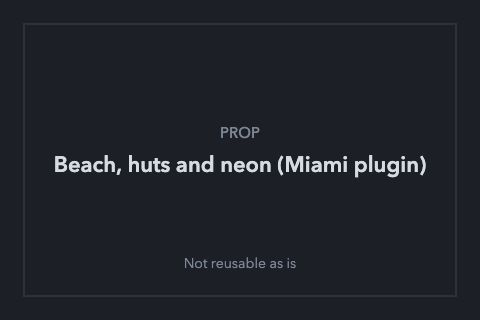 | **Beach, huts and neon (Miami plugin)**<br>code, demo: miami-drive<br><sub>`miami-beach-dressing`</sub> | `samples/miami-drive/world.js`<br>`miamiPlugin` | made in code | Not reusable as is: built inside the miamiPlugin MapWorld plugin from internal functions (hut, neonCanvas, coconutPalms, decoFrontage, sandMaterial); world.js also reads import.meta.env at load |
| 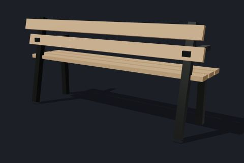 | **Bench**<br>code, engine<br><sub>`engine-furniture-bench`</sub> | `src/world/Furniture.js`<br>`makeFurnitureGeometry` | made in code | `const geometry = makeFurnitureGeometry('bench');`<br>[full snippet](#snippet-engine-furniture-bench) |
| 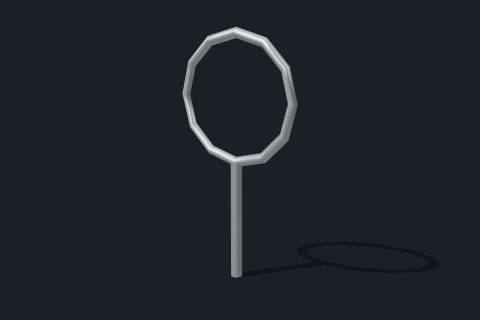 | **Bike rack**<br>code, engine<br><sub>`engine-furniture-bikeRack`</sub> | `src/world/Furniture.js`<br>`makeFurnitureGeometry` | made in code | `const geometry = makeFurnitureGeometry('bikeRack');`<br>[full snippet](#snippet-engine-furniture-bikeRack) |
| 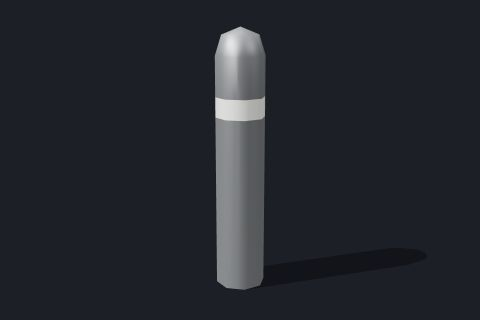 | **Bollard**<br>code, engine<br><sub>`engine-furniture-bollard`</sub> | `src/world/Furniture.js`<br>`makeFurnitureGeometry` | made in code | `const geometry = makeFurnitureGeometry('bollard');`<br>[full snippet](#snippet-engine-furniture-bollard) |
| 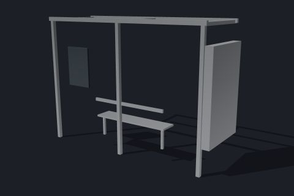 | **Bus shelter**<br>code, engine<br><sub>`engine-furniture-shelter`</sub> | `src/world/Furniture.js`<br>`makeFurnitureGeometry` | made in code | `const geometry = makeFurnitureGeometry('shelter');`<br>[full snippet](#snippet-engine-furniture-shelter) |
| 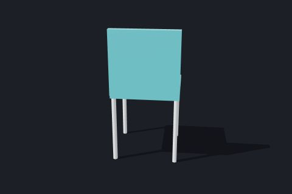 | **Cafe chair**<br>code, demo: miami-drive<br><sub>`miami-prop-chair`</sub> | `samples/miami-drive/props.js`<br>`Props` | made in code | `const props = new Props({ scene, physics, spots: [{ type: 'chair', x: 0, z: 0, yaw: 0.5 }], lod: 'high' });`<br>[full snippet](#snippet-miami-prop-chair) |
| 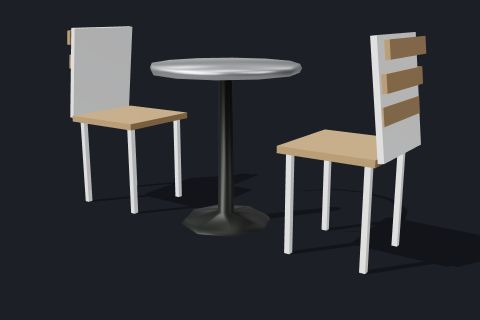 | **Cafe table and chairs**<br>code, engine<br><sub>`engine-furniture-cafeSet`</sub> | `src/world/Furniture.js`<br>`makeFurnitureGeometry` | made in code | `const geometry = makeFurnitureGeometry('cafeSet');`<br>[full snippet](#snippet-engine-furniture-cafeSet) |
| 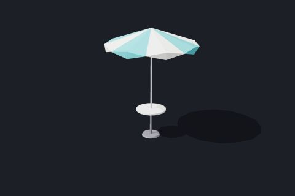 | **Cafe table with parasol**<br>code, demo: miami-drive<br><sub>`miami-prop-table`</sub> | `samples/miami-drive/props.js`<br>`Props` | made in code | `const props = new Props({ scene, physics, spots: [{ type: 'table', x: 0, z: 0, yaw: 0.5 }], lod: 'high' });`<br>[full snippet](#snippet-miami-prop-table) |
|  | **Candle lantern**<br>code, demo: halloween<br><sub>`halloween-candle-lantern`</sub> | `samples/halloween/props.js`<br>`candleLantern` | made in code | `candleLantern(solid, glow, 0, 0, 0);`<br>[full snippet](#snippet-halloween-candle-lantern) |
|  | **Candy pickups**<br>code, demo: halloween<br><sub>`halloween-candy`</sub> | `samples/halloween/candy.js`<br>`Candy` | made in code | `const candy = new Candy({ scene, heightAt: () => 0, candySpot: () => false, crisp: true });`<br>[full snippet](#snippet-halloween-candy) |
|  | **Cardboard box**<br>code, demo: miami-drive<br><sub>`miami-prop-box`</sub> | `samples/miami-drive/props.js`<br>`Props` | made in code | `const props = new Props({ scene, physics, spots: [{ type: 'box', x: 0, z: 0, yaw: 0.5 }], lod: 'high' });`<br>[full snippet](#snippet-miami-prop-box) |
|  | **Cobra-head street light**<br>code, engine<br><sub>`engine-furniture-cobra`</sub> | `src/world/Furniture.js`<br>`makeFurnitureGeometry` | made in code | `const geometry = makeFurnitureGeometry('cobra');`<br>[full snippet](#snippet-engine-furniture-cobra) |
|  | **Double-globe promenade lamp**<br>code, engine<br><sub>`engine-furniture-doubleGlobe`</sub> | `src/world/Furniture.js`<br>`makeFurnitureGeometry` | made in code | `const geometry = makeFurnitureGeometry('doubleGlobe');`<br>[full snippet](#snippet-engine-furniture-doubleGlobe) |
|  | **Fire hydrant**<br>code, engine<br><sub>`engine-furniture-hydrant`</sub> | `src/world/Furniture.js`<br>`makeFurnitureGeometry` | made in code | `const geometry = makeFurnitureGeometry('hydrant');`<br>[full snippet](#snippet-engine-furniture-hydrant) |
|  | **Gravestones**<br>code, demo: halloween<br><sub>`halloween-gravestones`</sub> | `samples/halloween/props.js`<br>`gravestone` | made in code | `for (let k = 0; k < 4; k++) gravestone(solid, { x: k * 1.4 - 2.1, y: 0, z: 0, kind: k });`<br>[full snippet](#snippet-halloween-gravestones) |
|  | **Hay bale**<br>code, demo: halloween<br><sub>`halloween-hay-bale`</sub> | `samples/halloween/props.js`<br>`hayBale` | made in code | `hayBale(solid, { x: 0, y: 0, z: 0 });`<br>[full snippet](#snippet-halloween-hay-bale) |
|  | **Iron fence**<br>code, demo: halloween<br><sub>`halloween-iron-fence`</sub> | `samples/halloween/props.js`<br>`ironFence` | made in code | `ironFence(solid, -4, 0, 4, 0, () => 0);`<br>[full snippet](#snippet-halloween-iron-fence) |
|  | **Litter bin**<br>code, demo: miami-drive<br><sub>`miami-prop-bin`</sub> | `samples/miami-drive/props.js`<br>`Props` | made in code | `const props = new Props({ scene, physics, spots: [{ type: 'bin', x: 0, z: 0, yaw: 0.5 }], lod: 'high' });`<br>[full snippet](#snippet-miami-prop-bin) |
|  | **Mailbox**<br>code, engine<br><sub>`engine-furniture-mailbox`</sub> | `src/world/Furniture.js`<br>`makeFurnitureGeometry` | made in code | `const geometry = makeFurnitureGeometry('mailbox');`<br>[full snippet](#snippet-engine-furniture-mailbox) |
|  | **Newspaper box**<br>code, engine<br><sub>`engine-furniture-newsBox`</sub> | `src/world/Furniture.js`<br>`makeFurnitureGeometry` | made in code | `const geometry = makeFurnitureGeometry('newsBox');`<br>[full snippet](#snippet-engine-furniture-newsBox) |
|  | **Parking meter**<br>code, engine<br><sub>`engine-furniture-meter`</sub> | `src/world/Furniture.js`<br>`makeFurnitureGeometry` | made in code | `const geometry = makeFurnitureGeometry('meter');`<br>[full snippet](#snippet-engine-furniture-meter) |
|  | **Path of Gold lamp**<br>code, engine<br><sub>`engine-furniture-pathOfGold`</sub> | `src/world/Furniture.js`<br>`makeFurnitureGeometry` | made in code | `const geometry = makeFurnitureGeometry('pathOfGold');`<br>[full snippet](#snippet-engine-furniture-pathOfGold) |
|  | **Pedestrian signal head**<br>code, engine<br><sub>`engine-furniture-pedHead`</sub> | `src/world/Furniture.js`<br>`makeFurnitureGeometry` | made in code | `const geometry = makeFurnitureGeometry('pedHead');`<br>[full snippet](#snippet-engine-furniture-pedHead) |
|  | **Picket fence**<br>code, demo: halloween<br><sub>`halloween-picket-fence`</sub> | `samples/halloween/props.js`<br>`pickets` | made in code | `pickets(solid, -3, 0, 3, 0, () => 0);`<br>[full snippet](#snippet-halloween-picket-fence) |
|  | **Planter**<br>code, engine<br><sub>`engine-furniture-planter`</sub> | `src/world/Furniture.js`<br>`makeFurnitureGeometry` | made in code | `const geometry = makeFurnitureGeometry('planter');`<br>[full snippet](#snippet-engine-furniture-planter) |
|  | **Residential street light**<br>code, engine<br><sub>`engine-furniture-cobraRes`</sub> | `src/world/Furniture.js`<br>`makeFurnitureGeometry` | made in code | `const geometry = makeFurnitureGeometry('cobraRes');`<br>[full snippet](#snippet-engine-furniture-cobraRes) |
|  | **Scarecrow**<br>code, demo: halloween<br><sub>`halloween-scarecrow`</sub> | `samples/halloween/props.js`<br>`scarecrow` | made in code | `scarecrow(solid, glow, ctx, { x: 0, y: 0, z: 0 });`<br>[full snippet](#snippet-halloween-scarecrow) |
|  | **Shrub pot**<br>code, engine<br><sub>`engine-furniture-pot`</sub> | `src/world/Furniture.js`<br>`makeFurnitureGeometry` | made in code | `const geometry = makeFurnitureGeometry('pot');`<br>[full snippet](#snippet-engine-furniture-pot) |
|  | **Signal mast arm**<br>code, engine<br><sub>`engine-furniture-mastArm`</sub> | `src/world/Furniture.js`<br>`makeFurnitureGeometry` | made in code | `const geometry = makeFurnitureGeometry('mastArm');`<br>[full snippet](#snippet-engine-furniture-mastArm) |
|  | **Signal mast pole**<br>code, engine<br><sub>`engine-furniture-mastPole`</sub> | `src/world/Furniture.js`<br>`makeFurnitureGeometry` | made in code | `const geometry = makeFurnitureGeometry('mastPole');`<br>[full snippet](#snippet-engine-furniture-mastPole) |
|  | **Signal pedestal pole**<br>code, engine<br><sub>`engine-furniture-pedPole`</sub> | `src/world/Furniture.js`<br>`makeFurnitureGeometry` | made in code | `const geometry = makeFurnitureGeometry('pedPole');`<br>[full snippet](#snippet-engine-furniture-pedPole) |
|  | **Small jack-o'-lantern**<br>code, demo: halloween<br><sub>`halloween-jack-o-lantern`</sub> | `samples/halloween/props.js`<br>`jackOLantern` | made in code | `jackOLantern(solid, glow, ctx, { x: 0, y: 0, z: 0, r: 0.17 });`<br>[full snippet](#snippet-halloween-jack-o-lantern) |
|  | **Smashable jack-o'-lanterns**<br>code, demo: halloween<br><sub>`halloween-lanterns`</sub> | `samples/halloween/pumpkins.js`<br>`Lanterns` | made in code | `const lanterns = new Lanterns({ scene, dyn: null, spots: [[-0.55, 0], [0.55, 0], [0, -1]], heightAt: () => 0, remaster: true });`<br>[full snippet](#snippet-halloween-lanterns) |
|  | **Standing stone**<br>code, demo: halloween<br><sub>`halloween-standing-stone`</sub> | `samples/halloween/props.js`<br>`standingStone` | made in code | `standingStone(solid, { x: 0, y: 0, z: 0 });`<br>[full snippet](#snippet-halloween-standing-stone) |
|  | **Stone well**<br>code, demo: halloween<br><sub>`halloween-well`</sub> | `samples/halloween/props.js`<br>`well` | made in code | `well(solid, { x: 0, y: 0, z: 0 });`<br>[full snippet](#snippet-halloween-well) |
|  | **Street kit placement**<br>code, demo: nyc-night<br><sub>`nyc-street-kit-placement`</sub> | `samples/nyc-night/streetkit.js`<br>`buildStreetKit` | made in code | Not reusable as is: places the street-kit models and flat insets (manholes, grates, vault doors, kerb stones, garbage piles) along a loaded MapWorld's road network; the models themselves are catalogued as files (nyc-street-*) |
|  | **Traffic cone**<br>code, demo: miami-drive<br><sub>`miami-prop-cone`</sub> | `samples/miami-drive/props.js`<br>`Props` | made in code | `const props = new Props({ scene, physics, spots: [{ type: 'cone', x: 0, z: 0, yaw: 0.5 }], lod: 'high' });`<br>[full snippet](#snippet-miami-prop-cone) |
|  | **Traffic signal head**<br>code, engine<br><sub>`engine-furniture-sigHead`</sub> | `src/world/Furniture.js`<br>`makeFurnitureGeometry` | made in code | `const geometry = makeFurnitureGeometry('sigHead');`<br>[full snippet](#snippet-engine-furniture-sigHead) |
|  | **Trash can**<br>code, engine<br><sub>`engine-furniture-trashCan`</sub> | `src/world/Furniture.js`<br>`makeFurnitureGeometry` | made in code | `const geometry = makeFurnitureGeometry('trashCan');`<br>[full snippet](#snippet-engine-furniture-trashCan) |
|  | **Utility pole**<br>code, engine<br><sub>`engine-furniture-utilityPole`</sub> | `src/world/Furniture.js`<br>`makeFurnitureGeometry` | made in code | `const geometry = makeFurnitureGeometry('utilityPole');`<br>[full snippet](#snippet-engine-furniture-utilityPole) |
|  | **Utility pole with transformer**<br>code, engine<br><sub>`engine-furniture-utilityPoleTx`</sub> | `src/world/Furniture.js`<br>`makeFurnitureGeometry` | made in code | `const geometry = makeFurnitureGeometry('utilityPoleTx');`<br>[full snippet](#snippet-engine-furniture-utilityPoleTx) |
|  | **Witch's cauldron**<br>code, demo: halloween<br><sub>`halloween-cauldron`</sub> | `samples/halloween/props.js`<br>`cauldron` | made in code | `cauldron(solid, glow, ctx, { x: 0, y: 0, z: 0 });`<br>[full snippet](#snippet-halloween-cauldron) |
|  | **Wooden bench**<br>code, demo: halloween<br><sub>`halloween-bench`</sub> | `samples/halloween/props.js`<br>`bench` | made in code | `bench(solid, { x: 0, y: 0, z: 0 });`<br>[full snippet](#snippet-halloween-bench) |
|  | **Wooden crate**<br>code, demo: miami-drive<br><sub>`miami-prop-crate`</sub> | `samples/miami-drive/props.js`<br>`Props` | made in code | `const props = new Props({ scene, physics, spots: [{ type: 'crate', x: 0, z: 0, yaw: 0.5 }], lod: 'high' });`<br>[full snippet](#snippet-miami-prop-crate) |

Snippets (prop):

<details id="snippet-nyc-street-box"><summary><b>Cardboard box</b> <code>nyc-street-box</code></summary>

Cardboard box from the Night NYC walk's street kit: a Poly Haven scan merged, simplified and UV-packed into one shared atlas by samples/nyc-night/tools/bake-street.mjs (meshes 'box', each with a \_lod1 in street.gltf). The demo places them along its streets (streetkit.js).

```js
import * as THREE from 'three';
import { GLTFLoader } from 'three/addons/loaders/GLTFLoader.js';
const dir = import.meta.env.BASE_URL + 'nyc/street/';                    // atlas512/ holds the phone atlas
const gltf = await new GLTFLoader().loadAsync(dir + 'street.gltf');
const tex = (f, srgb) => new THREE.TextureLoader().loadAsync(dir + f).then((t) => { t.flipY = false; t.colorSpace = srgb ? THREE.SRGBColorSpace : THREE.NoColorSpace; return t; });
const [map, normalMap, arm] = await Promise.all([tex('atlas_diff.jpg', true), tex('atlas_nor.jpg'), tex('atlas_arm.jpg')]);
const material = new THREE.MeshStandardMaterial({ map, normalMap, roughnessMap: arm, metalnessMap: arm, aoMap: arm, roughness: 0.85, metalness: 1 });
material.normalScale.set(1, -1);
const mesh = new THREE.Mesh(gltf.scene.getObjectByName('box').geometry, material);
scene.add(mesh);
```

</details>

<details id="snippet-nyc-street-hydrant"><summary><b>Fire hydrant</b> <code>nyc-street-hydrant</code></summary>

Fire hydrant from the Night NYC walk's street kit: a Poly Haven scan merged, simplified and UV-packed into one shared atlas by samples/nyc-night/tools/bake-street.mjs (meshes 'hydrant', 'hydrant\_aged', each with a \_lod1 in street.gltf). The demo places them along its streets (streetkit.js).

```js
import * as THREE from 'three';
import { GLTFLoader } from 'three/addons/loaders/GLTFLoader.js';
const dir = import.meta.env.BASE_URL + 'nyc/street/';                    // atlas512/ holds the phone atlas
const gltf = await new GLTFLoader().loadAsync(dir + 'street.gltf');
const tex = (f, srgb) => new THREE.TextureLoader().loadAsync(dir + f).then((t) => { t.flipY = false; t.colorSpace = srgb ? THREE.SRGBColorSpace : THREE.NoColorSpace; return t; });
const [map, normalMap, arm] = await Promise.all([tex('atlas_diff.jpg', true), tex('atlas_nor.jpg'), tex('atlas_arm.jpg')]);
const material = new THREE.MeshStandardMaterial({ map, normalMap, roughnessMap: arm, metalnessMap: arm, aoMap: arm, roughness: 0.85, metalness: 1 });
material.normalScale.set(1, -1);
const mesh = new THREE.Mesh(gltf.scene.getObjectByName('hydrant').geometry, material);
scene.add(mesh);
```

</details>

<details id="snippet-nyc-street-bag"><summary><b>Garbage bag</b> <code>nyc-street-bag</code></summary>

Garbage bag from the Night NYC walk's street kit: a Poly Haven scan merged, simplified and UV-packed into one shared atlas by samples/nyc-night/tools/bake-street.mjs (meshes 'bag', 'bagclear', each with a \_lod1 in street.gltf). The demo places them along its streets (streetkit.js).

```js
import * as THREE from 'three';
import { GLTFLoader } from 'three/addons/loaders/GLTFLoader.js';
const dir = import.meta.env.BASE_URL + 'nyc/street/';                    // atlas512/ holds the phone atlas
const gltf = await new GLTFLoader().loadAsync(dir + 'street.gltf');
const tex = (f, srgb) => new THREE.TextureLoader().loadAsync(dir + f).then((t) => { t.flipY = false; t.colorSpace = srgb ? THREE.SRGBColorSpace : THREE.NoColorSpace; return t; });
const [map, normalMap, arm] = await Promise.all([tex('atlas_diff.jpg', true), tex('atlas_nor.jpg'), tex('atlas_arm.jpg')]);
const material = new THREE.MeshStandardMaterial({ map, normalMap, roughnessMap: arm, metalnessMap: arm, aoMap: arm, roughness: 0.85, metalness: 1 });
material.normalScale.set(1, -1);
const mesh = new THREE.Mesh(gltf.scene.getObjectByName('bag').geometry, material);
scene.add(mesh);
```

</details>

<details id="snippet-nyc-street-barrier"><summary><b>Jersey barrier</b> <code>nyc-street-barrier</code></summary>

Jersey barrier from the Night NYC walk's street kit: a Poly Haven scan merged, simplified and UV-packed into one shared atlas by samples/nyc-night/tools/bake-street.mjs (meshes 'barrier', each with a \_lod1 in street.gltf). The demo places them along its streets (streetkit.js).

```js
import * as THREE from 'three';
import { GLTFLoader } from 'three/addons/loaders/GLTFLoader.js';
const dir = import.meta.env.BASE_URL + 'nyc/street/';                    // atlas512/ holds the phone atlas
const gltf = await new GLTFLoader().loadAsync(dir + 'street.gltf');
const tex = (f, srgb) => new THREE.TextureLoader().loadAsync(dir + f).then((t) => { t.flipY = false; t.colorSpace = srgb ? THREE.SRGBColorSpace : THREE.NoColorSpace; return t; });
const [map, normalMap, arm] = await Promise.all([tex('atlas_diff.jpg', true), tex('atlas_nor.jpg'), tex('atlas_arm.jpg')]);
const material = new THREE.MeshStandardMaterial({ map, normalMap, roughnessMap: arm, metalnessMap: arm, aoMap: arm, roughness: 0.85, metalness: 1 });
material.normalScale.set(1, -1);
const mesh = new THREE.Mesh(gltf.scene.getObjectByName('barrier').geometry, material);
scene.add(mesh);
```

</details>

<details id="snippet-nyc-street-manhole"><summary><b>Manhole cover (scan)</b> <code>nyc-street-manhole</code></summary>

Manhole cover (scan) from the Night NYC walk's street kit: a Poly Haven scan merged, simplified and UV-packed into one shared atlas by samples/nyc-night/tools/bake-street.mjs (meshes 'manhole' in street.gltf). The demo places them along its streets (streetkit.js).

```js
import * as THREE from 'three';
import { GLTFLoader } from 'three/addons/loaders/GLTFLoader.js';
const dir = import.meta.env.BASE_URL + 'nyc/street/';                    // atlas512/ holds the phone atlas
const gltf = await new GLTFLoader().loadAsync(dir + 'street.gltf');
const tex = (f, srgb) => new THREE.TextureLoader().loadAsync(dir + f).then((t) => { t.flipY = false; t.colorSpace = srgb ? THREE.SRGBColorSpace : THREE.NoColorSpace; return t; });
const [map, normalMap, arm] = await Promise.all([tex('atlas_diff.jpg', true), tex('atlas_nor.jpg'), tex('atlas_arm.jpg')]);
const material = new THREE.MeshStandardMaterial({ map, normalMap, roughnessMap: arm, metalnessMap: arm, aoMap: arm, roughness: 0.85, metalness: 1 });
material.normalScale.set(1, -1);
const mesh = new THREE.Mesh(gltf.scene.getObjectByName('manhole').geometry, material);
scene.add(mesh);
```

</details>

<details id="snippet-nyc-street-crate"><summary><b>Milk crate</b> <code>nyc-street-crate</code></summary>

Milk crate from the Night NYC walk's street kit: a Poly Haven scan merged, simplified and UV-packed into one shared atlas by samples/nyc-night/tools/bake-street.mjs (meshes 'crate', each with a \_lod1 in street.gltf). The demo places them along its streets (streetkit.js).

```js
import * as THREE from 'three';
import { GLTFLoader } from 'three/addons/loaders/GLTFLoader.js';
const dir = import.meta.env.BASE_URL + 'nyc/street/';                    // atlas512/ holds the phone atlas
const gltf = await new GLTFLoader().loadAsync(dir + 'street.gltf');
const tex = (f, srgb) => new THREE.TextureLoader().loadAsync(dir + f).then((t) => { t.flipY = false; t.colorSpace = srgb ? THREE.SRGBColorSpace : THREE.NoColorSpace; return t; });
const [map, normalMap, arm] = await Promise.all([tex('atlas_diff.jpg', true), tex('atlas_nor.jpg'), tex('atlas_arm.jpg')]);
const material = new THREE.MeshStandardMaterial({ map, normalMap, roughnessMap: arm, metalnessMap: arm, aoMap: arm, roughness: 0.85, metalness: 1 });
material.normalScale.set(1, -1);
const mesh = new THREE.Mesh(gltf.scene.getObjectByName('crate').geometry, material);
scene.add(mesh);
```

</details>

<details id="snippet-miami-rock_07"><summary><b>Rock 07 (two LODs)</b> <code>miami-rock_07</code></summary>

Poly Haven rock scan decimated to two levels (rock\_07\_lo.glb, rock\_07\_hi.glb), scattered as pebbles and rocks along the Miami drive's road (roadside.js).

```js
import { GLTFLoader } from 'three/addons/loaders/GLTFLoader.js';
const gltf = await new GLTFLoader().loadAsync(import.meta.env.BASE_URL + 'miami/roadside/rock_07_hi.glb');   // or rock_07_lo.glb
scene.add(gltf.scene);
```

</details>

<details id="snippet-nyc-street-ubox"><summary><b>Signal controller box</b> <code>nyc-street-ubox</code></summary>

Signal controller box from the Night NYC walk's street kit: a Poly Haven scan merged, simplified and UV-packed into one shared atlas by samples/nyc-night/tools/bake-street.mjs (meshes 'ubox', each with a \_lod1 in street.gltf). The demo places them along its streets (streetkit.js).

```js
import * as THREE from 'three';
import { GLTFLoader } from 'three/addons/loaders/GLTFLoader.js';
const dir = import.meta.env.BASE_URL + 'nyc/street/';                    // atlas512/ holds the phone atlas
const gltf = await new GLTFLoader().loadAsync(dir + 'street.gltf');
const tex = (f, srgb) => new THREE.TextureLoader().loadAsync(dir + f).then((t) => { t.flipY = false; t.colorSpace = srgb ? THREE.SRGBColorSpace : THREE.NoColorSpace; return t; });
const [map, normalMap, arm] = await Promise.all([tex('atlas_diff.jpg', true), tex('atlas_nor.jpg'), tex('atlas_arm.jpg')]);
const material = new THREE.MeshStandardMaterial({ map, normalMap, roughnessMap: arm, metalnessMap: arm, aoMap: arm, roughness: 0.85, metalness: 1 });
material.normalScale.set(1, -1);
const mesh = new THREE.Mesh(gltf.scene.getObjectByName('ubox').geometry, material);
scene.add(mesh);
```

</details>

<details id="snippet-nyc-street-can"><summary><b>Trash can</b> <code>nyc-street-can</code></summary>

Trash can from the Night NYC walk's street kit: a Poly Haven scan merged, simplified and UV-packed into one shared atlas by samples/nyc-night/tools/bake-street.mjs (meshes 'can', 'can\_rust', each with a \_lod1 in street.gltf). The demo places them along its streets (streetkit.js).

```js
import * as THREE from 'three';
import { GLTFLoader } from 'three/addons/loaders/GLTFLoader.js';
const dir = import.meta.env.BASE_URL + 'nyc/street/';                    // atlas512/ holds the phone atlas
const gltf = await new GLTFLoader().loadAsync(dir + 'street.gltf');
const tex = (f, srgb) => new THREE.TextureLoader().loadAsync(dir + f).then((t) => { t.flipY = false; t.colorSpace = srgb ? THREE.SRGBColorSpace : THREE.NoColorSpace; return t; });
const [map, normalMap, arm] = await Promise.all([tex('atlas_diff.jpg', true), tex('atlas_nor.jpg'), tex('atlas_arm.jpg')]);
const material = new THREE.MeshStandardMaterial({ map, normalMap, roughnessMap: arm, metalnessMap: arm, aoMap: arm, roughness: 0.85, metalness: 1 });
material.normalScale.set(1, -1);
const mesh = new THREE.Mesh(gltf.scene.getObjectByName('can').geometry, material);
scene.add(mesh);
```

</details>

<details id="snippet-engine-furniture-aframe"><summary><b>A-frame sandwich board</b> <code>engine-furniture-aframe</code></summary>

A-frame sandwich board built in code by the engine (src/world/Furniture.js). Origin on the ground (pavement top), +Y up; 0.62 x 0.94 x 0.41 m along X x Y x Z. MapWorld's Props places street furniture along the map's roads; one cached geometry per type, vertex coloured, painted parts take the instance colour.

```js
import * as THREE from 'three';
import { makeFurnitureGeometry, createFurnitureMaterial } from '@vibe/engine/world';
const geometry = makeFurnitureGeometry('aframe');                       // cached: shared by every caller
const item = new THREE.InstancedMesh(geometry, createFurnitureMaterial(), 1);
item.setMatrixAt(0, new THREE.Matrix4());
item.setColorAt(0, new THREE.Color(0xffffff));       // paint of the painted parts
scene.add(item);
```

</details>

<details id="snippet-engine-furniture-acorn"><summary><b>Acorn lamp</b> <code>engine-furniture-acorn</code></summary>

Acorn lamp built in code by the engine (src/world/Furniture.js): plaza lamp post. Origin on the ground (pavement top), +Y up; 0.38 x 5.1 x 0.38 m along X x Y x Z. MapWorld's Props places street furniture along the map's roads; one cached geometry per type, vertex coloured, painted parts take the instance colour; lamp heads and screens glow with the material's userData.u.uNight uniform (0 day .. 1 night, set in the snippet).

```js
import * as THREE from 'three';
import { makeFurnitureGeometry, createFurnitureMaterial } from '@vibe/engine/world';
const geometry = makeFurnitureGeometry('acorn');                       // cached: shared by every caller
const item = new THREE.InstancedMesh(geometry, createFurnitureMaterial(), 1);
item.setMatrixAt(0, new THREE.Matrix4());
item.setColorAt(0, new THREE.Color(0xffffff));       // paint of the painted parts
item.material.userData.u.uNight.value = 1;                               // lamp head on: 0 day .. 1 night
scene.add(item);
```

</details>

<details id="snippet-miami-prop-lounger"><summary><b>Beach lounger</b> <code>miami-prop-lounger</code></summary>

Beach lounger: a physics prop of the Miami drive (built in code, vertex coloured, one instanced mesh per type) that the car can knock over. Props needs the engine's PhysicsWorld for ground height and runs its own DynamicsWorld.

```js
import { PhysicsWorld } from '@vibe/engine/physics';
import { Props } from '../miami-drive/props.js';
const physics = new PhysicsWorld({ groundLevel: 0 });
const props = new Props({ scene, physics, spots: [{ type: 'lounger', x: 0, z: 0, yaw: 0.5 }], lod: 'high' });
props.render();
// every frame: props.step(dt); props.render();
```

</details>

<details id="snippet-miami-prop-parasol"><summary><b>Beach umbrella</b> <code>miami-prop-parasol</code></summary>

Beach umbrella: a physics prop of the Miami drive (built in code, vertex coloured, one instanced mesh per type) that the car can knock over. Props needs the engine's PhysicsWorld for ground height and runs its own DynamicsWorld.

```js
import { PhysicsWorld } from '@vibe/engine/physics';
import { Props } from '../miami-drive/props.js';
const physics = new PhysicsWorld({ groundLevel: 0 });
const props = new Props({ scene, physics, spots: [{ type: 'parasol', x: 0, z: 0, yaw: 0.5 }], lod: 'high' });
props.render();
// every frame: props.step(dt); props.render();
```

</details>

<details id="snippet-engine-furniture-bench"><summary><b>Bench</b> <code>engine-furniture-bench</code></summary>

Bench built in code by the engine (src/world/Furniture.js). Origin on the ground (pavement top), +Y up, the seat faces -Z; 1.8 x 0.85 x 0.51 m along X x Y x Z. MapWorld's Props places street furniture along the map's roads; one cached geometry per type, vertex coloured, painted parts take the instance colour.

```js
import * as THREE from 'three';
import { makeFurnitureGeometry, createFurnitureMaterial } from '@vibe/engine/world';
const geometry = makeFurnitureGeometry('bench');                       // cached: shared by every caller
const item = new THREE.InstancedMesh(geometry, createFurnitureMaterial(), 1);
item.setMatrixAt(0, new THREE.Matrix4());
item.setColorAt(0, new THREE.Color(0x2e4a35));       // paint of the painted parts
scene.add(item);
```

</details>

<details id="snippet-engine-furniture-bikeRack"><summary><b>Bike rack</b> <code>engine-furniture-bikeRack</code></summary>

Bike rack built in code by the engine (src/world/Furniture.js). Origin on the ground (pavement top), +Y up; 0.65 x 1.2 x 0.05 m along X x Y x Z. MapWorld's Props places street furniture along the map's roads; one cached geometry per type, vertex coloured, painted parts take the instance colour.

```js
import * as THREE from 'three';
import { makeFurnitureGeometry, createFurnitureMaterial } from '@vibe/engine/world';
const geometry = makeFurnitureGeometry('bikeRack');                       // cached: shared by every caller
const item = new THREE.InstancedMesh(geometry, createFurnitureMaterial(), 1);
item.setMatrixAt(0, new THREE.Matrix4());
item.setColorAt(0, new THREE.Color(0xffffff));       // paint of the painted parts
scene.add(item);
```

</details>

<details id="snippet-engine-furniture-bollard"><summary><b>Bollard</b> <code>engine-furniture-bollard</code></summary>

Bollard built in code by the engine (src/world/Furniture.js). Origin on the ground (pavement top), +Y up; 0.20 x 1.0 x 0.20 m along X x Y x Z. MapWorld's Props places street furniture along the map's roads; one cached geometry per type, vertex coloured, painted parts take the instance colour.

```js
import * as THREE from 'three';
import { makeFurnitureGeometry, createFurnitureMaterial } from '@vibe/engine/world';
const geometry = makeFurnitureGeometry('bollard');                       // cached: shared by every caller
const item = new THREE.InstancedMesh(geometry, createFurnitureMaterial(), 1);
item.setMatrixAt(0, new THREE.Matrix4());
item.setColorAt(0, new THREE.Color(0xffffff));       // paint of the painted parts
scene.add(item);
```

</details>

<details id="snippet-engine-furniture-shelter"><summary><b>Bus shelter</b> <code>engine-furniture-shelter</code></summary>

Bus shelter built in code by the engine (src/world/Furniture.js): frame only; the glass is makeShelterGlassGeometry + createShelterGlassMaterial. Origin on the ground (pavement top), +Y up, open side towards -Z; 4.2 x 3.0 x 1.5 m along X x Y x Z. MapWorld's Props places street furniture along the map's roads; one cached geometry per type, vertex coloured, painted parts take the instance colour; lamp heads and screens glow with the material's userData.u.uNight uniform (0 day .. 1 night, set in the snippet).

```js
import * as THREE from 'three';
import { makeFurnitureGeometry, createFurnitureMaterial } from '@vibe/engine/world';
const geometry = makeFurnitureGeometry('shelter');                       // cached: shared by every caller
const item = new THREE.InstancedMesh(geometry, createFurnitureMaterial(), 1);
item.setMatrixAt(0, new THREE.Matrix4());
item.setColorAt(0, new THREE.Color(0xffffff));       // paint of the painted parts
item.material.userData.u.uNight.value = 1;                               // screen on: 0 day .. 1 night
scene.add(item);
```

</details>

<details id="snippet-miami-prop-chair"><summary><b>Cafe chair</b> <code>miami-prop-chair</code></summary>

Cafe chair: a physics prop of the Miami drive (built in code, vertex coloured, one instanced mesh per type) that the car can knock over. Props needs the engine's PhysicsWorld for ground height and runs its own DynamicsWorld.

```js
import { PhysicsWorld } from '@vibe/engine/physics';
import { Props } from '../miami-drive/props.js';
const physics = new PhysicsWorld({ groundLevel: 0 });
const props = new Props({ scene, physics, spots: [{ type: 'chair', x: 0, z: 0, yaw: 0.5 }], lod: 'high' });
props.render();
// every frame: props.step(dt); props.render();
```

</details>

<details id="snippet-engine-furniture-cafeSet"><summary><b>Cafe table and chairs</b> <code>engine-furniture-cafeSet</code></summary>

Cafe table and chairs built in code by the engine (src/world/Furniture.js). Origin on the ground (pavement top), +Y up; 1.7 x 0.91 x 0.70 m along X x Y x Z. MapWorld's Props places street furniture along the map's roads; one cached geometry per type, vertex coloured, painted parts take the instance colour.

```js
import * as THREE from 'three';
import { makeFurnitureGeometry, createFurnitureMaterial } from '@vibe/engine/world';
const geometry = makeFurnitureGeometry('cafeSet');                       // cached: shared by every caller
const item = new THREE.InstancedMesh(geometry, createFurnitureMaterial(), 1);
item.setMatrixAt(0, new THREE.Matrix4());
item.setColorAt(0, new THREE.Color(0xffffff));       // paint of the painted parts
scene.add(item);
```

</details>

<details id="snippet-miami-prop-table"><summary><b>Cafe table with parasol</b> <code>miami-prop-table</code></summary>

Cafe table with parasol: a physics prop of the Miami drive (built in code, vertex coloured, one instanced mesh per type) that the car can knock over. Props needs the engine's PhysicsWorld for ground height and runs its own DynamicsWorld.

```js
import { PhysicsWorld } from '@vibe/engine/physics';
import { Props } from '../miami-drive/props.js';
const physics = new PhysicsWorld({ groundLevel: 0 });
const props = new Props({ scene, physics, spots: [{ type: 'table', x: 0, z: 0, yaw: 0.5 }], lod: 'high' });
props.render();
// every frame: props.step(dt); props.render();
```

</details>

<details id="snippet-halloween-candle-lantern"><summary><b>Candle lantern</b> <code>halloween-candle-lantern</code></summary>

Candle lantern from Midnight Candy Run, built in code: a small candle lantern. The builders append painted, placed parts to a Batch (solid parts and glowing parts), which the level merges into a few meshes; the variant follows the position.

```js
import * as THREE from 'three';
import { Batch, candleLantern } from '../halloween/props.js';
const solid = new Batch(), glow = new Batch();
const ctx = { glow: () => 0, use: () => {}, spot: () => 0 };   // the level's light bookkeeping: not needed alone
candleLantern(solid, glow, 0, 0, 0);
scene.add(solid.build(new THREE.MeshStandardMaterial({ vertexColors: true, roughness: 0.9 }), 'solid'));
const glowing = glow.build(new THREE.MeshBasicMaterial({ vertexColors: true }), 'glow');
if (glowing) scene.add(glowing);
```

</details>

<details id="snippet-halloween-candy"><summary><b>Candy pickups</b> <code>halloween-candy</code></summary>

The candy you collect: wrapped sweets in six colours, candy corn and swirl lollipops (with a light beam), instanced and patterned in the shader.

```js
import * as THREE from 'three';
import { Candy, CANDY_KIND } from '../halloween/candy.js';
const candy = new Candy({ scene, heightAt: () => 0, candySpot: () => false, crisp: true });
candy.place(-0.4, 0.3, 0.3, CANDY_KIND.WRAP);
candy.place(0.4, 0.3, 0.3, CANDY_KIND.CORN);
candy.place(0, 0.3, -0.6, CANDY_KIND.POP);
const kid = new THREE.Vector3(0, 0, 50);    // the player: candy within reach is collected
// every frame: candy.update(dt, kid, t, null);
```

</details>

<details id="snippet-miami-prop-box"><summary><b>Cardboard box</b> <code>miami-prop-box</code></summary>

Cardboard box: a physics prop of the Miami drive (built in code, vertex coloured, one instanced mesh per type) that the car can knock over. Props needs the engine's PhysicsWorld for ground height and runs its own DynamicsWorld.

```js
import { PhysicsWorld } from '@vibe/engine/physics';
import { Props } from '../miami-drive/props.js';
const physics = new PhysicsWorld({ groundLevel: 0 });
const props = new Props({ scene, physics, spots: [{ type: 'box', x: 0, z: 0, yaw: 0.5 }], lod: 'high' });
props.render();
// every frame: props.step(dt); props.render();
```

</details>

<details id="snippet-engine-furniture-cobra"><summary><b>Cobra-head street light</b> <code>engine-furniture-cobra</code></summary>

Cobra-head street light built in code by the engine (src/world/Furniture.js): 9 m arterial cobra head; the arm points along +X. Origin on the ground (pavement top), +Y up, the arm reaches along +X from the pole; 3.4 x 9.4 x 0.40 m along X x Y x Z. MapWorld's Props places street furniture along the map's roads; one cached geometry per type, vertex coloured, painted parts take the instance colour; lamp heads and screens glow with the material's userData.u.uNight uniform (0 day .. 1 night, set in the snippet).

```js
import * as THREE from 'three';
import { makeFurnitureGeometry, createFurnitureMaterial } from '@vibe/engine/world';
const geometry = makeFurnitureGeometry('cobra');                       // cached: shared by every caller
const item = new THREE.InstancedMesh(geometry, createFurnitureMaterial(), 1);
item.setMatrixAt(0, new THREE.Matrix4());
item.setColorAt(0, new THREE.Color(0xffffff));       // paint of the painted parts
item.material.userData.u.uNight.value = 1;                               // lamp head on: 0 day .. 1 night
scene.add(item);
```

</details>

<details id="snippet-engine-furniture-doubleGlobe"><summary><b>Double-globe promenade lamp</b> <code>engine-furniture-doubleGlobe</code></summary>

Double-globe promenade lamp built in code by the engine (src/world/Furniture.js): twin-globe lamp; the crossarm runs along the kerb. Origin on the ground (pavement top), +Y up, the crossarm runs along X; 1.7 x 5.5 x 0.46 m along X x Y x Z. MapWorld's Props places street furniture along the map's roads; one cached geometry per type, vertex coloured, painted parts take the instance colour; lamp heads and screens glow with the material's userData.u.uNight uniform (0 day .. 1 night, set in the snippet).

```js
import * as THREE from 'three';
import { makeFurnitureGeometry, createFurnitureMaterial } from '@vibe/engine/world';
const geometry = makeFurnitureGeometry('doubleGlobe');                       // cached: shared by every caller
const item = new THREE.InstancedMesh(geometry, createFurnitureMaterial(), 1);
item.setMatrixAt(0, new THREE.Matrix4());
item.setColorAt(0, new THREE.Color(0xffffff));       // paint of the painted parts
item.material.userData.u.uNight.value = 1;                               // lamp head on: 0 day .. 1 night
scene.add(item);
```

</details>

<details id="snippet-engine-furniture-hydrant"><summary><b>Fire hydrant</b> <code>engine-furniture-hydrant</code></summary>

Fire hydrant built in code by the engine (src/world/Furniture.js). Origin on the ground (pavement top), +Y up; 0.48 x 0.96 x 0.41 m along X x Y x Z. MapWorld's Props places street furniture along the map's roads; one cached geometry per type, vertex coloured, painted parts take the instance colour.

```js
import * as THREE from 'three';
import { makeFurnitureGeometry, createFurnitureMaterial } from '@vibe/engine/world';
const geometry = makeFurnitureGeometry('hydrant');                       // cached: shared by every caller
const item = new THREE.InstancedMesh(geometry, createFurnitureMaterial(), 1);
item.setMatrixAt(0, new THREE.Matrix4());
item.setColorAt(0, new THREE.Color(0xffffff));       // paint of the painted parts
scene.add(item);
```

</details>

<details id="snippet-halloween-gravestones"><summary><b>Gravestones</b> <code>halloween-gravestones</code></summary>

Gravestones from Midnight Candy Run, built in code: four kinds: slab, cross, obelisk, low marker (the variant also follows the position). The builders append painted, placed parts to a Batch (solid parts and glowing parts), which the level merges into a few meshes; the variant follows the position.

```js
import * as THREE from 'three';
import { Batch, gravestone } from '../halloween/props.js';
const solid = new Batch();
for (let k = 0; k < 4; k++) gravestone(solid, { x: k * 1.4 - 2.1, y: 0, z: 0, kind: k });
scene.add(solid.build(new THREE.MeshStandardMaterial({ vertexColors: true, roughness: 0.9 }), 'solid'));
```

</details>

<details id="snippet-halloween-hay-bale"><summary><b>Hay bale</b> <code>halloween-hay-bale</code></summary>

Hay bale from Midnight Candy Run, built in code: a round hay bale. The builders append painted, placed parts to a Batch (solid parts and glowing parts), which the level merges into a few meshes; the variant follows the position.

```js
import * as THREE from 'three';
import { Batch, hayBale } from '../halloween/props.js';
const solid = new Batch();
hayBale(solid, { x: 0, y: 0, z: 0 });
scene.add(solid.build(new THREE.MeshStandardMaterial({ vertexColors: true, roughness: 0.9 }), 'solid'));
```

</details>

<details id="snippet-halloween-iron-fence"><summary><b>Iron fence</b> <code>halloween-iron-fence</code></summary>

Iron fence from Midnight Candy Run, built in code: a wrought-iron fence between two points (1,344 triangles per 10 m). The builders append painted, placed parts to a Batch (solid parts and glowing parts), which the level merges into a few meshes; the variant follows the position.

```js
import * as THREE from 'three';
import { Batch, ironFence } from '../halloween/props.js';
const solid = new Batch();
ironFence(solid, -4, 0, 4, 0, () => 0);
scene.add(solid.build(new THREE.MeshStandardMaterial({ vertexColors: true, roughness: 0.9 }), 'solid'));
```

</details>

<details id="snippet-miami-prop-bin"><summary><b>Litter bin</b> <code>miami-prop-bin</code></summary>

Litter bin: a physics prop of the Miami drive (built in code, vertex coloured, one instanced mesh per type) that the car can knock over. Props needs the engine's PhysicsWorld for ground height and runs its own DynamicsWorld.

```js
import { PhysicsWorld } from '@vibe/engine/physics';
import { Props } from '../miami-drive/props.js';
const physics = new PhysicsWorld({ groundLevel: 0 });
const props = new Props({ scene, physics, spots: [{ type: 'bin', x: 0, z: 0, yaw: 0.5 }], lod: 'high' });
props.render();
// every frame: props.step(dt); props.render();
```

</details>

<details id="snippet-engine-furniture-mailbox"><summary><b>Mailbox</b> <code>engine-furniture-mailbox</code></summary>

Mailbox built in code by the engine (src/world/Furniture.js): USPS-style blue. Origin on the ground (pavement top), +Y up, the front faces -Z; 0.54 x 1.3 x 0.49 m along X x Y x Z. MapWorld's Props places street furniture along the map's roads; one cached geometry per type, vertex coloured, painted parts take the instance colour.

```js
import * as THREE from 'three';
import { makeFurnitureGeometry, createFurnitureMaterial } from '@vibe/engine/world';
const geometry = makeFurnitureGeometry('mailbox');                       // cached: shared by every caller
const item = new THREE.InstancedMesh(geometry, createFurnitureMaterial(), 1);
item.setMatrixAt(0, new THREE.Matrix4());
item.setColorAt(0, new THREE.Color(0xffffff));       // paint of the painted parts
scene.add(item);
```

</details>

<details id="snippet-engine-furniture-newsBox"><summary><b>Newspaper box</b> <code>engine-furniture-newsBox</code></summary>

Newspaper box built in code by the engine (src/world/Furniture.js). Origin on the ground (pavement top), +Y up, the front faces -Z; 0.52 x 1.1 x 0.45 m along X x Y x Z. MapWorld's Props places street furniture along the map's roads; one cached geometry per type, vertex coloured, painted parts take the instance colour.

```js
import * as THREE from 'three';
import { makeFurnitureGeometry, createFurnitureMaterial } from '@vibe/engine/world';
const geometry = makeFurnitureGeometry('newsBox');                       // cached: shared by every caller
const item = new THREE.InstancedMesh(geometry, createFurnitureMaterial(), 1);
item.setMatrixAt(0, new THREE.Matrix4());
item.setColorAt(0, new THREE.Color(0xffffff));       // paint of the painted parts
scene.add(item);
```

</details>

<details id="snippet-engine-furniture-meter"><summary><b>Parking meter</b> <code>engine-furniture-meter</code></summary>

Parking meter built in code by the engine (src/world/Furniture.js). Origin on the ground (pavement top), +Y up, the front faces -Z; 0.17 x 1.6 x 0.15 m along X x Y x Z. MapWorld's Props places street furniture along the map's roads; one cached geometry per type, vertex coloured, painted parts take the instance colour; lamp heads and screens glow with the material's userData.u.uNight uniform (0 day .. 1 night, set in the snippet).

```js
import * as THREE from 'three';
import { makeFurnitureGeometry, createFurnitureMaterial } from '@vibe/engine/world';
const geometry = makeFurnitureGeometry('meter');                       // cached: shared by every caller
const item = new THREE.InstancedMesh(geometry, createFurnitureMaterial(), 1);
item.setMatrixAt(0, new THREE.Matrix4());
item.setColorAt(0, new THREE.Color(0xffffff));       // paint of the painted parts
item.material.userData.u.uNight.value = 1;                               // screen on: 0 day .. 1 night
scene.add(item);
```

</details>

<details id="snippet-engine-furniture-pathOfGold"><summary><b>Path of Gold lamp</b> <code>engine-furniture-pathOfGold</code></summary>

Path of Gold lamp built in code by the engine (src/world/Furniture.js): ornate trident lamp post with gold lanterns. Origin on the ground (pavement top), +Y up; 1.9 x 8.2 x 0.68 m along X x Y x Z. MapWorld's Props places street furniture along the map's roads; one cached geometry per type, vertex coloured, painted parts take the instance colour; lamp heads and screens glow with the material's userData.u.uNight uniform (0 day .. 1 night, set in the snippet).

```js
import * as THREE from 'three';
import { makeFurnitureGeometry, createFurnitureMaterial } from '@vibe/engine/world';
const geometry = makeFurnitureGeometry('pathOfGold');                       // cached: shared by every caller
const item = new THREE.InstancedMesh(geometry, createFurnitureMaterial(), 1);
item.setMatrixAt(0, new THREE.Matrix4());
item.setColorAt(0, new THREE.Color(0xffffff));       // paint of the painted parts
item.material.userData.u.uNight.value = 1;                               // lamp head on: 0 day .. 1 night
scene.add(item);
```

</details>

<details id="snippet-engine-furniture-pedHead"><summary><b>Pedestrian signal head</b> <code>engine-furniture-pedHead</code></summary>

Pedestrian signal head built in code by the engine (src/world/Furniture.js): walk / don't walk head with push button. Origin on the ground (pavement top), +Y up, faces -Z, the head 1 to 3 m up on the pole side; 0.43 x 2.0 x 0.62 m along X x Y x Z. MapWorld's Props places street furniture along the map's roads; one cached geometry per type, vertex coloured, painted parts take the instance colour.

```js
import * as THREE from 'three';
import { makeFurnitureGeometry, createFurnitureMaterial } from '@vibe/engine/world';
const geometry = makeFurnitureGeometry('pedHead');                       // cached: shared by every caller
const item = new THREE.InstancedMesh(geometry, createFurnitureMaterial(), 1);
item.setMatrixAt(0, new THREE.Matrix4());
item.setColorAt(0, new THREE.Color(0xffffff));       // paint of the painted parts
scene.add(item);
```

</details>

<details id="snippet-halloween-picket-fence"><summary><b>Picket fence</b> <code>halloween-picket-fence</code></summary>

Picket fence from Midnight Candy Run, built in code: a picket fence between two points. The builders append painted, placed parts to a Batch (solid parts and glowing parts), which the level merges into a few meshes; the variant follows the position.

```js
import * as THREE from 'three';
import { Batch, pickets } from '../halloween/props.js';
const solid = new Batch();
pickets(solid, -3, 0, 3, 0, () => 0);
scene.add(solid.build(new THREE.MeshStandardMaterial({ vertexColors: true, roughness: 0.9 }), 'solid'));
```

</details>

<details id="snippet-engine-furniture-planter"><summary><b>Planter</b> <code>engine-furniture-planter</code></summary>

Planter built in code by the engine (src/world/Furniture.js). Origin on the ground (pavement top), +Y up; 1.4 x 1.2 x 0.60 m along X x Y x Z. MapWorld's Props places street furniture along the map's roads; one cached geometry per type, vertex coloured, painted parts take the instance colour.

```js
import * as THREE from 'three';
import { makeFurnitureGeometry, createFurnitureMaterial } from '@vibe/engine/world';
const geometry = makeFurnitureGeometry('planter');                       // cached: shared by every caller
const item = new THREE.InstancedMesh(geometry, createFurnitureMaterial(), 1);
item.setMatrixAt(0, new THREE.Matrix4());
item.setColorAt(0, new THREE.Color(0xffffff));       // paint of the painted parts
scene.add(item);
```

</details>

<details id="snippet-engine-furniture-cobraRes"><summary><b>Residential street light</b> <code>engine-furniture-cobraRes</code></summary>

Residential street light built in code by the engine (src/world/Furniture.js): 7.6 m residential cobra head. Origin on the ground (pavement top), +Y up, the arm reaches along +X from the pole; 2.7 x 8.1 x 0.40 m along X x Y x Z. MapWorld's Props places street furniture along the map's roads; one cached geometry per type, vertex coloured, painted parts take the instance colour; lamp heads and screens glow with the material's userData.u.uNight uniform (0 day .. 1 night, set in the snippet).

```js
import * as THREE from 'three';
import { makeFurnitureGeometry, createFurnitureMaterial } from '@vibe/engine/world';
const geometry = makeFurnitureGeometry('cobraRes');                       // cached: shared by every caller
const item = new THREE.InstancedMesh(geometry, createFurnitureMaterial(), 1);
item.setMatrixAt(0, new THREE.Matrix4());
item.setColorAt(0, new THREE.Color(0xffffff));       // paint of the painted parts
item.material.userData.u.uNight.value = 1;                               // lamp head on: 0 day .. 1 night
scene.add(item);
```

</details>

<details id="snippet-halloween-scarecrow"><summary><b>Scarecrow</b> <code>halloween-scarecrow</code></summary>

Scarecrow from Midnight Candy Run, built in code: a scarecrow with a glowing pumpkin head. The builders append painted, placed parts to a Batch (solid parts and glowing parts), which the level merges into a few meshes; the variant follows the position.

```js
import * as THREE from 'three';
import { Batch, scarecrow } from '../halloween/props.js';
const solid = new Batch(), glow = new Batch();
const ctx = { glow: () => 0, use: () => {}, spot: () => 0 };   // the level's light bookkeeping: not needed alone
scarecrow(solid, glow, ctx, { x: 0, y: 0, z: 0 });
scene.add(solid.build(new THREE.MeshStandardMaterial({ vertexColors: true, roughness: 0.9 }), 'solid'));
const glowing = glow.build(new THREE.MeshBasicMaterial({ vertexColors: true }), 'glow');
if (glowing) scene.add(glowing);
```

</details>

<details id="snippet-engine-furniture-pot"><summary><b>Shrub pot</b> <code>engine-furniture-pot</code></summary>

Shrub pot built in code by the engine (src/world/Furniture.js). Origin on the ground (pavement top), +Y up; 0.62 x 1.5 x 0.72 m along X x Y x Z. MapWorld's Props places street furniture along the map's roads; one cached geometry per type, vertex coloured, painted parts take the instance colour.

```js
import * as THREE from 'three';
import { makeFurnitureGeometry, createFurnitureMaterial } from '@vibe/engine/world';
const geometry = makeFurnitureGeometry('pot');                       // cached: shared by every caller
const item = new THREE.InstancedMesh(geometry, createFurnitureMaterial(), 1);
item.setMatrixAt(0, new THREE.Matrix4());
item.setColorAt(0, new THREE.Color(0xffffff));       // paint of the painted parts
scene.add(item);
```

</details>

<details id="snippet-engine-furniture-mastArm"><summary><b>Signal mast arm</b> <code>engine-furniture-mastArm</code></summary>

Signal mast arm built in code by the engine (src/world/Furniture.js): unit length along +X: scale X to the span. Origin at one end of the arm (x = 0), on its axis, +Y up, unit length along +X from the origin; 1.0 x 0.23 x 0.23 m along X x Y x Z. MapWorld's Props places street furniture along the map's roads; one cached geometry per type, vertex coloured, painted parts take the instance colour.

```js
import * as THREE from 'three';
import { makeFurnitureGeometry, createFurnitureMaterial } from '@vibe/engine/world';
const geometry = makeFurnitureGeometry('mastArm');                       // cached: shared by every caller
const item = new THREE.InstancedMesh(geometry, createFurnitureMaterial(), 1);
item.setMatrixAt(0, new THREE.Matrix4());
item.setColorAt(0, new THREE.Color(0xffffff));       // paint of the painted parts
scene.add(item);
```

</details>

<details id="snippet-engine-furniture-mastPole"><summary><b>Signal mast pole</b> <code>engine-furniture-mastPole</code></summary>

Signal mast pole built in code by the engine (src/world/Furniture.js): 7 m pole for a mast arm. Origin on the ground (pavement top), +Y up; 0.68 x 7.3 x 0.65 m along X x Y x Z. MapWorld's Props places street furniture along the map's roads; one cached geometry per type, vertex coloured, painted parts take the instance colour.

```js
import * as THREE from 'three';
import { makeFurnitureGeometry, createFurnitureMaterial } from '@vibe/engine/world';
const geometry = makeFurnitureGeometry('mastPole');                       // cached: shared by every caller
const item = new THREE.InstancedMesh(geometry, createFurnitureMaterial(), 1);
item.setMatrixAt(0, new THREE.Matrix4());
item.setColorAt(0, new THREE.Color(0xffffff));       // paint of the painted parts
scene.add(item);
```

</details>

<details id="snippet-engine-furniture-pedPole"><summary><b>Signal pedestal pole</b> <code>engine-furniture-pedPole</code></summary>

Signal pedestal pole built in code by the engine (src/world/Furniture.js): 4.6 m pole. Origin on the ground (pavement top), +Y up; 0.40 x 4.9 x 0.40 m along X x Y x Z. MapWorld's Props places street furniture along the map's roads; one cached geometry per type, vertex coloured, painted parts take the instance colour.

```js
import * as THREE from 'three';
import { makeFurnitureGeometry, createFurnitureMaterial } from '@vibe/engine/world';
const geometry = makeFurnitureGeometry('pedPole');                       // cached: shared by every caller
const item = new THREE.InstancedMesh(geometry, createFurnitureMaterial(), 1);
item.setMatrixAt(0, new THREE.Matrix4());
item.setColorAt(0, new THREE.Color(0xffffff));       // paint of the painted parts
scene.add(item);
```

</details>

<details id="snippet-halloween-jack-o-lantern"><summary><b>Small jack-o'-lantern</b> <code>halloween-jack-o-lantern</code></summary>

Small jack-o'-lantern from Midnight Candy Run, built in code: a small carved jack-o'-lantern for railings and porches. The builders append painted, placed parts to a Batch (solid parts and glowing parts), which the level merges into a few meshes; the variant follows the position.

```js
import * as THREE from 'three';
import { Batch, jackOLantern } from '../halloween/props.js';
const solid = new Batch(), glow = new Batch();
const ctx = { glow: () => 0, use: () => {}, spot: () => 0 };   // the level's light bookkeeping: not needed alone
jackOLantern(solid, glow, ctx, { x: 0, y: 0, z: 0, r: 0.17 });
scene.add(solid.build(new THREE.MeshStandardMaterial({ vertexColors: true, roughness: 0.9 }), 'solid'));
const glowing = glow.build(new THREE.MeshBasicMaterial({ vertexColors: true }), 'glow');
if (glowing) scene.add(glowing);
```

</details>

<details id="snippet-halloween-lanterns"><summary><b>Smashable jack-o'-lanterns</b> <code>halloween-lanterns</code></summary>

The carved jack-o'-lanterns of Midnight Candy Run: three faces, squat / tall / lopsided shapes, real point lights from a pool, and pre-fractured pieces for smashing (engine fracture).

```js
import { Lanterns } from '../halloween/pumpkins.js';
const lanterns = new Lanterns({ scene, dyn: null, spots: [[-0.55, 0], [0.55, 0], [0, -1]], heightAt: () => 0, remaster: true });
// every frame: lanterns.update(dt, { position: camera.position }, t);
```

</details>

<details id="snippet-halloween-standing-stone"><summary><b>Standing stone</b> <code>halloween-standing-stone</code></summary>

Standing stone from Midnight Candy Run, built in code: a leaning standing stone. The builders append painted, placed parts to a Batch (solid parts and glowing parts), which the level merges into a few meshes; the variant follows the position.

```js
import * as THREE from 'three';
import { Batch, standingStone } from '../halloween/props.js';
const solid = new Batch();
standingStone(solid, { x: 0, y: 0, z: 0 });
scene.add(solid.build(new THREE.MeshStandardMaterial({ vertexColors: true, roughness: 0.9 }), 'solid'));
```

</details>

<details id="snippet-halloween-well"><summary><b>Stone well</b> <code>halloween-well</code></summary>

Stone well from Midnight Candy Run, built in code: a stone well with a roof and bucket. The builders append painted, placed parts to a Batch (solid parts and glowing parts), which the level merges into a few meshes; the variant follows the position.

```js
import * as THREE from 'three';
import { Batch, well } from '../halloween/props.js';
const solid = new Batch();
well(solid, { x: 0, y: 0, z: 0 });
scene.add(solid.build(new THREE.MeshStandardMaterial({ vertexColors: true, roughness: 0.9 }), 'solid'));
```

</details>

<details id="snippet-miami-prop-cone"><summary><b>Traffic cone</b> <code>miami-prop-cone</code></summary>

Traffic cone: a physics prop of the Miami drive (built in code, vertex coloured, one instanced mesh per type) that the car can knock over. Props needs the engine's PhysicsWorld for ground height and runs its own DynamicsWorld.

```js
import { PhysicsWorld } from '@vibe/engine/physics';
import { Props } from '../miami-drive/props.js';
const physics = new PhysicsWorld({ groundLevel: 0 });
const props = new Props({ scene, physics, spots: [{ type: 'cone', x: 0, z: 0, yaw: 0.5 }], lod: 'high' });
props.render();
// every frame: props.step(dt); props.render();
```

</details>

<details id="snippet-engine-furniture-sigHead"><summary><b>Traffic signal head</b> <code>engine-furniture-sigHead</code></summary>

Traffic signal head built in code by the engine (src/world/Furniture.js): three-section head with visors, facing -Z. Origin at the hanger, the head hangs below it, +Y up, faces -Z; 0.64 x 1.3 x 0.51 m along X x Y x Z. MapWorld's Props places street furniture along the map's roads; one cached geometry per type, vertex coloured, painted parts take the instance colour.

```js
import * as THREE from 'three';
import { makeFurnitureGeometry, createFurnitureMaterial } from '@vibe/engine/world';
const geometry = makeFurnitureGeometry('sigHead');                       // cached: shared by every caller
const item = new THREE.InstancedMesh(geometry, createFurnitureMaterial(), 1);
item.setMatrixAt(0, new THREE.Matrix4());
item.setColorAt(0, new THREE.Color(0xffffff));       // paint of the painted parts
scene.add(item);
```

</details>

<details id="snippet-engine-furniture-trashCan"><summary><b>Trash can</b> <code>engine-furniture-trashCan</code></summary>

Trash can built in code by the engine (src/world/Furniture.js): green or black by instance colour. Origin on the ground (pavement top), +Y up; 0.64 x 1.1 x 0.61 m along X x Y x Z. MapWorld's Props places street furniture along the map's roads; one cached geometry per type, vertex coloured, painted parts take the instance colour.

```js
import * as THREE from 'three';
import { makeFurnitureGeometry, createFurnitureMaterial } from '@vibe/engine/world';
const geometry = makeFurnitureGeometry('trashCan');                       // cached: shared by every caller
const item = new THREE.InstancedMesh(geometry, createFurnitureMaterial(), 1);
item.setMatrixAt(0, new THREE.Matrix4());
item.setColorAt(0, new THREE.Color(0x2f5d3a));       // paint of the painted parts
scene.add(item);
```

</details>

<details id="snippet-engine-furniture-utilityPole"><summary><b>Utility pole</b> <code>engine-furniture-utilityPole</code></summary>

Utility pole built in code by the engine (src/world/Furniture.js): wire attachment points in FURNITURE\_META. Origin on the ground (pavement top), +Y up, the crossarm runs along X; 2.4 x 11.5 x 0.31 m along X x Y x Z. MapWorld's Props places street furniture along the map's roads; one cached geometry per type, vertex coloured, painted parts take the instance colour.

```js
import * as THREE from 'three';
import { makeFurnitureGeometry, createFurnitureMaterial } from '@vibe/engine/world';
const geometry = makeFurnitureGeometry('utilityPole');                       // cached: shared by every caller
const item = new THREE.InstancedMesh(geometry, createFurnitureMaterial(), 1);
item.setMatrixAt(0, new THREE.Matrix4());
item.setColorAt(0, new THREE.Color(0xffffff));       // paint of the painted parts
scene.add(item);
```

</details>

<details id="snippet-engine-furniture-utilityPoleTx"><summary><b>Utility pole with transformer</b> <code>engine-furniture-utilityPoleTx</code></summary>

Utility pole with transformer built in code by the engine (src/world/Furniture.js). Origin on the ground (pavement top), +Y up, the crossarm runs along X; 2.4 x 11.5 x 0.86 m along X x Y x Z. MapWorld's Props places street furniture along the map's roads; one cached geometry per type, vertex coloured, painted parts take the instance colour.

```js
import * as THREE from 'three';
import { makeFurnitureGeometry, createFurnitureMaterial } from '@vibe/engine/world';
const geometry = makeFurnitureGeometry('utilityPoleTx');                       // cached: shared by every caller
const item = new THREE.InstancedMesh(geometry, createFurnitureMaterial(), 1);
item.setMatrixAt(0, new THREE.Matrix4());
item.setColorAt(0, new THREE.Color(0xffffff));       // paint of the painted parts
scene.add(item);
```

</details>

<details id="snippet-halloween-cauldron"><summary><b>Witch's cauldron</b> <code>halloween-cauldron</code></summary>

Witch's cauldron from Midnight Candy Run, built in code: a bubbling cauldron over embers. The builders append painted, placed parts to a Batch (solid parts and glowing parts), which the level merges into a few meshes; the variant follows the position.

```js
import * as THREE from 'three';
import { Batch, cauldron } from '../halloween/props.js';
const solid = new Batch(), glow = new Batch();
const ctx = { glow: () => 0, use: () => {}, spot: () => 0 };   // the level's light bookkeeping: not needed alone
cauldron(solid, glow, ctx, { x: 0, y: 0, z: 0 });
scene.add(solid.build(new THREE.MeshStandardMaterial({ vertexColors: true, roughness: 0.9 }), 'solid'));
const glowing = glow.build(new THREE.MeshBasicMaterial({ vertexColors: true }), 'glow');
if (glowing) scene.add(glowing);
```

</details>

<details id="snippet-halloween-bench"><summary><b>Wooden bench</b> <code>halloween-bench</code></summary>

Wooden bench from Midnight Candy Run, built in code: a wooden bench. The builders append painted, placed parts to a Batch (solid parts and glowing parts), which the level merges into a few meshes; the variant follows the position.

```js
import * as THREE from 'three';
import { Batch, bench } from '../halloween/props.js';
const solid = new Batch();
bench(solid, { x: 0, y: 0, z: 0 });
scene.add(solid.build(new THREE.MeshStandardMaterial({ vertexColors: true, roughness: 0.9 }), 'solid'));
```

</details>

<details id="snippet-miami-prop-crate"><summary><b>Wooden crate</b> <code>miami-prop-crate</code></summary>

Wooden crate: a physics prop of the Miami drive (built in code, vertex coloured, one instanced mesh per type) that the car can knock over. Props needs the engine's PhysicsWorld for ground height and runs its own DynamicsWorld.

```js
import { PhysicsWorld } from '@vibe/engine/physics';
import { Props } from '../miami-drive/props.js';
const physics = new PhysicsWorld({ groundLevel: 0 });
const props = new Props({ scene, physics, spots: [{ type: 'crate', x: 0, z: 0, yaw: 0.5 }], lod: 'high' });
props.render();
// every frame: props.step(dt); props.render();
```

</details>

## Vegetation

| | Asset | Where | Credit | Use |
|---|---|---|---|---|
|  | **Shrub 04 (three LODs)**<br>file, demo: miami-drive<br><sub>`miami-shrub_04`</sub> | `miami/roadside/shrub_04.glb`<br>`miami/roadside/shrub_04_mid.glb`<br>`miami/roadside/shrub_04_lo.glb` | Rico Cilliers, CC0 1.0 ([source](https://polyhaven.com/a/shrub_04)) | `const gltf = await new GLTFLoader().loadAsync(import.meta.env.BASE_URL + 'miami/roadside/shrub_04_mid.glb');`<br>[full snippet](#snippet-miami-shrub_04) |
|  | **Canary date palm**<br>code, engine<br><sub>`engine-tree-palm`</sub> | `src/world/Vegetation.js`<br>`buildTreeMeshes` | made in code | `const trees = buildTreeMeshes([{ x: 0, z: 0, s: 1, hue: 0.5, kind: 'park', ctx: { park: 'park' } }], { mix: { park: [['palm', 1]] } });`<br>[full snippet](#snippet-engine-tree-palm) |
|  | **Coast live oak**<br>code, engine<br><sub>`engine-tree-oak`</sub> | `src/world/Vegetation.js`<br>`buildTreeMeshes` | made in code | `const trees = buildTreeMeshes([{ x: 0, z: 0, s: 1, hue: 0.5, kind: 'park', ctx: { park: 'park' } }], { mix: { park: [['oak', 1]] } });`<br>[full snippet](#snippet-engine-tree-oak) |
|  | **Coconut palm (detailed)**<br>code, demo: miami-drive<br><sub>`miami-near-palms`</sub> | `samples/miami-drive/palm.js`<br>`buildNearPalms` | made in code | `const palms = buildNearPalms([{ x: 0, y: 0, z: 0, h: 9, yaw: 0.4, lean: 0.12, leanDir: 1 }], { near: 400 });`<br>[full snippet](#snippet-miami-near-palms) |
|  | **Dead tree**<br>code, demo: halloween<br><sub>`halloween-dead-tree`</sub> | `samples/halloween/props.js`<br>`deadTree` | made in code | `deadTree(solid, { x: 0, y: 0, z: 0, h: 7, r: 0.3, phase: 0, crown: 1, seed: 3 });`<br>[full snippet](#snippet-halloween-dead-tree) |
|  | **Hollow oak**<br>code, demo: halloween<br><sub>`halloween-hollow-oak`</sub> | `samples/halloween/props.js`<br>`hollowOak` | made in code | `hollowOak(solid, glow, ctx, { x: 0, y: 0, z: 0 });`<br>[full snippet](#snippet-halloween-hollow-oak) |
|  | **London plane tree**<br>code, engine<br><sub>`engine-tree-planeA`</sub> | `src/world/Vegetation.js`<br>`buildTreeMeshes` | made in code | `const trees = buildTreeMeshes([{ x: 0, z: 0, s: 1, hue: 0.5, kind: 'park', ctx: { park: 'park' } }], { mix: { park: [['planeA', 1]] } });`<br>[full snippet](#snippet-engine-tree-planeA) |
|  | **London plane tree (variant)**<br>code, engine<br><sub>`engine-tree-planeB`</sub> | `src/world/Vegetation.js`<br>`buildTreeMeshes` | made in code | `const trees = buildTreeMeshes([{ x: 0, z: 0, s: 1, hue: 0.5, kind: 'park', ctx: { park: 'park' } }], { mix: { park: [['planeB', 1]] } });`<br>[full snippet](#snippet-engine-tree-planeB) |
|  | **Monterey cypress**<br>code, engine<br><sub>`engine-tree-cypress`</sub> | `src/world/Vegetation.js`<br>`buildTreeMeshes` | made in code | `const trees = buildTreeMeshes([{ x: 0, z: 0, s: 1, hue: 0.5, kind: 'park', ctx: { park: 'park' } }], { mix: { park: [['cypress', 1]] } });`<br>[full snippet](#snippet-engine-tree-cypress) |
|  | **Pine**<br>code, engine<br><sub>`engine-tree-pine`</sub> | `src/world/Vegetation.js`<br>`buildTreeMeshes` | made in code | `const trees = buildTreeMeshes([{ x: 0, z: 0, s: 1, hue: 0.5, kind: 'park', ctx: { park: 'park' } }], { mix: { park: [['pine', 1]] } });`<br>[full snippet](#snippet-engine-tree-pine) |
|  | **Pumpkin**<br>code, demo: halloween<br><sub>`halloween-pumpkin`</sub> | `samples/halloween/props.js`<br>`pumpkinGeometry` | made in code | `const geometry = pumpkinGeometry(0.4, 48, 0, '#e8681c', '#5a5a24', { lobes: 8, depth: 0.11, vine: true, seed: 11 });`<br>[full snippet](#snippet-halloween-pumpkin) |
|  | **Reeds**<br>code, demo: halloween<br><sub>`halloween-reeds`</sub> | `samples/halloween/props.js`<br>`reeds` | made in code | `reeds(solid, { x: 0, y: 0, z: 0, n: 9 });`<br>[full snippet](#snippet-halloween-reeds) |
|  | **Round-crowned tree**<br>code, engine<br><sub>`engine-tree-round`</sub> | `src/world/Vegetation.js`<br>`buildTreeMeshes` | made in code | `const trees = buildTreeMeshes([{ x: 0, z: 0, s: 1, hue: 0.5, kind: 'park', ctx: { park: 'park' } }], { mix: { park: [['round', 1]] } });`<br>[full snippet](#snippet-engine-tree-round) |

Snippets (vegetation):

<details id="snippet-miami-shrub_04"><summary><b>Shrub 04 (three LODs)</b> <code>miami-shrub_04</code></summary>

Poly Haven shrub scan at three levels (5,623 / 1,561 / 529 triangles): the Miami drive bakes impostors from the full one and draws the other two near the road (roadside.js; desktop only).

```js
import { GLTFLoader } from 'three/addons/loaders/GLTFLoader.js';
const gltf = await new GLTFLoader().loadAsync(import.meta.env.BASE_URL + 'miami/roadside/shrub_04_mid.glb');   // shrub_04.glb, shrub_04_lo.glb
scene.add(gltf.scene);
```

</details>

<details id="snippet-engine-tree-palm"><summary><b>Canary date palm</b> <code>engine-tree-palm</code></summary>

Canary date palm built in code by the engine (src/world/VegModels.js), with wind sway and a baked impostor for distance. MapWorld plants street, park and OSM trees with buildTreeMeshes; a mix override picks the species.

```js
import { buildTreeMeshes } from '@vibe/engine/world';
const trees = buildTreeMeshes([{ x: 0, z: 0, s: 1, hue: 0.5, kind: 'park', ctx: { park: 'park' } }], { mix: { park: [['palm', 1]] } });
scene.add(trees.group);
// every frame: trees.update(dt, camera.position, 0, t);
```

</details>

<details id="snippet-engine-tree-oak"><summary><b>Coast live oak</b> <code>engine-tree-oak</code></summary>

Coast live oak built in code by the engine (src/world/VegModels.js), with wind sway and a baked impostor for distance. MapWorld plants street, park and OSM trees with buildTreeMeshes; a mix override picks the species.

```js
import { buildTreeMeshes } from '@vibe/engine/world';
const trees = buildTreeMeshes([{ x: 0, z: 0, s: 1, hue: 0.5, kind: 'park', ctx: { park: 'park' } }], { mix: { park: [['oak', 1]] } });
scene.add(trees.group);
// every frame: trees.update(dt, camera.position, 0, t);
```

</details>

<details id="snippet-miami-near-palms"><summary><b>Coconut palm (detailed)</b> <code>miami-near-palms</code></summary>

Detailed coconut palms (ringed trunk, two crown variants with dead fronds and coconuts, wind) built in code for the Miami drive's beach, instanced per 60 m chunk; they dither in near the camera.

```js
import { buildNearPalms } from '../miami-drive/palm.js';
const palms = buildNearPalms([{ x: 0, y: 0, z: 0, h: 9, yaw: 0.4, lean: 0.12, leanDir: 1 }], { near: 400 });
scene.add(palms.group);
// every frame: palms.update(camera, dt);
```

</details>

<details id="snippet-halloween-dead-tree"><summary><b>Dead tree</b> <code>halloween-dead-tree</code></summary>

Dead tree from Midnight Candy Run, built in code: a bare, twisted tree. The builders append painted, placed parts to a Batch (solid parts and glowing parts), which the level merges into a few meshes; the variant follows the position.

```js
import * as THREE from 'three';
import { Batch, deadTree } from '../halloween/props.js';
const solid = new Batch();
deadTree(solid, { x: 0, y: 0, z: 0, h: 7, r: 0.3, phase: 0, crown: 1, seed: 3 });
scene.add(solid.build(new THREE.MeshStandardMaterial({ vertexColors: true, roughness: 0.9 }), 'solid'));
```

</details>

<details id="snippet-halloween-hollow-oak"><summary><b>Hollow oak</b> <code>halloween-hollow-oak</code></summary>

Hollow oak from Midnight Candy Run, built in code: an old oak with a hollow you can look into. The builders append painted, placed parts to a Batch (solid parts and glowing parts), which the level merges into a few meshes; the variant follows the position.

```js
import * as THREE from 'three';
import { Batch, hollowOak } from '../halloween/props.js';
const solid = new Batch(), glow = new Batch();
const ctx = { glow: () => 0, use: () => {}, spot: () => 0 };   // the level's light bookkeeping: not needed alone
hollowOak(solid, glow, ctx, { x: 0, y: 0, z: 0 });
scene.add(solid.build(new THREE.MeshStandardMaterial({ vertexColors: true, roughness: 0.9 }), 'solid'));
const glowing = glow.build(new THREE.MeshBasicMaterial({ vertexColors: true }), 'glow');
if (glowing) scene.add(glowing);
```

</details>

<details id="snippet-engine-tree-planeA"><summary><b>London plane tree</b> <code>engine-tree-planeA</code></summary>

London plane tree built in code by the engine (src/world/VegModels.js), with wind sway and a baked impostor for distance. MapWorld plants street, park and OSM trees with buildTreeMeshes; a mix override picks the species.

```js
import { buildTreeMeshes } from '@vibe/engine/world';
const trees = buildTreeMeshes([{ x: 0, z: 0, s: 1, hue: 0.5, kind: 'park', ctx: { park: 'park' } }], { mix: { park: [['planeA', 1]] } });
scene.add(trees.group);
// every frame: trees.update(dt, camera.position, 0, t);
```

</details>

<details id="snippet-engine-tree-planeB"><summary><b>London plane tree (variant)</b> <code>engine-tree-planeB</code></summary>

London plane tree (variant) built in code by the engine (src/world/VegModels.js), with wind sway and a baked impostor for distance. MapWorld plants street, park and OSM trees with buildTreeMeshes; a mix override picks the species.

```js
import { buildTreeMeshes } from '@vibe/engine/world';
const trees = buildTreeMeshes([{ x: 0, z: 0, s: 1, hue: 0.5, kind: 'park', ctx: { park: 'park' } }], { mix: { park: [['planeB', 1]] } });
scene.add(trees.group);
// every frame: trees.update(dt, camera.position, 0, t);
```

</details>

<details id="snippet-engine-tree-cypress"><summary><b>Monterey cypress</b> <code>engine-tree-cypress</code></summary>

Monterey cypress built in code by the engine (src/world/VegModels.js), with wind sway and a baked impostor for distance. MapWorld plants street, park and OSM trees with buildTreeMeshes; a mix override picks the species.

```js
import { buildTreeMeshes } from '@vibe/engine/world';
const trees = buildTreeMeshes([{ x: 0, z: 0, s: 1, hue: 0.5, kind: 'park', ctx: { park: 'park' } }], { mix: { park: [['cypress', 1]] } });
scene.add(trees.group);
// every frame: trees.update(dt, camera.position, 0, t);
```

</details>

<details id="snippet-engine-tree-pine"><summary><b>Pine</b> <code>engine-tree-pine</code></summary>

Pine built in code by the engine (src/world/VegModels.js), with wind sway and a baked impostor for distance. MapWorld plants street, park and OSM trees with buildTreeMeshes; a mix override picks the species.

```js
import { buildTreeMeshes } from '@vibe/engine/world';
const trees = buildTreeMeshes([{ x: 0, z: 0, s: 1, hue: 0.5, kind: 'park', ctx: { park: 'park' } }], { mix: { park: [['pine', 1]] } });
scene.add(trees.group);
// every frame: trees.update(dt, camera.position, 0, t);
```

</details>

<details id="snippet-halloween-pumpkin"><summary><b>Pumpkin</b> <code>halloween-pumpkin</code></summary>

A lobed pumpkin with a stem and optional vine and leaf, built in code (lathe profile); the same function makes the decor pumpkins and the lantern bodies.

```js
import * as THREE from 'three';
import { pumpkinGeometry } from '../halloween/props.js';
const geometry = pumpkinGeometry(0.4, 48, 0, '#e8681c', '#5a5a24', { lobes: 8, depth: 0.11, vine: true, seed: 11 });
scene.add(new THREE.Mesh(geometry, new THREE.MeshStandardMaterial({ vertexColors: true, roughness: 0.7 })));
```

</details>

<details id="snippet-halloween-reeds"><summary><b>Reeds</b> <code>halloween-reeds</code></summary>

Reeds from Midnight Candy Run, built in code: a clump of reeds. The builders append painted, placed parts to a Batch (solid parts and glowing parts), which the level merges into a few meshes; the variant follows the position.

```js
import * as THREE from 'three';
import { Batch, reeds } from '../halloween/props.js';
const solid = new Batch();
reeds(solid, { x: 0, y: 0, z: 0, n: 9 });
scene.add(solid.build(new THREE.MeshStandardMaterial({ vertexColors: true, roughness: 0.9 }), 'solid'));
```

</details>

<details id="snippet-engine-tree-round"><summary><b>Round-crowned tree</b> <code>engine-tree-round</code></summary>

Round-crowned tree built in code by the engine (src/world/VegModels.js), with wind sway and a baked impostor for distance. MapWorld plants street, park and OSM trees with buildTreeMeshes; a mix override picks the species.

```js
import { buildTreeMeshes } from '@vibe/engine/world';
const trees = buildTreeMeshes([{ x: 0, z: 0, s: 1, hue: 0.5, kind: 'park', ctx: { park: 'park' } }], { mix: { park: [['round', 1]] } });
scene.add(trees.group);
// every frame: trees.update(dt, camera.position, 0, t);
```

</details>

## Boat

| | Asset | Where | Credit | Use |
|---|---|---|---|---|
|  | **Bay ferry**<br>code, engine<br><sub>`engine-boat-ferry`</sub> | `src/world/Boats.js`<br>`ferryGeometry` | made in code | `const boat = new THREE.Mesh(ferryGeometry(), createBoatMaterial());`<br>[full snippet](#snippet-engine-boat-ferry) |
|  | **Container ship**<br>code, engine<br><sub>`engine-boat-ship`</sub> | `src/world/Boats.js`<br>`shipGeometry` | made in code | `const boat = new THREE.Mesh(shipGeometry(), createBoatMaterial());`<br>[full snippet](#snippet-engine-boat-ship) |
|  | **Fishing boat**<br>code, engine<br><sub>`engine-boat-fishingBoat`</sub> | `src/world/Boats.js`<br>`fishingBoatGeometry` | made in code | `const boat = new THREE.Mesh(fishingBoatGeometry(), createBoatMaterial());`<br>[full snippet](#snippet-engine-boat-fishingBoat) |
|  | **Motor launch**<br>code, engine<br><sub>`engine-boat-launch`</sub> | `src/world/Boats.js`<br>`launchGeometry` | made in code | `const boat = new THREE.Mesh(launchGeometry(), createBoatMaterial());`<br>[full snippet](#snippet-engine-boat-launch) |
|  | **Sailboat**<br>code, engine<br><sub>`engine-boat-sailboat`</sub> | `src/world/Boats.js`<br>`sailboatGeometry` | made in code | `const boat = new THREE.Mesh(sailboatGeometry(), createBoatMaterial());`<br>[full snippet](#snippet-engine-boat-sailboat) |

Snippets (boat):

<details id="snippet-engine-boat-ferry"><summary><b>Bay ferry</b> <code>engine-boat-ferry</code></summary>

Bay ferry built in code by the engine (src/world/Boats.js): 42 m two-deck ferry with nav lights. Bow towards -Z. MapWorld moves ferries, the ship and sailboats along routes and moors small boats at piers when a map defines them; neither city demo does, so no demo shows it today.

```js
import * as THREE from 'three';
import { ferryGeometry, createBoatMaterial } from '@vibe/engine/world';
const boat = new THREE.Mesh(ferryGeometry(), createBoatMaterial());
scene.add(boat);
```

</details>

<details id="snippet-engine-boat-ship"><summary><b>Container ship</b> <code>engine-boat-ship</code></summary>

Container ship built in code by the engine (src/world/Boats.js): 210 m ship with stacked containers. Bow towards -Z. MapWorld moves ferries, the ship and sailboats along routes and moors small boats at piers when a map defines them; neither city demo does, so no demo shows it today.

```js
import * as THREE from 'three';
import { shipGeometry, createBoatMaterial } from '@vibe/engine/world';
const boat = new THREE.Mesh(shipGeometry(), createBoatMaterial());
scene.add(boat);
```

</details>

<details id="snippet-engine-boat-fishingBoat"><summary><b>Fishing boat</b> <code>engine-boat-fishingBoat</code></summary>

Fishing boat built in code by the engine (src/world/Boats.js): 14 m. Bow towards -Z. MapWorld moves ferries, the ship and sailboats along routes and moors small boats at piers when a map defines them; neither city demo does, so no demo shows it today.

```js
import * as THREE from 'three';
import { fishingBoatGeometry, createBoatMaterial } from '@vibe/engine/world';
const boat = new THREE.Mesh(fishingBoatGeometry(), createBoatMaterial());
scene.add(boat);
```

</details>

<details id="snippet-engine-boat-launch"><summary><b>Motor launch</b> <code>engine-boat-launch</code></summary>

Motor launch built in code by the engine (src/world/Boats.js): 9 m. Bow towards -Z. MapWorld moves ferries, the ship and sailboats along routes and moors small boats at piers when a map defines them; neither city demo does, so no demo shows it today.

```js
import * as THREE from 'three';
import { launchGeometry, createBoatMaterial } from '@vibe/engine/world';
const boat = new THREE.Mesh(launchGeometry(), createBoatMaterial());
scene.add(boat);
```

</details>

<details id="snippet-engine-boat-sailboat"><summary><b>Sailboat</b> <code>engine-boat-sailboat</code></summary>

Sailboat built in code by the engine (src/world/Boats.js): 11 m sloop; sailboatGeometry(colour, false) furls the main. Bow towards -Z. MapWorld moves ferries, the ship and sailboats along routes and moors small boats at piers when a map defines them; neither city demo does, so no demo shows it today.

```js
import * as THREE from 'three';
import { sailboatGeometry, createBoatMaterial } from '@vibe/engine/world';
const boat = new THREE.Mesh(sailboatGeometry(), createBoatMaterial());
scene.add(boat);
```

</details>

## Texture set

| | Asset | Where | Credit | Use |
|---|---|---|---|---|
|  | **Asphalt 02**<br>file, demo: miami-drive<br><sub>`miami-asphalt_02`</sub> | `miami/textures/asphalt_02/ao.jpg`<br>`miami/textures/asphalt_02/ao.ktx2`<br>`miami/textures/asphalt_02/diff.jpg`<br>+5 more | Rob Tuytel, CC0 1.0 ([source](https://polyhaven.com/a/asphalt_02)) | `const set = await loadTextureSet('asphalt_02', { renderer, base, manifest });`<br>[full snippet](#snippet-miami-asphalt_02) |
|  | **Asphalt 02**<br>file, demo: miami-drive<br><sub>`miami-asphalt_02_2k`</sub> | `miami/road/asphalt_02_2k/diff.jpg`<br>`miami/road/asphalt_02_2k/diff.ktx2`<br>`miami/road/asphalt_02_2k/nor_gl.jpg`<br>+3 more | Rob Tuytel, CC0 1.0 ([source](https://polyhaven.com/a/asphalt_02)) | `const set = await loadTextureSet('asphalt_02_2k', { renderer, base, manifest });`<br>[full snippet](#snippet-miami-asphalt_02_2k) |
|  | **Asphalt 02**<br>file, demo: nyc-night<br><sub>`nyc-asphalt_02`</sub> | `nyc/textures/asphalt_02/ao.jpg`<br>`nyc/textures/asphalt_02/diff.jpg`<br>`nyc/textures/asphalt_02/nor_gl.jpg`<br>+5 more | Rob Tuytel, CC0 1.0 ([source](https://polyhaven.com/a/asphalt_02)) | `const set = await loadTextureSet('asphalt_02', { renderer, base, manifest });`<br>[full snippet](#snippet-nyc-asphalt_02) |
|  | **Bark Brown 02**<br>file, demo: halloween<br><sub>`halloween-bark_brown_02`</sub> | `halloween/props/bark_brown_02-diff.jpg`<br>`halloween/props/bark_brown_02-nor.jpg`<br>`halloween/props/bark_brown_02-diff-512.jpg` | Rob Tuytel, CC0 1.0 ([source](https://polyhaven.com/a/bark_brown_02)) | `const map = await loader.loadAsync(base + 'bark_brown_02-diff.jpg');`<br>[full snippet](#snippet-halloween-bark_brown_02) |
|  | **Beige Wall 002**<br>file, demo: miami-drive<br><sub>`miami-beige_wall_002`</sub> | `miami/textures/beige_wall_002/ao.jpg`<br>`miami/textures/beige_wall_002/ao.ktx2`<br>`miami/textures/beige_wall_002/diff.jpg`<br>+5 more | Dimitrios Savva, Rico Cilliers, CC0 1.0 ([source](https://polyhaven.com/a/beige_wall_002)) | `const set = await loadTextureSet('beige_wall_002', { renderer, base, manifest });`<br>[full snippet](#snippet-miami-beige_wall_002) |
|  | **Beige Wall 002**<br>file, demo: nyc-night<br><sub>`nyc-beige_wall_002`</sub> | `nyc/textures/beige_wall_002/ao.jpg`<br>`nyc/textures/beige_wall_002/diff.jpg`<br>`nyc/textures/beige_wall_002/nor_gl.jpg`<br>+5 more | Dimitrios Savva, Rico Cilliers, CC0 1.0 ([source](https://polyhaven.com/a/beige_wall_002)) | `const set = await loadTextureSet('beige_wall_002', { renderer, base, manifest });`<br>[full snippet](#snippet-nyc-beige_wall_002) |
|  | **Bitumen**<br>file, demo: miami-drive<br><sub>`miami-bitumen`</sub> | `miami/textures/bitumen/ao.jpg`<br>`miami/textures/bitumen/ao.ktx2`<br>`miami/textures/bitumen/diff.jpg`<br>+5 more | Rob Tuytel, CC0 1.0 ([source](https://polyhaven.com/a/bitumen)) | `const set = await loadTextureSet('bitumen', { renderer, base, manifest });`<br>[full snippet](#snippet-miami-bitumen) |
|  | **Bitumen**<br>file, demo: nyc-night<br><sub>`nyc-bitumen`</sub> | `nyc/textures/bitumen/ao.jpg`<br>`nyc/textures/bitumen/diff.jpg`<br>`nyc/textures/bitumen/nor_gl.jpg`<br>+5 more | Rob Tuytel, CC0 1.0 ([source](https://polyhaven.com/a/bitumen)) | `const set = await loadTextureSet('bitumen', { renderer, base, manifest });`<br>[full snippet](#snippet-nyc-bitumen) |
|  | **Brick Wall 006**<br>file, demo: nyc-night<br><sub>`nyc-brick_wall_006`</sub> | `nyc/textures/brick_wall_006/ao.jpg`<br>`nyc/textures/brick_wall_006/diff.jpg`<br>`nyc/textures/brick_wall_006/nor_gl.jpg`<br>+5 more | Jan Burghardt, CC0 1.0 ([source](https://polyhaven.com/a/brick_wall_006)) | `const set = await loadTextureSet('brick_wall_006', { renderer, base, manifest });`<br>[full snippet](#snippet-nyc-brick_wall_006) |
|  | **Brick Wall 10**<br>file, demo: nyc-night<br><sub>`nyc-brick_wall_10`</sub> | `nyc/textures/brick_wall_10/ao.jpg`<br>`nyc/textures/brick_wall_10/diff.jpg`<br>`nyc/textures/brick_wall_10/nor_gl.jpg`<br>+5 more | Dimitrios Savva, CC0 1.0 ([source](https://polyhaven.com/a/brick_wall_10)) | `const set = await loadTextureSet('brick_wall_10', { renderer, base, manifest });`<br>[full snippet](#snippet-nyc-brick_wall_10) |
|  | **Clean Asphalt**<br>file, demo: nyc-night<br><sub>`nyc-clean_asphalt`</sub> | `nyc/textures/clean_asphalt/ao.jpg`<br>`nyc/textures/clean_asphalt/diff.jpg`<br>`nyc/textures/clean_asphalt/nor_gl.jpg`<br>+5 more | Dimitrios Savva, CC0 1.0 ([source](https://polyhaven.com/a/clean_asphalt)) | `const set = await loadTextureSet('clean_asphalt', { renderer, base, manifest });`<br>[full snippet](#snippet-nyc-clean_asphalt) |
|  | **Coast Sand 01**<br>file, demo: miami-drive<br><sub>`miami-coast_sand_01`</sub> | `miami/textures/coast_sand_01/ao.jpg`<br>`miami/textures/coast_sand_01/ao.ktx2`<br>`miami/textures/coast_sand_01/diff.jpg`<br>+5 more | Rob Tuytel, CC0 1.0 ([source](https://polyhaven.com/a/coast_sand_01)) | `const set = await loadTextureSet('coast_sand_01', { renderer, base, manifest });`<br>[full snippet](#snippet-miami-coast_sand_01) |
|  | **Coast Sand Rocks 02**<br>file, demo: miami-drive<br><sub>`miami-coast_sand_rocks_02_2k`</sub> | `miami/road/coast_sand_rocks_02_2k/diff.jpg`<br>`miami/road/coast_sand_rocks_02_2k/diff.ktx2`<br>`miami/road/coast_sand_rocks_02_2k/disp.jpg`<br>+4 more | Rob Tuytel, CC0 1.0 ([source](https://polyhaven.com/a/coast_sand_rocks_02)) | `const set = await loadTextureSet('coast_sand_rocks_02_2k', { renderer, base, manifest });`<br>[full snippet](#snippet-miami-coast_sand_rocks_02_2k) |
|  | **Concrete Panels**<br>file, demo: nyc-night<br><sub>`nyc-concrete_panels`</sub> | `nyc/textures/concrete_panels/ao.jpg`<br>`nyc/textures/concrete_panels/diff.jpg`<br>`nyc/textures/concrete_panels/nor_gl.jpg`<br>+5 more | Amal Kumar, CC0 1.0 ([source](https://polyhaven.com/a/concrete_panels)) | `const set = await loadTextureSet('concrete_panels', { renderer, base, manifest });`<br>[full snippet](#snippet-nyc-concrete_panels) |
|  | **Concrete Pavement**<br>file, demo: miami-drive<br><sub>`miami-concrete_pavement`</sub> | `miami/textures/concrete_pavement/ao.jpg`<br>`miami/textures/concrete_pavement/ao.ktx2`<br>`miami/textures/concrete_pavement/diff.jpg`<br>+5 more | Charlotte Baglioni, CC0 1.0 ([source](https://polyhaven.com/a/concrete_pavement)) | `const set = await loadTextureSet('concrete_pavement', { renderer, base, manifest });`<br>[full snippet](#snippet-miami-concrete_pavement) |
|  | **Concrete Pavement**<br>file, demo: nyc-night<br><sub>`nyc-concrete_pavement`</sub> | `nyc/textures/concrete_pavement/ao.jpg`<br>`nyc/textures/concrete_pavement/diff.jpg`<br>`nyc/textures/concrete_pavement/nor_gl.jpg`<br>+5 more | Charlotte Baglioni, CC0 1.0 ([source](https://polyhaven.com/a/concrete_pavement)) | `const set = await loadTextureSet('concrete_pavement', { renderer, base, manifest });`<br>[full snippet](#snippet-nyc-concrete_pavement) |
|  | **Concrete Wall 004**<br>file, demo: miami-drive<br><sub>`miami-concrete_wall_004`</sub> | `miami/textures/concrete_wall_004/ao.jpg`<br>`miami/textures/concrete_wall_004/ao.ktx2`<br>`miami/textures/concrete_wall_004/diff.jpg`<br>+5 more | Dario Barresi, Charlotte Baglioni, CC0 1.0 ([source](https://polyhaven.com/a/concrete_wall_004)) | `const set = await loadTextureSet('concrete_wall_004', { renderer, base, manifest });`<br>[full snippet](#snippet-miami-concrete_wall_004) |
|  | **Coral Gravel**<br>file, demo: miami-drive<br><sub>`miami-coral_gravel`</sub> | `miami/roadside/coral_gravel_diff.jpg`<br>`miami/roadside/coral_gravel_nor_gl.jpg`<br>`miami/roadside/coral_gravel_rough.jpg` | Rob Tuytel, CC0 1.0 ([source](https://polyhaven.com/a/coral_gravel)) | `const loader = new THREE.TextureLoader(), base = import.meta.env.BASE_URL + 'miami/roadside/';`<br>[full snippet](#snippet-miami-coral_gravel) |
|  | **Corrugated Iron**<br>file, demo: nyc-night<br><sub>`nyc-corrugated_iron`</sub> | `nyc/textures/corrugated_iron/ao.jpg`<br>`nyc/textures/corrugated_iron/diff.jpg`<br>`nyc/textures/corrugated_iron/nor_gl.jpg`<br>+5 more | Jenelle van Heerden, Dimitrios Savva, CC0 1.0 ([source](https://polyhaven.com/a/corrugated_iron)) | `const set = await loadTextureSet('corrugated_iron', { renderer, base, manifest });`<br>[full snippet](#snippet-nyc-corrugated_iron) |
|  | **Forest Ground 01**<br>file, demo: halloween<br><sub>`halloween-forrest_ground_01`</sub> | `halloween/ground/forrest_ground_01-diff.jpg`<br>`halloween/ground/forrest_ground_01-nor.jpg`<br>`halloween/ground/forrest_ground_01-diff-512.jpg` | Rob Tuytel, CC0 1.0 ([source](https://polyhaven.com/a/forrest_ground_01)) | `const map = await loader.loadAsync(base + 'forrest_ground_01-diff.jpg');`<br>[full snippet](#snippet-halloween-forrest_ground_01) |
|  | **Forest Leaves 02**<br>file, demo: halloween<br><sub>`halloween-forest_leaves_02`</sub> | `halloween/ground/forest_leaves_02-diff.jpg`<br>`halloween/ground/forest_leaves_02-nor.jpg`<br>`halloween/ground/forest_leaves_02-diff-512.jpg` | Rob Tuytel, CC0 1.0 ([source](https://polyhaven.com/a/forest_leaves_02)) | `const map = await loader.loadAsync(base + 'forest_leaves_02-diff.jpg');`<br>[full snippet](#snippet-halloween-forest_leaves_02) |
|  | **Green Rough Planks**<br>file, demo: halloween<br><sub>`halloween-green_rough_planks`</sub> | `halloween/props/green_rough_planks-diff.jpg`<br>`halloween/props/green_rough_planks-nor.jpg`<br>`halloween/props/green_rough_planks-diff-512.jpg` | Rob Tuytel, CC0 1.0 ([source](https://polyhaven.com/a/green_rough_planks)) | `const map = await loader.loadAsync(base + 'green_rough_planks-diff.jpg');`<br>[full snippet](#snippet-halloween-green_rough_planks) |
|  | **Leafy Grass**<br>file, demo: miami-drive<br><sub>`miami-leafy_grass`</sub> | `miami/textures/leafy_grass/ao.jpg`<br>`miami/textures/leafy_grass/ao.ktx2`<br>`miami/textures/leafy_grass/diff.jpg`<br>+5 more | Charlotte Baglioni, CC0 1.0 ([source](https://polyhaven.com/a/leafy_grass)) | `const set = await loadTextureSet('leafy_grass', { renderer, base, manifest });`<br>[full snippet](#snippet-miami-leafy_grass) |
|  | **Leafy Grass**<br>file, demo: nyc-night<br><sub>`nyc-leafy_grass`</sub> | `nyc/textures/leafy_grass/ao.jpg`<br>`nyc/textures/leafy_grass/diff.jpg`<br>`nyc/textures/leafy_grass/nor_gl.jpg`<br>+5 more | Charlotte Baglioni, CC0 1.0 ([source](https://polyhaven.com/a/leafy_grass)) | `const set = await loadTextureSet('leafy_grass', { renderer, base, manifest });`<br>[full snippet](#snippet-nyc-leafy_grass) |
|  | **Lichen Rock**<br>file, demo: halloween<br><sub>`halloween-lichen_rock`</sub> | `halloween/props/lichen_rock-diff.jpg`<br>`halloween/props/lichen_rock-nor.jpg`<br>`halloween/props/lichen_rock-diff-512.jpg` | Rico Cilliers, CC0 1.0 ([source](https://polyhaven.com/a/lichen_rock)) | `const map = await loader.loadAsync(base + 'lichen_rock-diff.jpg');`<br>[full snippet](#snippet-halloween-lichen_rock) |
|  | **Old Stone Wall**<br>file, demo: halloween<br><sub>`halloween-old_stone_wall`</sub> | `halloween/props/old_stone_wall-diff.jpg`<br>`halloween/props/old_stone_wall-nor.jpg`<br>`halloween/props/old_stone_wall-diff-512.jpg` | Charlotte Baglioni, CC0 1.0 ([source](https://polyhaven.com/a/old_stone_wall)) | `const map = await loader.loadAsync(base + 'old_stone_wall-diff.jpg');`<br>[full snippet](#snippet-halloween-old_stone_wall) |
|  | **Painted Worn Brick**<br>file, demo: nyc-night<br><sub>`nyc-painted_worn_brick`</sub> | `nyc/textures/painted_worn_brick/ao.jpg`<br>`nyc/textures/painted_worn_brick/diff.jpg`<br>`nyc/textures/painted_worn_brick/nor_gl.jpg`<br>+5 more | Dimitrios Savva, CC0 1.0 ([source](https://polyhaven.com/a/painted_worn_brick)) | `const set = await loadTextureSet('painted_worn_brick', { renderer, base, manifest });`<br>[full snippet](#snippet-nyc-painted_worn_brick) |
|  | **Rocky Trail**<br>file, demo: halloween<br><sub>`halloween-rocky_trail`</sub> | `halloween/ground/rocky_trail-diff.jpg`<br>`halloween/ground/rocky_trail-nor.jpg`<br>`halloween/ground/rocky_trail-diff-512.jpg` | Amal Kumar, CC0 1.0 ([source](https://polyhaven.com/a/rocky_trail)) | `const map = await loader.loadAsync(base + 'rocky_trail-diff.jpg');`<br>[full snippet](#snippet-halloween-rocky_trail) |
|  | **Roof Slates 02**<br>file, demo: halloween<br><sub>`halloween-roof_slates_02`</sub> | `halloween/props/roof_slates_02-diff.jpg`<br>`halloween/props/roof_slates_02-nor.jpg`<br>`halloween/props/roof_slates_02-diff-512.jpg` | Rob Tuytel, CC0 1.0 ([source](https://polyhaven.com/a/roof_slates_02)) | `const map = await loader.loadAsync(base + 'roof_slates_02-diff.jpg');`<br>[full snippet](#snippet-halloween-roof_slates_02) |
|  | **Sandstone Blocks 08**<br>file, demo: nyc-night<br><sub>`nyc-sandstone_blocks_08`</sub> | `nyc/textures/sandstone_blocks_08/ao.jpg`<br>`nyc/textures/sandstone_blocks_08/diff.jpg`<br>`nyc/textures/sandstone_blocks_08/nor_gl.jpg`<br>+5 more | Rob Tuytel, CC0 1.0 ([source](https://polyhaven.com/a/sandstone_blocks_08)) | `const set = await loadTextureSet('sandstone_blocks_08', { renderer, base, manifest });`<br>[full snippet](#snippet-nyc-sandstone_blocks_08) |
|  | **Stone Block Wall**<br>file, demo: nyc-night<br><sub>`nyc-stone_block_wall`</sub> | `nyc/textures/stone_block_wall/ao.jpg`<br>`nyc/textures/stone_block_wall/diff.jpg`<br>`nyc/textures/stone_block_wall/nor_gl.jpg`<br>+5 more | Amal Kumar, CC0 1.0 ([source](https://polyhaven.com/a/stone_block_wall)) | `const set = await loadTextureSet('stone_block_wall', { renderer, base, manifest });`<br>[full snippet](#snippet-nyc-stone_block_wall) |
|  | **White Stucco**<br>file, demo: miami-drive<br><sub>`miami-white_stucco`</sub> | `miami/textures/white_stucco/ao.jpg`<br>`miami/textures/white_stucco/ao.ktx2`<br>`miami/textures/white_stucco/diff.jpg`<br>+5 more | Amal Kumar, CC0 1.0 ([source](https://polyhaven.com/a/white_stucco)) | `const set = await loadTextureSet('white_stucco', { renderer, base, manifest });`<br>[full snippet](#snippet-miami-white_stucco) |
|  | **Whitewashed Brick**<br>file, demo: nyc-night<br><sub>`nyc-whitewashed_brick`</sub> | `nyc/textures/whitewashed_brick/ao.jpg`<br>`nyc/textures/whitewashed_brick/diff.jpg`<br>`nyc/textures/whitewashed_brick/nor_gl.jpg`<br>+1 more | Charlotte Baglioni, CC0 1.0 ([source](https://polyhaven.com/a/whitewashed_brick)) | `const set = await loadTextureSet('whitewashed_brick', { renderer, base, manifest });`<br>[full snippet](#snippet-nyc-whitewashed_brick) |

Snippets (texture set):

<details id="snippet-miami-asphalt_02"><summary><b>Asphalt 02</b> <code>miami-asphalt_02</code></summary>

Poly Haven PBR scan used by the Miami drive as its 'asphalt\_a' surface; KTX2 (Basis) copies next to the JPGs, which stay as the fallback. The engine's TextureSets loads it by manifest id.

```js
import * as THREE from 'three';
import { TextureSets, loadTextureManifest, loadTextureSet } from '@vibe/engine/render';
TextureSets.configure({ basisPath: import.meta.env.BASE_URL + 'miami/basis/' });   // KTX2 transcoder
const base = import.meta.env.BASE_URL + 'miami/textures/';
const manifest = await loadTextureManifest(base);
const set = await loadTextureSet('asphalt_02', { renderer, base, manifest });
const ball = new THREE.Mesh(new THREE.SphereGeometry(1, 64, 32), new THREE.MeshStandardMaterial({ map: set.map, normalMap: set.normalMap, roughnessMap: set.roughnessMap }));
scene.add(ball);
```

</details>

<details id="snippet-miami-asphalt_02_2k"><summary><b>Asphalt 02</b> <code>miami-asphalt_02_2k</code></summary>

Poly Haven PBR scan used by the Miami drive as its 'road\_asphalt' surface; KTX2 (Basis) copies next to the JPGs, which stay as the fallback. The engine's TextureSets loads it by manifest id.

```js
import * as THREE from 'three';
import { TextureSets, loadTextureManifest, loadTextureSet } from '@vibe/engine/render';
TextureSets.configure({ basisPath: import.meta.env.BASE_URL + 'miami/basis/' });   // KTX2 transcoder
const base = import.meta.env.BASE_URL + 'miami/road/';
const manifest = await loadTextureManifest(base);
const set = await loadTextureSet('asphalt_02_2k', { renderer, base, manifest });
const ball = new THREE.Mesh(new THREE.SphereGeometry(1, 64, 32), new THREE.MeshStandardMaterial({ map: set.map, normalMap: set.normalMap, roughnessMap: set.roughnessMap }));
scene.add(ball);
```

</details>

<details id="snippet-nyc-asphalt_02"><summary><b>Asphalt 02</b> <code>nyc-asphalt_02</code></summary>

Poly Haven PBR scan used by the Night NYC walk as its 'asphalt\_a' surface. The engine's TextureSets loads it by manifest id. Full size (1024 x 1024) in nyc/textures/asphalt\_02/; nyc/textures-512/ holds a 512 x 512 copy that the Night NYC walk loads on the mobile tier. loadTextureSet('asphalt\_02', { base }) reads \<base\>asphalt\_02/, so base 'nyc/textures/' gives the full size and 'nyc/textures-512/' the small copy.

```js
import * as THREE from 'three';
import { loadTextureManifest, loadTextureSet } from '@vibe/engine/render';
const base = import.meta.env.BASE_URL + 'nyc/textures/';
const manifest = await loadTextureManifest(base);
const set = await loadTextureSet('asphalt_02', { renderer, base, manifest });
const ball = new THREE.Mesh(new THREE.SphereGeometry(1, 64, 32), new THREE.MeshStandardMaterial({ map: set.map, normalMap: set.normalMap, roughnessMap: set.roughnessMap }));
scene.add(ball);
```

</details>

<details id="snippet-halloween-bark_brown_02"><summary><b>Bark Brown 02</b> <code>halloween-bark_brown_02</code></summary>

Poly Haven scan used by Midnight Candy Run for tree bark (loaded by loadPropSets in samples/halloween/world.js; the remastered look only).

```js
import * as THREE from 'three';
const loader = new THREE.TextureLoader(), base = import.meta.env.BASE_URL + 'halloween/props/';
const map = await loader.loadAsync(base + 'bark_brown_02-diff.jpg');      // '-diff-512.jpg' on phones
const normalMap = await loader.loadAsync(base + 'bark_brown_02-nor.jpg');
map.colorSpace = THREE.SRGBColorSpace;
for (const t of [map, normalMap]) t.wrapS = t.wrapT = THREE.RepeatWrapping;
const ball = new THREE.Mesh(new THREE.SphereGeometry(1, 64, 32), new THREE.MeshStandardMaterial({ map, normalMap, roughness: 0.9 }));
scene.add(ball);
```

</details>

<details id="snippet-miami-beige_wall_002"><summary><b>Beige Wall 002</b> <code>miami-beige_wall_002</code></summary>

Poly Haven PBR scan used by the Miami drive as its 'stucco\_a' surface; KTX2 (Basis) copies next to the JPGs, which stay as the fallback. The engine's TextureSets loads it by manifest id.

```js
import * as THREE from 'three';
import { TextureSets, loadTextureManifest, loadTextureSet } from '@vibe/engine/render';
TextureSets.configure({ basisPath: import.meta.env.BASE_URL + 'miami/basis/' });   // KTX2 transcoder
const base = import.meta.env.BASE_URL + 'miami/textures/';
const manifest = await loadTextureManifest(base);
const set = await loadTextureSet('beige_wall_002', { renderer, base, manifest });
const ball = new THREE.Mesh(new THREE.SphereGeometry(1, 64, 32), new THREE.MeshStandardMaterial({ map: set.map, normalMap: set.normalMap, roughnessMap: set.roughnessMap }));
scene.add(ball);
```

</details>

<details id="snippet-nyc-beige_wall_002"><summary><b>Beige Wall 002</b> <code>nyc-beige_wall_002</code></summary>

Poly Haven PBR scan used by the Night NYC walk as its 'stucco\_a' surface. The engine's TextureSets loads it by manifest id. Full size (1024 x 256) in nyc/textures/beige\_wall\_002/; nyc/textures-512/ holds a 512 x 128 copy that the Night NYC walk loads on the mobile tier. loadTextureSet('beige\_wall\_002', { base }) reads \<base\>beige\_wall\_002/, so base 'nyc/textures/' gives the full size and 'nyc/textures-512/' the small copy.

```js
import * as THREE from 'three';
import { loadTextureManifest, loadTextureSet } from '@vibe/engine/render';
const base = import.meta.env.BASE_URL + 'nyc/textures/';
const manifest = await loadTextureManifest(base);
const set = await loadTextureSet('beige_wall_002', { renderer, base, manifest });
const ball = new THREE.Mesh(new THREE.SphereGeometry(1, 64, 32), new THREE.MeshStandardMaterial({ map: set.map, normalMap: set.normalMap, roughnessMap: set.roughnessMap }));
scene.add(ball);
```

</details>

<details id="snippet-miami-bitumen"><summary><b>Bitumen</b> <code>miami-bitumen</code></summary>

Poly Haven PBR scan used by the Miami drive as its 'roof\_tar' surface; KTX2 (Basis) copies next to the JPGs, which stay as the fallback. The engine's TextureSets loads it by manifest id.

```js
import * as THREE from 'three';
import { TextureSets, loadTextureManifest, loadTextureSet } from '@vibe/engine/render';
TextureSets.configure({ basisPath: import.meta.env.BASE_URL + 'miami/basis/' });   // KTX2 transcoder
const base = import.meta.env.BASE_URL + 'miami/textures/';
const manifest = await loadTextureManifest(base);
const set = await loadTextureSet('bitumen', { renderer, base, manifest });
const ball = new THREE.Mesh(new THREE.SphereGeometry(1, 64, 32), new THREE.MeshStandardMaterial({ map: set.map, normalMap: set.normalMap, roughnessMap: set.roughnessMap }));
scene.add(ball);
```

</details>

<details id="snippet-nyc-bitumen"><summary><b>Bitumen</b> <code>nyc-bitumen</code></summary>

Poly Haven PBR scan used by the Night NYC walk as its 'roof\_tar' surface. The engine's TextureSets loads it by manifest id. Full size (1024 x 1024) in nyc/textures/bitumen/; nyc/textures-512/ holds a 512 x 512 copy that the Night NYC walk loads on the mobile tier. loadTextureSet('bitumen', { base }) reads \<base\>bitumen/, so base 'nyc/textures/' gives the full size and 'nyc/textures-512/' the small copy.

```js
import * as THREE from 'three';
import { loadTextureManifest, loadTextureSet } from '@vibe/engine/render';
const base = import.meta.env.BASE_URL + 'nyc/textures/';
const manifest = await loadTextureManifest(base);
const set = await loadTextureSet('bitumen', { renderer, base, manifest });
const ball = new THREE.Mesh(new THREE.SphereGeometry(1, 64, 32), new THREE.MeshStandardMaterial({ map: set.map, normalMap: set.normalMap, roughnessMap: set.roughnessMap }));
scene.add(ball);
```

</details>

<details id="snippet-nyc-brick_wall_006"><summary><b>Brick Wall 006</b> <code>nyc-brick_wall_006</code></summary>

Poly Haven PBR scan used by the Night NYC walk as its 'brick\_red' surface. The engine's TextureSets loads it by manifest id. Full size (1024 x 1024) in nyc/textures/brick\_wall\_006/; nyc/textures-512/ holds a 512 x 512 copy that the Night NYC walk loads on the mobile tier. loadTextureSet('brick\_wall\_006', { base }) reads \<base\>brick\_wall\_006/, so base 'nyc/textures/' gives the full size and 'nyc/textures-512/' the small copy.

```js
import * as THREE from 'three';
import { loadTextureManifest, loadTextureSet } from '@vibe/engine/render';
const base = import.meta.env.BASE_URL + 'nyc/textures/';
const manifest = await loadTextureManifest(base);
const set = await loadTextureSet('brick_wall_006', { renderer, base, manifest });
const ball = new THREE.Mesh(new THREE.SphereGeometry(1, 64, 32), new THREE.MeshStandardMaterial({ map: set.map, normalMap: set.normalMap, roughnessMap: set.roughnessMap }));
scene.add(ball);
```

</details>

<details id="snippet-nyc-brick_wall_10"><summary><b>Brick Wall 10</b> <code>nyc-brick_wall_10</code></summary>

Poly Haven PBR scan used by the Night NYC walk as its 'brick\_dark' surface. The engine's TextureSets loads it by manifest id. Full size (1024 x 1024) in nyc/textures/brick\_wall\_10/; nyc/textures-512/ holds a 512 x 512 copy that the Night NYC walk loads on the mobile tier. loadTextureSet('brick\_wall\_10', { base }) reads \<base\>brick\_wall\_10/, so base 'nyc/textures/' gives the full size and 'nyc/textures-512/' the small copy.

```js
import * as THREE from 'three';
import { loadTextureManifest, loadTextureSet } from '@vibe/engine/render';
const base = import.meta.env.BASE_URL + 'nyc/textures/';
const manifest = await loadTextureManifest(base);
const set = await loadTextureSet('brick_wall_10', { renderer, base, manifest });
const ball = new THREE.Mesh(new THREE.SphereGeometry(1, 64, 32), new THREE.MeshStandardMaterial({ map: set.map, normalMap: set.normalMap, roughnessMap: set.roughnessMap }));
scene.add(ball);
```

</details>

<details id="snippet-nyc-clean_asphalt"><summary><b>Clean Asphalt</b> <code>nyc-clean_asphalt</code></summary>

Poly Haven PBR scan used by the Night NYC walk as its 'asphalt\_b' surface. The engine's TextureSets loads it by manifest id. Full size (1024 x 1024) in nyc/textures/clean\_asphalt/; nyc/textures-512/ holds a 512 x 512 copy that the Night NYC walk loads on the mobile tier. loadTextureSet('clean\_asphalt', { base }) reads \<base\>clean\_asphalt/, so base 'nyc/textures/' gives the full size and 'nyc/textures-512/' the small copy.

```js
import * as THREE from 'three';
import { loadTextureManifest, loadTextureSet } from '@vibe/engine/render';
const base = import.meta.env.BASE_URL + 'nyc/textures/';
const manifest = await loadTextureManifest(base);
const set = await loadTextureSet('clean_asphalt', { renderer, base, manifest });
const ball = new THREE.Mesh(new THREE.SphereGeometry(1, 64, 32), new THREE.MeshStandardMaterial({ map: set.map, normalMap: set.normalMap, roughnessMap: set.roughnessMap }));
scene.add(ball);
```

</details>

<details id="snippet-miami-coast_sand_01"><summary><b>Coast Sand 01</b> <code>miami-coast_sand_01</code></summary>

Poly Haven PBR scan used by the Miami drive as its 'sand' surface; KTX2 (Basis) copies next to the JPGs, which stay as the fallback. The engine's TextureSets loads it by manifest id.

```js
import * as THREE from 'three';
import { TextureSets, loadTextureManifest, loadTextureSet } from '@vibe/engine/render';
TextureSets.configure({ basisPath: import.meta.env.BASE_URL + 'miami/basis/' });   // KTX2 transcoder
const base = import.meta.env.BASE_URL + 'miami/textures/';
const manifest = await loadTextureManifest(base);
const set = await loadTextureSet('coast_sand_01', { renderer, base, manifest });
const ball = new THREE.Mesh(new THREE.SphereGeometry(1, 64, 32), new THREE.MeshStandardMaterial({ map: set.map, normalMap: set.normalMap, roughnessMap: set.roughnessMap }));
scene.add(ball);
```

</details>

<details id="snippet-miami-coast_sand_rocks_02_2k"><summary><b>Coast Sand Rocks 02</b> <code>miami-coast_sand_rocks_02_2k</code></summary>

Poly Haven PBR scan used by the Miami drive as its 'bank' surface; KTX2 (Basis) copies next to the JPGs, which stay as the fallback. The engine's TextureSets loads it by manifest id.

```js
import * as THREE from 'three';
import { TextureSets, loadTextureManifest, loadTextureSet } from '@vibe/engine/render';
TextureSets.configure({ basisPath: import.meta.env.BASE_URL + 'miami/basis/' });   // KTX2 transcoder
const base = import.meta.env.BASE_URL + 'miami/road/';
const manifest = await loadTextureManifest(base);
const set = await loadTextureSet('coast_sand_rocks_02_2k', { renderer, base, manifest });
const ball = new THREE.Mesh(new THREE.SphereGeometry(1, 64, 32), new THREE.MeshStandardMaterial({ map: set.map, normalMap: set.normalMap, roughnessMap: set.roughnessMap }));
scene.add(ball);
```

</details>

<details id="snippet-nyc-concrete_panels"><summary><b>Concrete Panels</b> <code>nyc-concrete_panels</code></summary>

Poly Haven PBR scan used by the Night NYC walk as its 'concrete\_rough' surface. The engine's TextureSets loads it by manifest id. Full size (1024 x 1024) in nyc/textures/concrete\_panels/; nyc/textures-512/ holds a 512 x 512 copy that the Night NYC walk loads on the mobile tier. loadTextureSet('concrete\_panels', { base }) reads \<base\>concrete\_panels/, so base 'nyc/textures/' gives the full size and 'nyc/textures-512/' the small copy.

```js
import * as THREE from 'three';
import { loadTextureManifest, loadTextureSet } from '@vibe/engine/render';
const base = import.meta.env.BASE_URL + 'nyc/textures/';
const manifest = await loadTextureManifest(base);
const set = await loadTextureSet('concrete_panels', { renderer, base, manifest });
const ball = new THREE.Mesh(new THREE.SphereGeometry(1, 64, 32), new THREE.MeshStandardMaterial({ map: set.map, normalMap: set.normalMap, roughnessMap: set.roughnessMap }));
scene.add(ball);
```

</details>

<details id="snippet-miami-concrete_pavement"><summary><b>Concrete Pavement</b> <code>miami-concrete_pavement</code></summary>

Poly Haven PBR scan used by the Miami drive as its 'sidewalk' surface; KTX2 (Basis) copies next to the JPGs, which stay as the fallback. The engine's TextureSets loads it by manifest id.

```js
import * as THREE from 'three';
import { TextureSets, loadTextureManifest, loadTextureSet } from '@vibe/engine/render';
TextureSets.configure({ basisPath: import.meta.env.BASE_URL + 'miami/basis/' });   // KTX2 transcoder
const base = import.meta.env.BASE_URL + 'miami/textures/';
const manifest = await loadTextureManifest(base);
const set = await loadTextureSet('concrete_pavement', { renderer, base, manifest });
const ball = new THREE.Mesh(new THREE.SphereGeometry(1, 64, 32), new THREE.MeshStandardMaterial({ map: set.map, normalMap: set.normalMap, roughnessMap: set.roughnessMap }));
scene.add(ball);
```

</details>

<details id="snippet-nyc-concrete_pavement"><summary><b>Concrete Pavement</b> <code>nyc-concrete_pavement</code></summary>

Poly Haven PBR scan used by the Night NYC walk as its 'sidewalk' surface. The engine's TextureSets loads it by manifest id. Full size (1024 x 1024) in nyc/textures/concrete\_pavement/; nyc/textures-512/ holds a 512 x 512 copy that the Night NYC walk loads on the mobile tier. loadTextureSet('concrete\_pavement', { base }) reads \<base\>concrete\_pavement/, so base 'nyc/textures/' gives the full size and 'nyc/textures-512/' the small copy.

```js
import * as THREE from 'three';
import { loadTextureManifest, loadTextureSet } from '@vibe/engine/render';
const base = import.meta.env.BASE_URL + 'nyc/textures/';
const manifest = await loadTextureManifest(base);
const set = await loadTextureSet('concrete_pavement', { renderer, base, manifest });
const ball = new THREE.Mesh(new THREE.SphereGeometry(1, 64, 32), new THREE.MeshStandardMaterial({ map: set.map, normalMap: set.normalMap, roughnessMap: set.roughnessMap }));
scene.add(ball);
```

</details>

<details id="snippet-miami-concrete_wall_004"><summary><b>Concrete Wall 004</b> <code>miami-concrete_wall_004</code></summary>

Poly Haven PBR scan used by the Miami drive as its 'concrete\_panel' surface; KTX2 (Basis) copies next to the JPGs, which stay as the fallback. The engine's TextureSets loads it by manifest id.

```js
import * as THREE from 'three';
import { TextureSets, loadTextureManifest, loadTextureSet } from '@vibe/engine/render';
TextureSets.configure({ basisPath: import.meta.env.BASE_URL + 'miami/basis/' });   // KTX2 transcoder
const base = import.meta.env.BASE_URL + 'miami/textures/';
const manifest = await loadTextureManifest(base);
const set = await loadTextureSet('concrete_wall_004', { renderer, base, manifest });
const ball = new THREE.Mesh(new THREE.SphereGeometry(1, 64, 32), new THREE.MeshStandardMaterial({ map: set.map, normalMap: set.normalMap, roughnessMap: set.roughnessMap }));
scene.add(ball);
```

</details>

<details id="snippet-miami-coral_gravel"><summary><b>Coral Gravel</b> <code>miami-coral_gravel</code></summary>

Poly Haven gravel scan for the Miami drive's road shoulders (roadside.js).

```js
import * as THREE from 'three';
const loader = new THREE.TextureLoader(), base = import.meta.env.BASE_URL + 'miami/roadside/';
const [map, normalMap, roughnessMap] = await Promise.all(['diff', 'nor_gl', 'rough'].map((m) => loader.loadAsync(base + 'coral_gravel_' + m + '.jpg')));
map.colorSpace = THREE.SRGBColorSpace;
const ball = new THREE.Mesh(new THREE.SphereGeometry(1, 64, 32), new THREE.MeshStandardMaterial({ map, normalMap, roughnessMap }));
scene.add(ball);
```

</details>

<details id="snippet-nyc-corrugated_iron"><summary><b>Corrugated Iron</b> <code>nyc-corrugated_iron</code></summary>

Poly Haven PBR scan used by the Night NYC walk as its 'metal\_corrugated' surface. The engine's TextureSets loads it by manifest id. Full size (1024 x 1024) in nyc/textures/corrugated\_iron/; nyc/textures-512/ holds a 512 x 512 copy that the Night NYC walk loads on the mobile tier. loadTextureSet('corrugated\_iron', { base }) reads \<base\>corrugated\_iron/, so base 'nyc/textures/' gives the full size and 'nyc/textures-512/' the small copy.

```js
import * as THREE from 'three';
import { loadTextureManifest, loadTextureSet } from '@vibe/engine/render';
const base = import.meta.env.BASE_URL + 'nyc/textures/';
const manifest = await loadTextureManifest(base);
const set = await loadTextureSet('corrugated_iron', { renderer, base, manifest });
const ball = new THREE.Mesh(new THREE.SphereGeometry(1, 64, 32), new THREE.MeshStandardMaterial({ map: set.map, normalMap: set.normalMap, roughnessMap: set.roughnessMap }));
scene.add(ball);
```

</details>

<details id="snippet-halloween-forrest_ground_01"><summary><b>Forest Ground 01</b> <code>halloween-forrest_ground_01</code></summary>

Poly Haven scan used by Midnight Candy Run for grass (loaded by loadGroundSets in samples/halloween/world.js; the remastered look only).

```js
import * as THREE from 'three';
const loader = new THREE.TextureLoader(), base = import.meta.env.BASE_URL + 'halloween/ground/';
const map = await loader.loadAsync(base + 'forrest_ground_01-diff.jpg');      // '-diff-512.jpg' on phones
const normalMap = await loader.loadAsync(base + 'forrest_ground_01-nor.jpg');
map.colorSpace = THREE.SRGBColorSpace;
for (const t of [map, normalMap]) t.wrapS = t.wrapT = THREE.RepeatWrapping;
const ball = new THREE.Mesh(new THREE.SphereGeometry(1, 64, 32), new THREE.MeshStandardMaterial({ map, normalMap, roughness: 0.9 }));
scene.add(ball);
```

</details>

<details id="snippet-halloween-forest_leaves_02"><summary><b>Forest Leaves 02</b> <code>halloween-forest_leaves_02</code></summary>

Poly Haven scan used by Midnight Candy Run for leaf litter (loaded by loadGroundSets in samples/halloween/world.js; the remastered look only).

```js
import * as THREE from 'three';
const loader = new THREE.TextureLoader(), base = import.meta.env.BASE_URL + 'halloween/ground/';
const map = await loader.loadAsync(base + 'forest_leaves_02-diff.jpg');      // '-diff-512.jpg' on phones
const normalMap = await loader.loadAsync(base + 'forest_leaves_02-nor.jpg');
map.colorSpace = THREE.SRGBColorSpace;
for (const t of [map, normalMap]) t.wrapS = t.wrapT = THREE.RepeatWrapping;
const ball = new THREE.Mesh(new THREE.SphereGeometry(1, 64, 32), new THREE.MeshStandardMaterial({ map, normalMap, roughness: 0.9 }));
scene.add(ball);
```

</details>

<details id="snippet-halloween-green_rough_planks"><summary><b>Green Rough Planks</b> <code>halloween-green_rough_planks</code></summary>

Poly Haven scan used by Midnight Candy Run for boards, walls, fences (loaded by loadPropSets in samples/halloween/world.js; the remastered look only).

```js
import * as THREE from 'three';
const loader = new THREE.TextureLoader(), base = import.meta.env.BASE_URL + 'halloween/props/';
const map = await loader.loadAsync(base + 'green_rough_planks-diff.jpg');      // '-diff-512.jpg' on phones
const normalMap = await loader.loadAsync(base + 'green_rough_planks-nor.jpg');
map.colorSpace = THREE.SRGBColorSpace;
for (const t of [map, normalMap]) t.wrapS = t.wrapT = THREE.RepeatWrapping;
const ball = new THREE.Mesh(new THREE.SphereGeometry(1, 64, 32), new THREE.MeshStandardMaterial({ map, normalMap, roughness: 0.9 }));
scene.add(ball);
```

</details>

<details id="snippet-miami-leafy_grass"><summary><b>Leafy Grass</b> <code>miami-leafy_grass</code></summary>

Poly Haven PBR scan used by the Miami drive as its 'grass' surface; KTX2 (Basis) copies next to the JPGs, which stay as the fallback. The engine's TextureSets loads it by manifest id.

```js
import * as THREE from 'three';
import { TextureSets, loadTextureManifest, loadTextureSet } from '@vibe/engine/render';
TextureSets.configure({ basisPath: import.meta.env.BASE_URL + 'miami/basis/' });   // KTX2 transcoder
const base = import.meta.env.BASE_URL + 'miami/textures/';
const manifest = await loadTextureManifest(base);
const set = await loadTextureSet('leafy_grass', { renderer, base, manifest });
const ball = new THREE.Mesh(new THREE.SphereGeometry(1, 64, 32), new THREE.MeshStandardMaterial({ map: set.map, normalMap: set.normalMap, roughnessMap: set.roughnessMap }));
scene.add(ball);
```

</details>

<details id="snippet-nyc-leafy_grass"><summary><b>Leafy Grass</b> <code>nyc-leafy_grass</code></summary>

Poly Haven PBR scan used by the Night NYC walk as its 'grass' surface. The engine's TextureSets loads it by manifest id. Full size (1024 x 1024) in nyc/textures/leafy\_grass/; nyc/textures-512/ holds a 512 x 512 copy that the Night NYC walk loads on the mobile tier. loadTextureSet('leafy\_grass', { base }) reads \<base\>leafy\_grass/, so base 'nyc/textures/' gives the full size and 'nyc/textures-512/' the small copy.

```js
import * as THREE from 'three';
import { loadTextureManifest, loadTextureSet } from '@vibe/engine/render';
const base = import.meta.env.BASE_URL + 'nyc/textures/';
const manifest = await loadTextureManifest(base);
const set = await loadTextureSet('leafy_grass', { renderer, base, manifest });
const ball = new THREE.Mesh(new THREE.SphereGeometry(1, 64, 32), new THREE.MeshStandardMaterial({ map: set.map, normalMap: set.normalMap, roughnessMap: set.roughnessMap }));
scene.add(ball);
```

</details>

<details id="snippet-halloween-lichen_rock"><summary><b>Lichen Rock</b> <code>halloween-lichen_rock</code></summary>

Poly Haven scan used by Midnight Candy Run for gravestones, standing stones (loaded by loadPropSets in samples/halloween/world.js; the remastered look only).

```js
import * as THREE from 'three';
const loader = new THREE.TextureLoader(), base = import.meta.env.BASE_URL + 'halloween/props/';
const map = await loader.loadAsync(base + 'lichen_rock-diff.jpg');      // '-diff-512.jpg' on phones
const normalMap = await loader.loadAsync(base + 'lichen_rock-nor.jpg');
map.colorSpace = THREE.SRGBColorSpace;
for (const t of [map, normalMap]) t.wrapS = t.wrapT = THREE.RepeatWrapping;
const ball = new THREE.Mesh(new THREE.SphereGeometry(1, 64, 32), new THREE.MeshStandardMaterial({ map, normalMap, roughness: 0.9 }));
scene.add(ball);
```

</details>

<details id="snippet-halloween-old_stone_wall"><summary><b>Old Stone Wall</b> <code>halloween-old_stone_wall</code></summary>

Poly Haven scan used by Midnight Candy Run for masonry (loaded by loadPropSets in samples/halloween/world.js; the remastered look only).

```js
import * as THREE from 'three';
const loader = new THREE.TextureLoader(), base = import.meta.env.BASE_URL + 'halloween/props/';
const map = await loader.loadAsync(base + 'old_stone_wall-diff.jpg');      // '-diff-512.jpg' on phones
const normalMap = await loader.loadAsync(base + 'old_stone_wall-nor.jpg');
map.colorSpace = THREE.SRGBColorSpace;
for (const t of [map, normalMap]) t.wrapS = t.wrapT = THREE.RepeatWrapping;
const ball = new THREE.Mesh(new THREE.SphereGeometry(1, 64, 32), new THREE.MeshStandardMaterial({ map, normalMap, roughness: 0.9 }));
scene.add(ball);
```

</details>

<details id="snippet-nyc-painted_worn_brick"><summary><b>Painted Worn Brick</b> <code>nyc-painted_worn_brick</code></summary>

Poly Haven PBR scan used by the Night NYC walk as its 'brick\_painted' surface. The engine's TextureSets loads it by manifest id. Full size (1024 x 1024) in nyc/textures/painted\_worn\_brick/; nyc/textures-512/ holds a 512 x 512 copy that the Night NYC walk loads on the mobile tier. loadTextureSet('painted\_worn\_brick', { base }) reads \<base\>painted\_worn\_brick/, so base 'nyc/textures/' gives the full size and 'nyc/textures-512/' the small copy.

```js
import * as THREE from 'three';
import { loadTextureManifest, loadTextureSet } from '@vibe/engine/render';
const base = import.meta.env.BASE_URL + 'nyc/textures/';
const manifest = await loadTextureManifest(base);
const set = await loadTextureSet('painted_worn_brick', { renderer, base, manifest });
const ball = new THREE.Mesh(new THREE.SphereGeometry(1, 64, 32), new THREE.MeshStandardMaterial({ map: set.map, normalMap: set.normalMap, roughnessMap: set.roughnessMap }));
scene.add(ball);
```

</details>

<details id="snippet-halloween-rocky_trail"><summary><b>Rocky Trail</b> <code>halloween-rocky_trail</code></summary>

Poly Haven scan used by Midnight Candy Run for gravel lane, creek bed (loaded by loadGroundSets in samples/halloween/world.js; the remastered look only).

```js
import * as THREE from 'three';
const loader = new THREE.TextureLoader(), base = import.meta.env.BASE_URL + 'halloween/ground/';
const map = await loader.loadAsync(base + 'rocky_trail-diff.jpg');      // '-diff-512.jpg' on phones
const normalMap = await loader.loadAsync(base + 'rocky_trail-nor.jpg');
map.colorSpace = THREE.SRGBColorSpace;
for (const t of [map, normalMap]) t.wrapS = t.wrapT = THREE.RepeatWrapping;
const ball = new THREE.Mesh(new THREE.SphereGeometry(1, 64, 32), new THREE.MeshStandardMaterial({ map, normalMap, roughness: 0.9 }));
scene.add(ball);
```

</details>

<details id="snippet-halloween-roof_slates_02"><summary><b>Roof Slates 02</b> <code>halloween-roof_slates_02</code></summary>

Poly Haven scan used by Midnight Candy Run for slate roofs (loaded by loadPropSets in samples/halloween/world.js; the remastered look only).

```js
import * as THREE from 'three';
const loader = new THREE.TextureLoader(), base = import.meta.env.BASE_URL + 'halloween/props/';
const map = await loader.loadAsync(base + 'roof_slates_02-diff.jpg');      // '-diff-512.jpg' on phones
const normalMap = await loader.loadAsync(base + 'roof_slates_02-nor.jpg');
map.colorSpace = THREE.SRGBColorSpace;
for (const t of [map, normalMap]) t.wrapS = t.wrapT = THREE.RepeatWrapping;
const ball = new THREE.Mesh(new THREE.SphereGeometry(1, 64, 32), new THREE.MeshStandardMaterial({ map, normalMap, roughness: 0.9 }));
scene.add(ball);
```

</details>

<details id="snippet-nyc-sandstone_blocks_08"><summary><b>Sandstone Blocks 08</b> <code>nyc-sandstone_blocks_08</code></summary>

Poly Haven PBR scan used by the Night NYC walk as its 'concrete\_panel' surface. The engine's TextureSets loads it by manifest id. Full size (1024 x 1024) in nyc/textures/sandstone\_blocks\_08/; nyc/textures-512/ holds a 512 x 512 copy that the Night NYC walk loads on the mobile tier. loadTextureSet('sandstone\_blocks\_08', { base }) reads \<base\>sandstone\_blocks\_08/, so base 'nyc/textures/' gives the full size and 'nyc/textures-512/' the small copy.

```js
import * as THREE from 'three';
import { loadTextureManifest, loadTextureSet } from '@vibe/engine/render';
const base = import.meta.env.BASE_URL + 'nyc/textures/';
const manifest = await loadTextureManifest(base);
const set = await loadTextureSet('sandstone_blocks_08', { renderer, base, manifest });
const ball = new THREE.Mesh(new THREE.SphereGeometry(1, 64, 32), new THREE.MeshStandardMaterial({ map: set.map, normalMap: set.normalMap, roughnessMap: set.roughnessMap }));
scene.add(ball);
```

</details>

<details id="snippet-nyc-stone_block_wall"><summary><b>Stone Block Wall</b> <code>nyc-stone_block_wall</code></summary>

Poly Haven PBR scan used by the Night NYC walk as its 'granite' surface. The engine's TextureSets loads it by manifest id. Full size (1024 x 1024) in nyc/textures/stone\_block\_wall/; nyc/textures-512/ holds a 512 x 512 copy that the Night NYC walk loads on the mobile tier. loadTextureSet('stone\_block\_wall', { base }) reads \<base\>stone\_block\_wall/, so base 'nyc/textures/' gives the full size and 'nyc/textures-512/' the small copy.

```js
import * as THREE from 'three';
import { loadTextureManifest, loadTextureSet } from '@vibe/engine/render';
const base = import.meta.env.BASE_URL + 'nyc/textures/';
const manifest = await loadTextureManifest(base);
const set = await loadTextureSet('stone_block_wall', { renderer, base, manifest });
const ball = new THREE.Mesh(new THREE.SphereGeometry(1, 64, 32), new THREE.MeshStandardMaterial({ map: set.map, normalMap: set.normalMap, roughnessMap: set.roughnessMap }));
scene.add(ball);
```

</details>

<details id="snippet-miami-white_stucco"><summary><b>White Stucco</b> <code>miami-white_stucco</code></summary>

Poly Haven PBR scan used by the Miami drive as its 'stucco\_b' surface; KTX2 (Basis) copies next to the JPGs, which stay as the fallback. The engine's TextureSets loads it by manifest id.

```js
import * as THREE from 'three';
import { TextureSets, loadTextureManifest, loadTextureSet } from '@vibe/engine/render';
TextureSets.configure({ basisPath: import.meta.env.BASE_URL + 'miami/basis/' });   // KTX2 transcoder
const base = import.meta.env.BASE_URL + 'miami/textures/';
const manifest = await loadTextureManifest(base);
const set = await loadTextureSet('white_stucco', { renderer, base, manifest });
const ball = new THREE.Mesh(new THREE.SphereGeometry(1, 64, 32), new THREE.MeshStandardMaterial({ map: set.map, normalMap: set.normalMap, roughnessMap: set.roughnessMap }));
scene.add(ball);
```

</details>

<details id="snippet-nyc-whitewashed_brick"><summary><b>Whitewashed Brick</b> <code>nyc-whitewashed_brick</code></summary>

Poly Haven PBR scan used by the Night NYC walk as its 'stucco\_b' surface. The engine's TextureSets loads it by manifest id.

```js
import * as THREE from 'three';
import { loadTextureManifest, loadTextureSet } from '@vibe/engine/render';
const base = import.meta.env.BASE_URL + 'nyc/textures/';
const manifest = await loadTextureManifest(base);
const set = await loadTextureSet('whitewashed_brick', { renderer, base, manifest });
const ball = new THREE.Mesh(new THREE.SphereGeometry(1, 64, 32), new THREE.MeshStandardMaterial({ map: set.map, normalMap: set.normalMap, roughnessMap: set.roughnessMap }));
scene.add(ball);
```

</details>

## Texture

| | Asset | Where | Credit | Use |
|---|---|---|---|---|
|  | **Asphalt (procedural)**<br>code, engine<br><sub>`engine-tex-asphalt`</sub> | `src/render/TextureSets.js`<br>`makeAsphaltTexture` | made in code | `const map = makeAsphaltTexture(renderer);`<br>[full snippet](#snippet-engine-tex-asphalt) |
|  | **Cloud noise atlas**<br>code, engine<br><sub>`engine-cloud-texture`</sub> | `src/render/skyTextures.js`<br>`makeCloudTexture` | made in code | `const clouds = makeCloudTexture(512);`<br>[full snippet](#snippet-engine-cloud-texture) |
|  | **Facade window styles**<br>code, engine<br><sub>`engine-facade-windows`</sub> | `src/world/FacadeTextures.js`<br>`makeFacadeTextures` | made in code | `const facade = makeFacadeTextures(renderer);`<br>[full snippet](#snippet-engine-facade-windows) |
|  | **Grass (procedural)**<br>code, engine<br><sub>`engine-tex-grass`</sub> | `src/render/TextureSets.js`<br>`makeGrassTexture` | made in code | `const map = makeGrassTexture(renderer);`<br>[full snippet](#snippet-engine-tex-grass) |
|  | **Ground (procedural)**<br>code, engine<br><sub>`engine-tex-ground`</sub> | `src/render/TextureSets.js`<br>`makeGroundTexture` | made in code | `const map = makeGroundTexture(renderer);`<br>[full snippet](#snippet-engine-tex-ground) |
|  | **Paving (procedural)**<br>code, engine<br><sub>`engine-tex-paving`</sub> | `src/render/TextureSets.js`<br>`makePavingTexture` | made in code | `const map = makePavingTexture(renderer);`<br>[full snippet](#snippet-engine-tex-paving) |
|  | **Shop interiors atlas**<br>code, demo: nyc-night<br><sub>`nyc-shop-interiors`</sub> | `samples/nyc-night/signage.js`<br>`buildShopAtlas` | made in code | `const atlas = buildShopAtlas();`<br>[full snippet](#snippet-nyc-shop-interiors) |
|  | **Vegetation atlas**<br>code, engine<br><sub>`engine-vegetation-atlas`</sub> | `src/world/VegTextures.js`<br>`makeVegAtlas` | made in code | `const atlas = makeVegAtlas(1);`<br>[full snippet](#snippet-engine-vegetation-atlas) |
|  | **Water normal map (procedural)**<br>code, engine<br><sub>`engine-tex-waternormal`</sub> | `src/render/TextureSets.js`<br>`makeWaterNormalTexture` | made in code | `const map = makeWaterNormalTexture(renderer);`<br>[full snippet](#snippet-engine-tex-waternormal) |

Snippets (texture):

<details id="snippet-engine-tex-asphalt"><summary><b>Asphalt (procedural)</b> <code>engine-tex-asphalt</code></summary>

Tileable canvas texture painted in code (asphalt with aggregate, patches and cracks; 1024 px, an 8 m tile). MapWorld uses the painters where no photo set is configured.

```js
import * as THREE from 'three';
import { makeAsphaltTexture } from '@vibe/engine/render';
const map = makeAsphaltTexture(renderer);
map.repeat.set(2, 2);
const tile = new THREE.Mesh(new THREE.PlaneGeometry(3, 2), new THREE.MeshBasicMaterial({ map }));
scene.add(tile);
```

</details>

<details id="snippet-engine-cloud-texture"><summary><b>Cloud noise atlas</b> <code>engine-cloud-texture</code></summary>

RGBA cloud noise (cumulus, cirrus, detail) the Atmosphere's sky draws its drifting clouds from.

```js
import * as THREE from 'three';
import { makeCloudTexture } from '@vibe/engine/render';
const clouds = makeCloudTexture(512);
const sheet = new THREE.Mesh(new THREE.PlaneGeometry(3, 2), new THREE.MeshBasicMaterial({ map: clouds.texture }));
scene.add(sheet);
```

</details>

<details id="snippet-engine-facade-windows"><summary><b>Facade window styles</b> <code>engine-facade-windows</code></summary>

Twelve window styles painted in code into texture arrays (albedo and data); the engine's building facades pick one per building style. Shown here: the albedo layers side by side.

```js
import * as THREE from 'three';
import { makeFacadeTextures } from '@vibe/engine/world';
const facade = makeFacadeTextures(renderer);       // { albedo, data: DataArrayTextures, layers }
// facade.albedo feeds createFacadeMaterials(facade, pbr); it is an array texture, so a plain material cannot show it
```

</details>

<details id="snippet-engine-tex-grass"><summary><b>Grass (procedural)</b> <code>engine-tex-grass</code></summary>

Tileable canvas texture painted in code (grass; 512 px). MapWorld uses the painters where no photo set is configured.

```js
import * as THREE from 'three';
import { makeGrassTexture } from '@vibe/engine/render';
const map = makeGrassTexture(renderer);
map.repeat.set(2, 2);
const tile = new THREE.Mesh(new THREE.PlaneGeometry(3, 2), new THREE.MeshBasicMaterial({ map }));
scene.add(tile);
```

</details>

<details id="snippet-engine-tex-ground"><summary><b>Ground (procedural)</b> <code>engine-tex-ground</code></summary>

Tileable canvas texture painted in code (urban ground; 1024 px). MapWorld uses the painters where no photo set is configured.

```js
import * as THREE from 'three';
import { makeGroundTexture } from '@vibe/engine/render';
const map = makeGroundTexture(renderer);
map.repeat.set(2, 2);
const tile = new THREE.Mesh(new THREE.PlaneGeometry(3, 2), new THREE.MeshBasicMaterial({ map }));
scene.add(tile);
```

</details>

<details id="snippet-engine-tex-paving"><summary><b>Paving (procedural)</b> <code>engine-tex-paving</code></summary>

Tileable canvas texture painted in code (concrete paving; 512 px). MapWorld uses the painters where no photo set is configured.

```js
import * as THREE from 'three';
import { makePavingTexture } from '@vibe/engine/render';
const map = makePavingTexture(renderer);
map.repeat.set(2, 2);
const tile = new THREE.Mesh(new THREE.PlaneGeometry(3, 2), new THREE.MeshBasicMaterial({ map }));
scene.add(tile);
```

</details>

<details id="snippet-nyc-shop-interiors"><summary><b>Shop interiors atlas</b> <code>nyc-shop-interiors</code></summary>

Eight shop interiors painted in code (deli, cafe, clothes, pharmacy, electronics, bar, pizza, lobby): the fallback for the parallax shop windows when the panoramas do not load.

```js
import * as THREE from 'three';
import { buildShopAtlas } from '../nyc-night/signage.js';
const atlas = buildShopAtlas();
const sheet = new THREE.Mesh(new THREE.PlaneGeometry(2, 1), new THREE.MeshBasicMaterial({ map: atlas.texture }));
scene.add(sheet);
```

</details>

<details id="snippet-engine-vegetation-atlas"><summary><b>Vegetation atlas</b> <code>engine-vegetation-atlas</code></summary>

Leaf, frond, grass and bark atlas painted in code; every engine tree and its impostor samples it.

```js
import * as THREE from 'three';
import { makeVegAtlas } from '@vibe/engine/world';
const atlas = makeVegAtlas(1);
const sheet = new THREE.Mesh(new THREE.PlaneGeometry(2, 2), new THREE.MeshBasicMaterial({ map: atlas.texture, transparent: true }));
scene.add(sheet);
```

</details>

<details id="snippet-engine-tex-waternormal"><summary><b>Water normal map (procedural)</b> <code>engine-tex-waternormal</code></summary>

Tileable canvas texture painted in code (tileable ripple normal map; 512 px). MapWorld uses the painters where no photo set is configured.

```js
import * as THREE from 'three';
import { makeWaterNormalTexture } from '@vibe/engine/render';
const map = makeWaterNormalTexture(renderer);
map.repeat.set(2, 2);
const tile = new THREE.Mesh(new THREE.PlaneGeometry(3, 2), new THREE.MeshBasicMaterial({ map }));
scene.add(tile);
```

</details>

## Road and ground

| | Asset | Where | Credit | Use |
|---|---|---|---|---|
|  | **Dune road**<br>code, demo: miami-drive<br><sub>`miami-dune-road`</sub> | `samples/miami-drive/dune-road.js`<br>`buildDuneRoad` | made in code | `const road = buildDuneRoad({ rows, sandHeight: () => 0, lod: 'high' });`<br>[full snippet](#snippet-miami-dune-road) |
|  | **Street surface wear and wet streets**<br>code, demo: nyc-night<br><sub>`nyc-street-surface`</sub> | `samples/nyc-night/streetsurface.js`<br>`makeStreetSurface` | made in code | Not reusable as is: patches the engine road and sidewalk materials of a loaded MapWorld and reads its road network (makeStreetSurface, wearTactile; makeStreetsWet in wet.js) |

Snippets (road and ground):

<details id="snippet-miami-dune-road"><summary><b>Dune road</b> <code>miami-dune-road</code></summary>

The Miami drive's beach road built in code: a worn two-lane asphalt corridor with a double yellow line, patches, cracks and wheel tracks, plus scattered stones, rocks, scrub and grass tufts. Rows give its centre line; sandHeight its ground.

```js
import { buildDuneRoad } from '../miami-drive/dune-road.js';
const rows = Array.from({ length: 181 }, (_, i) => ({ z: -180 + 2 * i, x0: 0 }));
const road = buildDuneRoad({ rows, sandHeight: () => 0, lod: 'high' });
scene.add(road.group);
```

</details>

## Water

| | Asset | Where | Credit | Use |
|---|---|---|---|---|
|  | **Creek water and mist**<br>code, demo: halloween<br><sub>`halloween-creek`</sub> | `samples/halloween/village.js`<br>`creekWater` | made in code | `const creek = creekWater(CREEK, heightAt, time);`<br>[full snippet](#snippet-halloween-creek) |
|  | **Water surface**<br>code, engine<br><sub>`engine-water`</sub> | `src/world/Water.js`<br>`createWaterMaterial` | made in code | `const material = createWaterMaterial({ normalMap: makeWaterNormalMap(renderer, 512), noiseMap: makeNoiseTexture(renderer, 256), pond: true });`<br>[full snippet](#snippet-engine-water) |

Snippets (water):

<details id="snippet-halloween-creek"><summary><b>Creek water and mist</b> <code>halloween-creek</code></summary>

The village creek: a shader water strip with two additive mist layers, laid along the level's creek course.

```js
import { creekWater } from '../halloween/village.js';
import { CREEK, heightAt } from '../halloween/world.js';
const time = { value: 0 };
const creek = creekWater(CREEK, heightAt, time);
scene.add(creek);
// every frame: time.value = t;
```

</details>

<details id="snippet-engine-water"><summary><b>Water surface</b> <code>engine-water</code></summary>

The engine's water: Gerstner swell (CPU and GPU agree, so boats can float), procedural normal and noise maps, shore foam from a distance field, optional refraction. pond: true is the calm open-water version used here; MapWorld passes its own shore field.

```js
import { Atmosphere } from '@vibe/engine/render';
import { Water, createWaterMaterial, makeWaterNormalMap, makeNoiseTexture } from '@vibe/engine/world';
const atmo = new Atmosphere({ scene, renderer, camera, timeOfDay: 'golden' });   // sky, sun and the environment it reflects
const material = createWaterMaterial({ normalMap: makeWaterNormalMap(renderer, 512), noiseMap: makeNoiseTexture(renderer, 256), pond: true });
const water = new Water({ material, level: 0 });
scene.add(water.build());
// every frame: atmo.update(camera.position, dt); water.update(t, 0);
```

</details>

## Sign

| | Asset | Where | Credit | Use |
|---|---|---|---|---|
|  | **Hotel lettering atlas**<br>code, demo: miami-drive<br><sub>`miami-hotel-signs`</sub> | `samples/miami-drive/building-materials.js`<br>`signAtlas` | made in code | `const atlas = signAtlas();`<br>[full snippet](#snippet-miami-hotel-signs) |
|  | **Neon and LED signs**<br>code, demo: nyc-night<br><sub>`nyc-signage`</sub> | `samples/nyc-night/signage.js`<br>`buildSignage` | made in code | `const signs = buildSignage({ world, square: { x: 0, z: 0 }, squareRadius: 60, shopRadius: 60 });`<br>[full snippet](#snippet-nyc-signage) |
|  | **Sign post**<br>code, engine<br><sub>`engine-furniture-signPost`</sub> | `src/world/Furniture.js`<br>`makeFurnitureGeometry` | made in code | `const geometry = makeFurnitureGeometry('signPost');`<br>[full snippet](#snippet-engine-furniture-signPost) |
|  | **Signpost**<br>code, demo: halloween<br><sub>`halloween-signpost`</sub> | `samples/halloween/props.js`<br>`signpost` | made in code | `signpost(solid, { x: 0, y: 0, z: 0, arms: [[0.3, '#8a5a3a'], [2.1, '#6a4a6a'], [3.6, '#4a6a5a']] });`<br>[full snippet](#snippet-halloween-signpost) |
|  | **Street sign atlas**<br>code, engine<br><sub>`engine-street-signs`</sub> | `src/world/Furniture.js`<br>`buildSignAtlas` | made in code | `const atlas = buildSignAtlas(['Main Street', 'Ocean Drive']);`<br>[full snippet](#snippet-engine-street-signs) |
|  | **Times Square sign atlas**<br>code, demo: nyc-night<br><sub>`nyc-sign-atlas`</sub> | `samples/nyc-night/signage.js`<br>`buildSignAtlas` | made in code | `const atlas = buildSignAtlas();`<br>[full snippet](#snippet-nyc-sign-atlas) |

Snippets (sign):

<details id="snippet-miami-hotel-signs"><summary><b>Hotel lettering atlas</b> <code>miami-hotel-signs</code></summary>

Canvas atlas of invented hotel names in two styles (cream canopy fascia, coloured roof board) with an emissive map, for the Miami drive's buildings.

```js
import * as THREE from 'three';
import { signAtlas } from '../miami-drive/building-materials.js';
const atlas = signAtlas();
const sheet = new THREE.Mesh(new THREE.PlaneGeometry(1, 2), atlas.material);
scene.add(sheet);
```

</details>

<details id="snippet-nyc-signage"><summary><b>Neon and LED signs</b> <code>nyc-signage</code></summary>

Times Square signage built in code: giant LED screen stacks, corner wraps, rooftop screens, theatre marquees, neon shop fascias, blade signs and a news ticker, all animated in one shader from a painted atlas (every brand and show invented). It places them on the street-facing walls of the buildings it is given.

```js
import { buildSignage, updateSignage } from '../nyc-night/signage.js';
const world = {                      // the bits of a MapWorld this builder reads
  data: { buildings: [{ p: [[-12, -8], [12, -8], [12, 8], [-12, 8]], h: 48 }] },
  raster: { any: () => true }, getGroundHeight: () => 0, colliders: { add() {} },
};
const signs = buildSignage({ world, square: { x: 0, z: 0 }, squareRadius: 60, shopRadius: 60 });
scene.add(signs.group);
// every frame: updateSignage(signs, t);
```

</details>

<details id="snippet-engine-furniture-signPost"><summary><b>Sign post</b> <code>engine-furniture-signPost</code></summary>

Sign post built in code by the engine (src/world/Furniture.js): unit height: scale Y. Origin on the ground (pavement top), +Y up, unit height; 0.06 x 1.0 x 0.06 m along X x Y x Z. MapWorld's Props places street furniture along the map's roads; one cached geometry per type, vertex coloured, painted parts take the instance colour.

```js
import * as THREE from 'three';
import { makeFurnitureGeometry, createFurnitureMaterial } from '@vibe/engine/world';
const geometry = makeFurnitureGeometry('signPost');                       // cached: shared by every caller
const item = new THREE.InstancedMesh(geometry, createFurnitureMaterial(), 1);
item.setMatrixAt(0, new THREE.Matrix4());
item.setColorAt(0, new THREE.Color(0xffffff));       // paint of the painted parts
scene.add(item);
```

</details>

<details id="snippet-halloween-signpost"><summary><b>Signpost</b> <code>halloween-signpost</code></summary>

Signpost from Midnight Candy Run, built in code: a wooden signpost with arms. The builders append painted, placed parts to a Batch (solid parts and glowing parts), which the level merges into a few meshes; the variant follows the position.

```js
import * as THREE from 'three';
import { Batch, signpost } from '../halloween/props.js';
const solid = new Batch();
signpost(solid, { x: 0, y: 0, z: 0, arms: [[0.3, '#8a5a3a'], [2.1, '#6a4a6a'], [3.6, '#4a6a5a']] });
scene.add(solid.build(new THREE.MeshStandardMaterial({ vertexColors: true, roughness: 0.9 }), 'solid'));
```

</details>

<details id="snippet-engine-street-signs"><summary><b>Street sign atlas</b> <code>engine-street-signs</code></summary>

Canvas atlas of US street signs and street-name blades, painted in code. MapWorld's Props mounts them on sign posts, signal masts and decals (createPanelMaterial with per-instance atlas rectangles).

```js
import * as THREE from 'three';
import { buildSignAtlas } from '@vibe/engine/world';
const atlas = buildSignAtlas(['Main Street', 'Ocean Drive']);
const sheet = new THREE.Mesh(new THREE.PlaneGeometry(2, 2), new THREE.MeshBasicMaterial({ map: atlas.texture, transparent: true }));
scene.add(sheet);
```

</details>

<details id="snippet-nyc-sign-atlas"><summary><b>Times Square sign atlas</b> <code>nyc-sign-atlas</code></summary>

The painted atlas behind the Night NYC walk's signs: LED ads, theatre marquees, neon shop fascias and vertical blades (all names invented).

```js
import * as THREE from 'three';
import { buildSignAtlas } from '../nyc-night/signage.js';
const atlas = buildSignAtlas();
const map = new THREE.CanvasTexture(atlas.canvas);
map.colorSpace = THREE.SRGBColorSpace;
const sheet = new THREE.Mesh(new THREE.PlaneGeometry(2, 2), new THREE.MeshBasicMaterial({ map }));
scene.add(sheet);
```

</details>

## Sky

| | Asset | Where | Credit | Use |
|---|---|---|---|---|
|  | **Dusk sky with cumulus**<br>code, demo: miami-drive<br><sub>`miami-dusk-sky`</sub> | `samples/miami-drive/sky.js`<br>`DuskSky` | made in code | `const sky = new DuskSky({ scene, renderer, atmo, glowAzimuth: 0, exposure: 1 });`<br>[full snippet](#snippet-miami-dusk-sky) |
|  | **Night cumulus**<br>code, demo: halloween<br><sub>`halloween-clouds`</sub> | `samples/halloween/clouds.js`<br>`CumulusClouds` | made in code | `const clouds = new CumulusClouds({ scene, count: 18 });`<br>[full snippet](#snippet-halloween-clouds) |
|  | **NYC night sky**<br>code, demo: nyc-night<br><sub>`nyc-night-sky`</sub> | `samples/nyc-night/look.js`<br>`cityNightSky` | made in code | `cityNightSky(atmo);`<br>[full snippet](#snippet-nyc-night-sky) |
|  | **Sky: afternoon**<br>code, engine<br><sub>`engine-sky-afternoon`</sub> | `src/render/Atmosphere.js`<br>`Atmosphere` | made in code | `const atmo = new Atmosphere({ scene, renderer, camera, timeOfDay: 'afternoon' });`<br>[full snippet](#snippet-engine-sky-afternoon) |
|  | **Sky: dawn**<br>code, engine<br><sub>`engine-sky-dawn`</sub> | `src/render/Atmosphere.js`<br>`Atmosphere` | made in code | `const atmo = new Atmosphere({ scene, renderer, camera, timeOfDay: 'dawn' });`<br>[full snippet](#snippet-engine-sky-dawn) |
|  | **Sky: dusk**<br>code, engine<br><sub>`engine-sky-dusk`</sub> | `src/render/Atmosphere.js`<br>`Atmosphere` | made in code | `const atmo = new Atmosphere({ scene, renderer, camera, timeOfDay: 'dusk' });`<br>[full snippet](#snippet-engine-sky-dusk) |
|  | **Sky: golden**<br>code, engine<br><sub>`engine-sky-golden`</sub> | `src/render/Atmosphere.js`<br>`Atmosphere` | made in code | `const atmo = new Atmosphere({ scene, renderer, camera, timeOfDay: 'golden' });`<br>[full snippet](#snippet-engine-sky-golden) |
|  | **Sky: morning**<br>code, engine<br><sub>`engine-sky-morning`</sub> | `src/render/Atmosphere.js`<br>`Atmosphere` | made in code | `const atmo = new Atmosphere({ scene, renderer, camera, timeOfDay: 'morning' });`<br>[full snippet](#snippet-engine-sky-morning) |
|  | **Sky: night**<br>code, engine<br><sub>`engine-sky-night`</sub> | `src/render/Atmosphere.js`<br>`Atmosphere` | made in code | `const atmo = new Atmosphere({ scene, renderer, camera, timeOfDay: 'night' });`<br>[full snippet](#snippet-engine-sky-night) |
|  | **Sky: noon**<br>code, engine<br><sub>`engine-sky-noon`</sub> | `src/render/Atmosphere.js`<br>`Atmosphere` | made in code | `const atmo = new Atmosphere({ scene, renderer, camera, timeOfDay: 'noon' });`<br>[full snippet](#snippet-engine-sky-noon) |
|  | **Sky: sunset**<br>code, engine<br><sub>`engine-sky-sunset`</sub> | `src/render/Atmosphere.js`<br>`Atmosphere` | made in code | `const atmo = new Atmosphere({ scene, renderer, camera, timeOfDay: 'sunset' });`<br>[full snippet](#snippet-engine-sky-sunset) |

Snippets (sky):

<details id="snippet-miami-dusk-sky"><summary><b>Dusk sky with cumulus</b> <code>miami-dusk-sky</code></summary>

The Miami drive's dusk sky dome with procedural cumulus. It switches itself on when the sun is just below the horizon (it reads atmo.sunDir), so a stand-in with a low sun is enough.

```js
import * as THREE from 'three';
import { DuskSky } from '../miami-drive/sky.js';
const atmo = { sunDir: new THREE.Vector3(0, -0.02, 1).normalize(), version: 0 };   // or a real engine Atmosphere
const sky = new DuskSky({ scene, renderer, atmo, glowAzimuth: 0, exposure: 1 });
await sky.load();
// every frame: sky.update(camera);
```

</details>

<details id="snippet-halloween-clouds"><summary><b>Night cumulus</b> <code>halloween-clouds</code></summary>

Billboard cumulus puffs lit by the moon (off in the game unless ?clouds=1).

```js
import * as THREE from 'three';
import { CumulusClouds } from '../halloween/clouds.js';
const clouds = new CumulusClouds({ scene, count: 18 });
const moonDir = new THREE.Vector3(0.3, 0.5, -1).normalize();
// every frame: clouds.update(camera.position, moonDir, t);
```

</details>

<details id="snippet-nyc-night-sky"><summary><b>NYC night sky</b> <code>nyc-night-sky</code></summary>

The engine sky retuned for a city night: light-polluted horizon, few stars, darker zenith (cityNightSky plus nightLooks for fog and ambient).

```js
import { Atmosphere } from '@vibe/engine/render';
import { cityNightSky, nightLooks, NYC_SUN } from '../nyc-night/look.js';
const atmo = new Atmosphere({ scene, renderer, camera, timeOfDay: 22, sun: NYC_SUN, looks: nightLooks() });
cityNightSky(atmo);
// every frame: atmo.update(camera.position, dt);
```

</details>

<details id="snippet-engine-sky-afternoon"><summary><b>Sky: afternoon</b> <code>engine-sky-afternoon</code></summary>

The engine's physical sky at the 'afternoon' preset (15.5 h): sun and moon, procedural clouds, stars, fog, hemisphere light, cascaded sun shadows and an environment map from the sky. Every demo runs an Atmosphere (the city demos through MapWorld, with their own sun model and looks).

```js
import { Atmosphere } from '@vibe/engine/render';
const atmo = new Atmosphere({ scene, renderer, camera, timeOfDay: 'afternoon' });
// every frame: atmo.update(camera.position, dt);
```

</details>

<details id="snippet-engine-sky-dawn"><summary><b>Sky: dawn</b> <code>engine-sky-dawn</code></summary>

The engine's physical sky at the 'dawn' preset (7.25 h): sun and moon, procedural clouds, stars, fog, hemisphere light, cascaded sun shadows and an environment map from the sky. Every demo runs an Atmosphere (the city demos through MapWorld, with their own sun model and looks).

```js
import { Atmosphere } from '@vibe/engine/render';
const atmo = new Atmosphere({ scene, renderer, camera, timeOfDay: 'dawn' });
// every frame: atmo.update(camera.position, dt);
```

</details>

<details id="snippet-engine-sky-dusk"><summary><b>Sky: dusk</b> <code>engine-sky-dusk</code></summary>

The engine's physical sky at the 'dusk' preset (18.95 h): sun and moon, procedural clouds, stars, fog, hemisphere light, cascaded sun shadows and an environment map from the sky. Every demo runs an Atmosphere (the city demos through MapWorld, with their own sun model and looks).

```js
import { Atmosphere } from '@vibe/engine/render';
const atmo = new Atmosphere({ scene, renderer, camera, timeOfDay: 'dusk' });
// every frame: atmo.update(camera.position, dt);
```

</details>

<details id="snippet-engine-sky-golden"><summary><b>Sky: golden</b> <code>engine-sky-golden</code></summary>

The engine's physical sky at the 'golden' preset (17.55 h): sun and moon, procedural clouds, stars, fog, hemisphere light, cascaded sun shadows and an environment map from the sky. Every demo runs an Atmosphere (the city demos through MapWorld, with their own sun model and looks).

```js
import { Atmosphere } from '@vibe/engine/render';
const atmo = new Atmosphere({ scene, renderer, camera, timeOfDay: 'golden' });
// every frame: atmo.update(camera.position, dt);
```

</details>

<details id="snippet-engine-sky-morning"><summary><b>Sky: morning</b> <code>engine-sky-morning</code></summary>

The engine's physical sky at the 'morning' preset (9.5 h): sun and moon, procedural clouds, stars, fog, hemisphere light, cascaded sun shadows and an environment map from the sky. Every demo runs an Atmosphere (the city demos through MapWorld, with their own sun model and looks).

```js
import { Atmosphere } from '@vibe/engine/render';
const atmo = new Atmosphere({ scene, renderer, camera, timeOfDay: 'morning' });
// every frame: atmo.update(camera.position, dt);
```

</details>

<details id="snippet-engine-sky-night"><summary><b>Sky: night</b> <code>engine-sky-night</code></summary>

The engine's physical sky at the 'night' preset (22 h): sun and moon, procedural clouds, stars, fog, hemisphere light, cascaded sun shadows and an environment map from the sky. Every demo runs an Atmosphere (the city demos through MapWorld, with their own sun model and looks).

```js
import { Atmosphere } from '@vibe/engine/render';
const atmo = new Atmosphere({ scene, renderer, camera, timeOfDay: 'night' });
// every frame: atmo.update(camera.position, dt);
```

</details>

<details id="snippet-engine-sky-noon"><summary><b>Sky: noon</b> <code>engine-sky-noon</code></summary>

The engine's physical sky at the 'noon' preset (13 h): sun and moon, procedural clouds, stars, fog, hemisphere light, cascaded sun shadows and an environment map from the sky. Every demo runs an Atmosphere (the city demos through MapWorld, with their own sun model and looks).

```js
import { Atmosphere } from '@vibe/engine/render';
const atmo = new Atmosphere({ scene, renderer, camera, timeOfDay: 'noon' });
// every frame: atmo.update(camera.position, dt);
```

</details>

<details id="snippet-engine-sky-sunset"><summary><b>Sky: sunset</b> <code>engine-sky-sunset</code></summary>

The engine's physical sky at the 'sunset' preset (18.45 h): sun and moon, procedural clouds, stars, fog, hemisphere light, cascaded sun shadows and an environment map from the sky. Every demo runs an Atmosphere (the city demos through MapWorld, with their own sun model and looks).

```js
import { Atmosphere } from '@vibe/engine/render';
const atmo = new Atmosphere({ scene, renderer, camera, timeOfDay: 'sunset' });
// every frame: atmo.update(camera.position, dt);
```

</details>

## Environment

| | Asset | Where | Credit | Use |
|---|---|---|---|---|
|  | **Cinema Lobby panorama**<br>file, demo: nyc-night<br><sub>`nyc-env-cinema_lobby`</sub> | `nyc/env/cinema_lobby.jpg` | Sergej Majboroda, CC0 1.0 ([source](https://polyhaven.com/a/cinema_lobby)) | `const tex = await new THREE.TextureLoader().loadAsync(import.meta.env.BASE_URL + 'nyc/env/cinema_lobby.jpg');`<br>[full snippet](#snippet-nyc-env-cinema_lobby) |
|  | **Comfy Cafe panorama**<br>file, demo: nyc-night<br><sub>`nyc-env-comfy_cafe`</sub> | `nyc/env/comfy_cafe.jpg` | Sergej Majboroda, CC0 1.0 ([source](https://polyhaven.com/a/comfy_cafe)) | `const tex = await new THREE.TextureLoader().loadAsync(import.meta.env.BASE_URL + 'nyc/env/comfy_cafe.jpg');`<br>[full snippet](#snippet-nyc-env-comfy_cafe) |
|  | **Decor Shop panorama**<br>file, demo: nyc-night<br><sub>`nyc-env-decor_shop`</sub> | `nyc/env/decor_shop.jpg` | Sergej Majboroda, CC0 1.0 ([source](https://polyhaven.com/a/decor_shop)) | `const tex = await new THREE.TextureLoader().loadAsync(import.meta.env.BASE_URL + 'nyc/env/decor_shop.jpg');`<br>[full snippet](#snippet-nyc-env-decor_shop) |
|  | **Gear Store panorama**<br>file, demo: nyc-night<br><sub>`nyc-env-gear_store`</sub> | `nyc/env/gear_store.jpg` | Dimitrios Savva, Jarod Guest, CC0 1.0 ([source](https://polyhaven.com/a/gear_store)) | `const tex = await new THREE.TextureLoader().loadAsync(import.meta.env.BASE_URL + 'nyc/env/gear_store.jpg');`<br>[full snippet](#snippet-nyc-env-gear_store) |
|  | **Modern Buildings (Night) panorama**<br>file, demo: nyc-night<br><sub>`nyc-env-modern_buildings_night`</sub> | `nyc/env/modern_buildings_night.jpg` | Greg Zaal, CC0 1.0 ([source](https://polyhaven.com/a/modern_buildings_night)) | `const tex = await new THREE.TextureLoader().loadAsync(import.meta.env.BASE_URL + 'nyc/env/modern_buildings_night.jpg');`<br>[full snippet](#snippet-nyc-env-modern_buildings_night) |
|  | **Warm Bar panorama**<br>file, demo: nyc-night<br><sub>`nyc-env-warm_bar`</sub> | `nyc/env/warm_bar.jpg` | Greg Zaal, Jarod Guest, CC0 1.0 ([source](https://polyhaven.com/a/warm_bar)) | `const tex = await new THREE.TextureLoader().loadAsync(import.meta.env.BASE_URL + 'nyc/env/warm_bar.jpg');`<br>[full snippet](#snippet-nyc-env-warm_bar) |
|  | **Warm Restaurant (Night) panorama**<br>file, demo: nyc-night<br><sub>`nyc-env-warm_restaurant_night`</sub> | `nyc/env/warm_restaurant_night.jpg` | Greg Zaal, Jarod Guest, CC0 1.0 ([source](https://polyhaven.com/a/warm_restaurant_night)) | `const tex = await new THREE.TextureLoader().loadAsync(import.meta.env.BASE_URL + 'nyc/env/warm_restaurant_night.jpg');`<br>[full snippet](#snippet-nyc-env-warm_restaurant_night) |
|  | **Car reflection environment**<br>code, demo: miami-drive<br><sub>`miami-car-env`</sub> | `samples/miami-drive/car-model.js`<br>`makeCarEnvironment` | made in code | `scene.environment = makeCarEnvironment(renderer, 0.5);`<br>[full snippet](#snippet-miami-car-env) |
|  | **City night environment (procedural)**<br>code, demo: nyc-night<br><sub>`nyc-city-env`</sub> | `samples/nyc-night/wet.js`<br>`makeCityEnv` | made in code | `scene.environment = scene.background = makeCityEnv(renderer);`<br>[full snippet](#snippet-nyc-city-env) |
|  | **Halloween level (terrain, moon, tree line)**<br>code, demo: halloween<br><sub>`halloween-level`</sub> | `samples/halloween/world.js`<br>`buildWorld` | made in code | Not reusable as is: the terrain, moon, skyline tree line, grass and ground cover are internal to buildWorld, which builds the whole level at once and keeps module-level state |

Snippets (environment):

<details id="snippet-nyc-env-cinema_lobby"><summary><b>Cinema Lobby panorama</b> <code>nyc-env-cinema_lobby</code></summary>

Small interior panorama: the Night NYC walk stacks these into an atlas and shows them as parallax interiors behind its shop windows (signage.js buildInteriorAtlas).

```js
import * as THREE from 'three';
const tex = await new THREE.TextureLoader().loadAsync(import.meta.env.BASE_URL + 'nyc/env/cinema_lobby.jpg');
tex.mapping = THREE.EquirectangularReflectionMapping;
tex.colorSpace = THREE.SRGBColorSpace;
scene.background = tex;
const pmrem = new THREE.PMREMGenerator(renderer);
scene.environment = pmrem.fromEquirectangular(tex).texture;
```

</details>

<details id="snippet-nyc-env-comfy_cafe"><summary><b>Comfy Cafe panorama</b> <code>nyc-env-comfy_cafe</code></summary>

Small interior panorama: the Night NYC walk stacks these into an atlas and shows them as parallax interiors behind its shop windows (signage.js buildInteriorAtlas).

```js
import * as THREE from 'three';
const tex = await new THREE.TextureLoader().loadAsync(import.meta.env.BASE_URL + 'nyc/env/comfy_cafe.jpg');
tex.mapping = THREE.EquirectangularReflectionMapping;
tex.colorSpace = THREE.SRGBColorSpace;
scene.background = tex;
const pmrem = new THREE.PMREMGenerator(renderer);
scene.environment = pmrem.fromEquirectangular(tex).texture;
```

</details>

<details id="snippet-nyc-env-decor_shop"><summary><b>Decor Shop panorama</b> <code>nyc-env-decor_shop</code></summary>

Small interior panorama: the Night NYC walk stacks these into an atlas and shows them as parallax interiors behind its shop windows (signage.js buildInteriorAtlas).

```js
import * as THREE from 'three';
const tex = await new THREE.TextureLoader().loadAsync(import.meta.env.BASE_URL + 'nyc/env/decor_shop.jpg');
tex.mapping = THREE.EquirectangularReflectionMapping;
tex.colorSpace = THREE.SRGBColorSpace;
scene.background = tex;
const pmrem = new THREE.PMREMGenerator(renderer);
scene.environment = pmrem.fromEquirectangular(tex).texture;
```

</details>

<details id="snippet-nyc-env-gear_store"><summary><b>Gear Store panorama</b> <code>nyc-env-gear_store</code></summary>

Small interior panorama: the Night NYC walk stacks these into an atlas and shows them as parallax interiors behind its shop windows (signage.js buildInteriorAtlas).

```js
import * as THREE from 'three';
const tex = await new THREE.TextureLoader().loadAsync(import.meta.env.BASE_URL + 'nyc/env/gear_store.jpg');
tex.mapping = THREE.EquirectangularReflectionMapping;
tex.colorSpace = THREE.SRGBColorSpace;
scene.background = tex;
const pmrem = new THREE.PMREMGenerator(renderer);
scene.environment = pmrem.fromEquirectangular(tex).texture;
```

</details>

<details id="snippet-nyc-env-modern_buildings_night"><summary><b>Modern Buildings (Night) panorama</b> <code>nyc-env-modern_buildings_night</code></summary>

Night city panorama: the Night NYC walk turns it into the scene environment (PMREM) for glass, cars and the damp street.

```js
import * as THREE from 'three';
const tex = await new THREE.TextureLoader().loadAsync(import.meta.env.BASE_URL + 'nyc/env/modern_buildings_night.jpg');
tex.mapping = THREE.EquirectangularReflectionMapping;
tex.colorSpace = THREE.SRGBColorSpace;
scene.background = tex;
const pmrem = new THREE.PMREMGenerator(renderer);
scene.environment = pmrem.fromEquirectangular(tex).texture;
```

</details>

<details id="snippet-nyc-env-warm_bar"><summary><b>Warm Bar panorama</b> <code>nyc-env-warm_bar</code></summary>

Small interior panorama: the Night NYC walk stacks these into an atlas and shows them as parallax interiors behind its shop windows (signage.js buildInteriorAtlas).

```js
import * as THREE from 'three';
const tex = await new THREE.TextureLoader().loadAsync(import.meta.env.BASE_URL + 'nyc/env/warm_bar.jpg');
tex.mapping = THREE.EquirectangularReflectionMapping;
tex.colorSpace = THREE.SRGBColorSpace;
scene.background = tex;
const pmrem = new THREE.PMREMGenerator(renderer);
scene.environment = pmrem.fromEquirectangular(tex).texture;
```

</details>

<details id="snippet-nyc-env-warm_restaurant_night"><summary><b>Warm Restaurant (Night) panorama</b> <code>nyc-env-warm_restaurant_night</code></summary>

Small interior panorama: the Night NYC walk stacks these into an atlas and shows them as parallax interiors behind its shop windows (signage.js buildInteriorAtlas).

```js
import * as THREE from 'three';
const tex = await new THREE.TextureLoader().loadAsync(import.meta.env.BASE_URL + 'nyc/env/warm_restaurant_night.jpg');
tex.mapping = THREE.EquirectangularReflectionMapping;
tex.colorSpace = THREE.SRGBColorSpace;
scene.background = tex;
const pmrem = new THREE.PMREMGenerator(renderer);
scene.environment = pmrem.fromEquirectangular(tex).texture;
```

</details>

<details id="snippet-miami-car-env"><summary><b>Car reflection environment</b> <code>miami-car-env</code></summary>

A procedural dusk environment (sky gradient, horizon, glowing lamp and neon cards) baked to a PMREM map for the car paint's reflections.

```js
import { makeCarEnvironment } from '../miami-drive/car-model.js';
scene.environment = makeCarEnvironment(renderer, 0.5);   // darkness 0..1
```

</details>

<details id="snippet-nyc-city-env"><summary><b>City night environment (procedural)</b> <code>nyc-city-env</code></summary>

A night-city reflection environment painted in code (sodium band, coloured light blobs), the fallback when the night panorama does not load.

```js
import { makeCityEnv } from '../nyc-night/wet.js';
scene.environment = scene.background = makeCityEnv(renderer);
```

</details>

## Effect

| | Asset | Where | Credit | Use |
|---|---|---|---|---|
|  | **Bats**<br>code, demo: halloween<br><sub>`halloween-bats`</sub> | `samples/halloween/effects.js`<br>`Bats` | made in code | `const bats = new Bats({ scene, count: 9, center: [0, 3, 0], radius: 4 });`<br>[full snippet](#snippet-halloween-bats) |
|  | **Car effects (skids, smoke, sparks, backfire)**<br>code, demo: miami-drive<br><sub>`miami-car-effects`</sub> | `samples/miami-drive/car.js`<br>`HeroCar` | made in code | Not reusable as is: part of the HeroCar rig, which needs a driven car (engine VehicleController + PhysicsWorld); the particle presets are a few lines in car.js to copy |
|  | **Living night (mist, crows, wind-blown leaves)**<br>code, demo: halloween<br><sub>`halloween-environment`</sub> | `samples/halloween/environment.js`<br>`Environment` | made in code | Not reusable as is: needs the built level (buildWorld output) and a real engine Atmosphere |
|  | **Street steam**<br>code, demo: nyc-night<br><sub>`nyc-steam`</sub> | `samples/nyc-night/steam.js`<br>`Steam` | made in code | `const steam = new Steam({ scene, renderer, gpu: false, vents: [{ x: 0, y: 0, z: 0, stack: true }], lights: [], lamps: [] });`<br>[full snippet](#snippet-nyc-steam) |

Snippets (effect):

<details id="snippet-halloween-bats"><summary><b>Bats</b> <code>halloween-bats</code></summary>

A flock of bats circling a point, flapping and flying in the vertex shader (one draw).

```js
import { Bats } from '../halloween/effects.js';
const bats = new Bats({ scene, count: 9, center: [0, 3, 0], radius: 4 });
// every frame: bats.update(dt);
```

</details>

<details id="snippet-nyc-steam"><summary><b>Street steam</b> <code>nyc-steam</code></summary>

Steam from manholes and orange-and-white steam stacks, as engine particles (GPU when available), tinted by nearby lamps and signs.

```js
import { Steam } from '../nyc-night/steam.js';
const steam = new Steam({ scene, renderer, gpu: false, vents: [{ x: 0, y: 0, z: 0, stack: true }], lights: [], lamps: [] });
steam.preroll(4, camera);
// every frame: steam.update(dt, camera);
```

</details>

## Colour grade

| | Asset | Where | Credit | Use |
|---|---|---|---|---|
|  | **Bleach bypass grade**<br>file, demo: <br><sub>`lut-bleach`</sub> | `luts/bleach.cube` | the repository, MIT (the repository licence) | `const lut = parseCubeLUT(await (await fetch(import.meta.env.BASE_URL + 'luts/bleach.cube')).text());`<br>[full snippet](#snippet-lut-bleach) |
|  | **Identity LUT**<br>file, demo: <br><sub>`lut-identity`</sub> | `luts/identity.cube` | the repository, MIT (the repository licence) | `const lut = parseCubeLUT(await (await fetch(import.meta.env.BASE_URL + 'luts/identity.cube')).text());`<br>[full snippet](#snippet-lut-identity) |
|  | **Warm grade**<br>file, demo: <br><sub>`lut-warm`</sub> | `luts/warm.cube` | the repository, MIT (the repository licence) | `const lut = parseCubeLUT(await (await fetch(import.meta.env.BASE_URL + 'luts/warm.cube')).text());`<br>[full snippet](#snippet-lut-warm) |
|  | **Miami dusk grade**<br>code, demo: miami-drive<br><sub>`miami-dusk-grade`</sub> | `samples/miami-drive/main.js`<br>`duskLut` (not exported) | made in code | Not reusable as is: defined inside main.js, which starts the demo when imported; about 25 lines to copy (lutFromFunction + DEFAULT_GRADE) |
|  | **NYC night grade**<br>code, demo: nyc-night<br><sub>`nyc-night-lut`</sub> | `samples/nyc-night/look.js`<br>`nightLut` | made in code | `const lut = nightLut();`<br>[full snippet](#snippet-nyc-night-lut) |

Snippets (colour grade):

<details id="snippet-lut-bleach"><summary><b>Bleach bypass grade</b> <code>lut-bleach</code></summary>

3D LUT made for the engine's samples (generated, no outside source): a desaturated, contrasty procedural grade. No demo loads it by default; samples/shared/fx-flags.js loadLut can (?lut=bleach), but no page imports that module today.

```js
import { parseCubeLUT, PostFX } from '@vibe/engine/render';
const lut = parseCubeLUT(await (await fetch(import.meta.env.BASE_URL + 'luts/bleach.cube')).text());
// then: new PostFX(renderer, scene, camera, { ..., lut: { texture: lut.texture, size: lut.size, strength: 1 } })
```

</details>

<details id="snippet-lut-identity"><summary><b>Identity LUT</b> <code>lut-identity</code></summary>

3D LUT made for the engine's samples (generated, no outside source): the identity: applying it must leave the image unchanged (a test gate). No demo loads it by default; samples/shared/fx-flags.js loadLut can (?lut=identity), but no page imports that module today.

```js
import { parseCubeLUT, PostFX } from '@vibe/engine/render';
const lut = parseCubeLUT(await (await fetch(import.meta.env.BASE_URL + 'luts/identity.cube')).text());
// then: new PostFX(renderer, scene, camera, { ..., lut: { texture: lut.texture, size: lut.size, strength: 1 } })
```

</details>

<details id="snippet-lut-warm"><summary><b>Warm grade</b> <code>lut-warm</code></summary>

3D LUT made for the engine's samples (generated, no outside source): a warm procedural grade. No demo loads it by default; samples/shared/fx-flags.js loadLut can (?lut=warm), but no page imports that module today.

```js
import { parseCubeLUT, PostFX } from '@vibe/engine/render';
const lut = parseCubeLUT(await (await fetch(import.meta.env.BASE_URL + 'luts/warm.cube')).text());
// then: new PostFX(renderer, scene, camera, { ..., lut: { texture: lut.texture, size: lut.size, strength: 1 } })
```

</details>

<details id="snippet-nyc-night-lut"><summary><b>NYC night grade</b> <code>nyc-night-lut</code></summary>

The Night NYC walk's colour grade as a LUT built in code: a long toe, warm hues kept, cool hues desaturated (look.js also has the matching night sky, looks and PostFX grade keyframes).

```js
import { nightLut } from '../nyc-night/look.js';
const lut = nightLut();
// then: new PostFX(renderer, scene, camera, { ..., lut: { texture: lut.texture, size: lut.size, strength: 1 } })
```

</details>

## Map data

| | Asset | Where | Credit | Use |
|---|---|---|---|---|
|  | **Midtown Manhattan map**<br>file, demo: nyc-night<br><sub>`nyc-map`</sub> | `nyc/map/city.json` | OpenStreetMap contributors, ODbL 1.0 (attribution required: "© OpenStreetMap contributors") ([source](https://www.openstreetmap.org/copyright)) | `const map = await loadMapData(import.meta.env.BASE_URL + 'nyc/map/city.json');`<br>[full snippet](#snippet-nyc-map) |
|  | **South Beach map**<br>file, demo: miami-drive<br><sub>`miami-map`</sub> | `miami/map/city.json` | OpenStreetMap contributors, ODbL 1.0 (attribution required: "© OpenStreetMap contributors") ([source](https://www.openstreetmap.org/copyright)) | `const map = await loadMapData(import.meta.env.BASE_URL + 'miami/map/city.json');`<br>[full snippet](#snippet-miami-map) |

Snippets (map data):

<details id="snippet-nyc-map"><summary><b>Midtown Manhattan map</b> <code>nyc-map</code></summary>

Baked OpenStreetMap data (roads, buildings, parks, water) for the engine's MapWorld: the Night NYC walk builds its city from it.

```js
import { loadMapData } from '@vibe/engine/world';
const map = await loadMapData(import.meta.env.BASE_URL + 'nyc/map/city.json');
// a whole city: new MapWorld({ scene, renderer, camera, data: { mapUrl: import.meta.env.BASE_URL + 'nyc/map/city.json', farlandUrl: false } })
```

</details>

<details id="snippet-miami-map"><summary><b>South Beach map</b> <code>miami-map</code></summary>

Baked OpenStreetMap data for the engine's MapWorld: the Miami drive builds South Beach from it (plus its own beach and buildings plugins).

```js
import { loadMapData } from '@vibe/engine/world';
const map = await loadMapData(import.meta.env.BASE_URL + 'miami/map/city.json');
```

</details>

## Sound

| | Asset | Where | Credit | Use |
|---|---|---|---|---|
|  | **City ambience**<br>code, engine<br><sub>`engine-city-ambience`</sub> | `src/audio/Ambience.js`<br>`CityAmbience` | made in code | `const ambience = new CityAmbience(bus, { level: 1, gulls: true });`<br>[full snippet](#snippet-engine-city-ambience) |
|  | **Electric vehicle sound**<br>code, engine<br><sub>`engine-vehicle-audio`</sub> | `src/audio/VehicleAudio.js`<br>`VehicleAudio` | made in code | `const audio = new VehicleAudio({ volume: 0.7, topSpeed: 200 });`<br>[full snippet](#snippet-engine-vehicle-audio) |
|  | **Halloween music and sound effects**<br>code, demo: halloween<br><sub>`halloween-audio`</sub> | `samples/halloween/audio.js`<br>`GameAudio` | made in code | `const audio = new GameAudio();`<br>[full snippet](#snippet-halloween-audio) |
|  | **Petrol car sound**<br>code, demo: miami-drive<br><sub>`miami-car-audio`</sub> | `samples/miami-drive/audio.js`<br>`CarAudio` | made in code | `const audio = new CarAudio({ volume: 0.7 });`<br>[full snippet](#snippet-miami-car-audio) |

Snippets (sound):

<details id="snippet-engine-city-ambience"><summary><b>City ambience</b> <code>engine-city-ambience</code></summary>

Synthesised city ambience: wind with gusts, distant city hum and traffic swell (quieter at night), gull calls near water. No demo uses it today. Needs a user gesture before the AudioContext runs.

```js
import { AudioBus, CityAmbience } from '@vibe/engine/audio';
const bus = new AudioBus({ volume: 0.8 });
bus.unlockOnGesture();                      // audio starts on the first click / key
const ambience = new CityAmbience(bus, { level: 1, gulls: true });
ambience.setEnvironment({ nearWater: 1, darkness: 0.2 });
// every frame: ambience.update(dt, { speedN: 0, altitude: 0 });
```

</details>

<details id="snippet-engine-vehicle-audio"><summary><b>Electric vehicle sound</b> <code>engine-vehicle-audio</code></summary>

Synthesised vehicle sound: EV motor whine, inverter whistle, thruster roar, tyre slip, wind and impact thumps, plus a city ambience bed. No demo uses it today (the Miami drive has its own CarAudio).

```js
import { VehicleAudio } from '@vibe/engine/audio';
const audio = new VehicleAudio({ volume: 0.7, topSpeed: 200 });
addEventListener('pointerdown', () => audio.start(), { once: true });   // needs a user gesture
// every frame: audio.update(dt, { speedKmh: 60, rpmLike: 0.4, thrust: 0.5, grounded: true, wheelSlip: 0 });
```

</details>

<details id="snippet-halloween-audio"><summary><b>Halloween music and sound effects</b> <code>halloween-audio</code></summary>

Midnight Candy Run's soundtrack and effects, all synthesised: a D-minor music-box loop with bass and organ, wind, crickets, owl and wolf, and about 30 game sounds (candy, smash, BOO, bell, potion ...).

```js
import { GameAudio } from '../halloween/audio.js';
const audio = new GameAudio();
audio.unlock();                          // starts on the first click / key
// later: audio.candy(1, false); audio.boo(); audio.bell(12, 0.9, 1);
// every frame: audio.update(dt, true);
```

</details>

<details id="snippet-miami-car-audio"><summary><b>Petrol car sound</b> <code>miami-car-audio</code></summary>

The Miami drive's synthesised car: engine with firing pulses and intake, turbo whistle and blow-off, tyre squeal, road and wind noise, surf, plus thumps, knocks and backfires.

```js
import { CarAudio } from '../miami-drive/audio.js';
const audio = new CarAudio({ volume: 0.7 });
audio.bus.unlockOnGesture();                 // starts on the first click / key
// every frame: audio.update(dt, { rpm: 3000, throttle: 0.6, speed: 20, slip: 0, grounded: true, surface: 'asphalt', beach: 0, gear: 3 });
```

</details>

## Not catalogued

Files under `samples/public` that are not assets:

- `samples/public/catalog/`: the catalogue itself (catalog.json and the thumbnails)
- `samples/public/miami/basis/`: Basis Universal transcoder (from three/examples/jsm/libs/basis, Apache-2.0): a runtime library for the KTX2 textures, not an asset
- `samples/public/halloween/apple-touch-icon.png`: home-screen icon of the Halloween page (made for the game)
- `samples/public/halloween/icon-192.png`: web app manifest icon of the Halloween page
- `samples/public/halloween/icon-512.png`: web app manifest icon of the Halloween page
- `samples/public/halloween/manifest.webmanifest`: web app manifest of the Halloween page
- `samples/public/halloween/share.jpg`: link-preview image of the Halloween page (a screenshot of the game)
- `samples/public/miami/textures-lite/manifest.json`: phone-tier texture manifest of the Miami drive: it lists no sets (procedural layers)
- every `CREDITS.md`: the credits this catalogue reads

