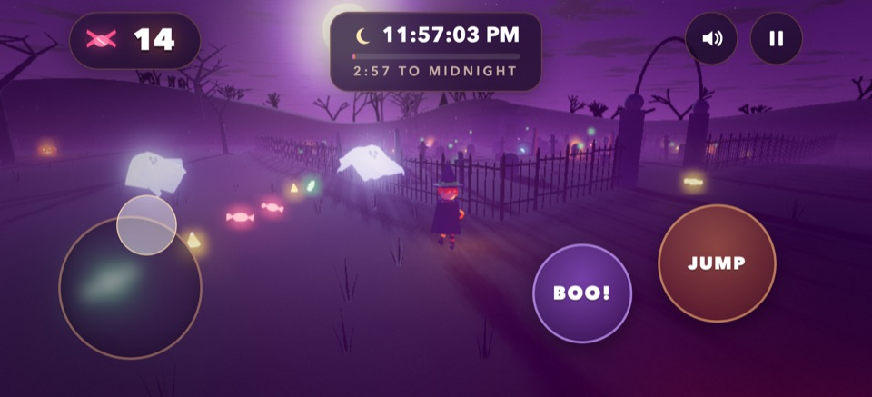
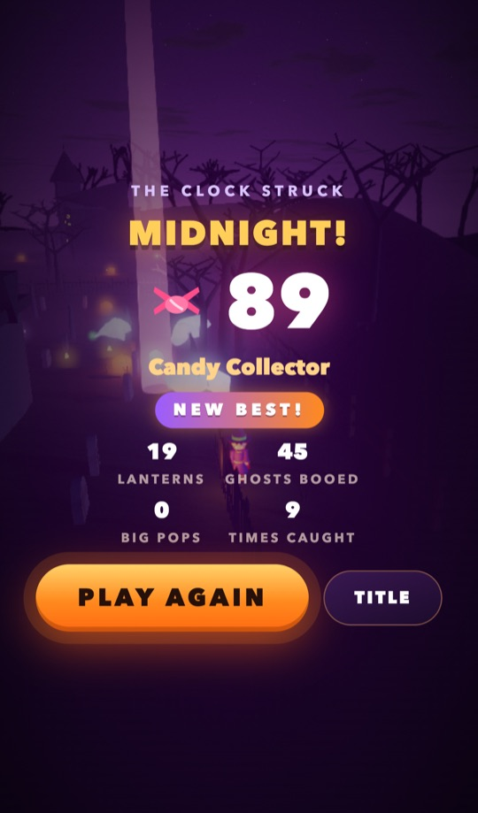

# Midnight Candy Run

The 2026 Halloween game, built only on `@vibe/engine` and three.js. You are a kid in a witch costume on Halloween
night. Run through the moonlit pumpkin patch and the graveyard and grab as much candy as you can before the clock
strikes midnight. One round lasts 3 minutes (11:57 to 12:00).

| Portrait | Landscape | Results |
|---|---|---|
|  | <br> |  |

## How to play
- **Candy** glows on the grass. Run past it and it flies into your pail. Big swirl lollipops (with a light beam
  over them) are worth 5.
- **Jack-o'-lanterns:** run into one to kick it to pieces, or jump on it to stomp it for more candy and a bounce.
  They grow back after a while.
- **Ghosts** rise from the graves (the first one a few seconds in, then one about every 30 s) and get faster as
  midnight gets closer. A ghost that spots you chases you, and the screen edges frost over while one is close. If it
  touches you, it steals some candy. The candy scatters, so you can grab part of it back. After a touch you are safe
  for 2 s. You can outrun a chasing ghost, and it gives up after a long chase. A ghost that caught you or got
  booed leaves you alone for a few seconds.
- **BOO!** scares every ghost near you, and each ghost you scare drops 2 candies. It takes 5 s to recharge (the ring
  on the button). The best trick is to let a ghost come within a few steps, then BOO it.
- When the clock strikes twelve, the round ends. Your best score is saved on this device.

## Controls
| | Phone / tablet | Keyboard + mouse | Gamepad |
|---|---|---|---|
| Move | left thumb anywhere on the left side (floating stick) | W A S D / arrows | left stick |
| Look | drag on the right side | click the view (pointer lock) or hold the right mouse button; wheel zooms | right stick |
| Jump | JUMP | Space | A |
| BOO | BOO! | E (or F, B, Q) | X / B |
| Start / Play Again | TAP TO START / PLAY AGAIN | click, Enter / Space | A |
| Pause | the pause button, top right (also pauses on its own when the tab is hidden) | Esc / P | Start |
| Sound | the speaker button (top right, title) or SOUND on the pause screen | M | Back / Select |
| Full screen | the corner-arrows button (top right, title), where the browser allows it: Android Chrome, iPad; iPhone Safari has none, use Add to Home Screen | the same button | |
| How to play | HOW TO PLAY on the title and the pause screen | the same button | |

Every button is at least 44 x 44 px and sits inside the safe area (notch, home indicator). The stick and the buttons
light up while pressed, and on Android short vibrations mark a candy, a smashed lantern, a BOO and a ghost's touch
(iOS browsers have no vibration API). Hold the stick while you press JUMP or BOO, or while the other thumb drags to look.

The touch controls appear on phones and tablets (also an iPad with a keyboard attached). On a laptop with a
touchscreen they appear with the first touch and hide again when you press a key. A Bluetooth gamepad paired to a phone
plays too.

The camera swings in behind you while you run forward, so you can play with one thumb. Push the stick sideways or back
and the kid runs across or toward the view while the camera holds still (no spinning). Both portrait and landscape work,
and you can turn the phone during a round. Entering full screen asks for landscape where the browser can lock it.

## Run it
```sh
npm install
npm run dev                 # http://localhost:5190/halloween/
```
**On a phone on the same Wi-Fi:** start the dev server on the LAN:
```sh
npx vite --host             # prints a "Network:" URL
```
Then open `http://<computer-ip>:5190/halloween/` on the phone. On macOS, `ipconfig getifaddr en0` prints the
computer's IP. Tap **TAP TO START**: that first tap also starts the sound. On an iPhone, sound also needs the
silent switch off. For a full-screen game, use "Add to Home Screen" (iOS) or "Install app" / "Add to Home screen"
(Android): the web app manifest and icons (`samples/public/halloween/`, copied next to the page by the build; all URLs
relative, so it also works under a sub-path such as `/web-engine/halloween/`) open it full screen from the home
screen.

**Build:** `npm run build` writes every sample into `dist/` (this game is `dist/halloween/index.html`).
`npm run preview` serves the build at http://localhost:5191/halloween/.

URL options:
- `?touch=1` / `?touch=0` forces the touch UI on or off.
- `?quality=low` / `?quality=high`: phones use low by default (pixel ratio capped at 1.5, no AO, a 1024 shadow map,
  smaller cloth ghosts, fewer props).
- `?nofx=1` turns post-processing off.
- `?shadows=0` turns shadows off.
- `?round=60` changes the round length (s).
- `?fps=30` caps the frame rate.

## Test
```sh
node test/browser/halloween.mjs                       # starts its own Vite server
node test/browser/halloween.mjs --url=http://localhost:5190/halloween/ --only=iphone-portrait
node test/browser/halloween.mjs --only=pixel-portrait --perf   # + a stress check under 4x CPU throttling
```
It drives the game in headless Chrome on a 1280x720 desktop and in phone emulation: iPhone 13 and Pixel 7 (portrait
and landscape), a small 360x640 Android, an iPhone SE in landscape and a tall 430x932 iPhone, with touch input on the
phones and safe-area insets on the notched iPhones. It checks:
- the title screen fits; start (a tap or click, which also unlocks audio)
- the stick / WASD moves the kid, a drag turns the camera, JUMP, and BOO with its cooldown ring
- two thumbs: the stick stays held while BOO and JUMP are tapped
- the camera does not spin while the stick points sideways or back
- smashing a lantern and collecting candy
- pause and resume; hiding the tab pauses the round and the audio, and it stays paused until RESUME
- turning the phone during a round; the browser toolbar taking part of the height
- the midnight results screen, the saved best score, and Play Again
- touch controls and HUD stay inside the screen and the safe area and don't overlap
- five rounds back to back keep geometries, textures, shader programs, physics bodies, scene objects, DOM nodes and
  event listeners flat (iphone-portrait)
- no console errors or warnings, no WebGL errors or lost context

Screenshots go to `test/browser/out/halloween/` (gitignored; `--out=<dir>` changes it). The few in `screenshots/`
were picked from runs by hand and saved as small JPEGs.

## How it is built (engine parts used)
| File | What it does |
|---|---|
| `main.js` | Wires everything up. Engine (120 Hz fixed step, render interpolation, adaptive resolution), PhysicsWorld (heightfield + static boxes), CharacterController, AnimationController, ThirdPersonRig / OrbitRig, CharacterInput with the phone touch layout, Atmosphere (night, moon light with shadows, purple night sky), PostFX (bloom, height fog, grade), and the round flow. |
| `kid.js` | The procedural skinned kid: hat, cape, striped stockings, and a glowing pumpkin pail. It reuses the character sample's procedural clips. |
| `world.js` | The terrain, plus one merged mesh for all static props and one for all glowing windows and candles. Also the instanced pumpkins and grass, the moon billboard, the horizon silhouettes, and the colliders. |
| `pumpkins.js` | The jack-o'-lanterns. Lights come from the `NearestLights` pool. Smashing uses `fracturePieces` + `pieceGeometry`: the pieces are real dynamic bodies on the `DynamicsWorld`. |
| `ghosts.js` | Each ghost is a `Cloth.grid` sheet pinned to a kinematic head sphere on the same `DynamicsWorld`, drawn with `ClothMesh`. A small state machine moves them: rise, wander, chase, flee, retreat. |
| `candy.js` | The candy pool: instanced meshes, the magnet, and spilled candy. |
| `effects.js` | Additive glow billboards, the engine `ParticleSystem` sparks, and the BOO ring. |
| `audio.js` | All synth sound on `AudioBus`: a D-minor music loop that speeds up toward midnight, ambience, SFX, and the midnight bells. |
| `hud.js` | The DOM title, HUD, pause, how-to-play and results screens, the full-screen toggle. They sit inside the safe area and fit portrait and landscape; `setTouch` switches the touch / keyboard presentation. |

Engine additions made for this game are all opt-in (CHANGELOG "Unreleased"):
- `TouchControls`: `safeArea`, per-entry `portrait` overrides, `floating` sticks, `setProgress` (cooldown ring),
  `setLabel` and `get`.
- `CharacterInput`: `touchOptions`, plus safe-area and portrait support for its touchpads; `touchReveal` (controls
  on the first touch, hidden on a key press).
- `isTouchDevice({ multiTouch: true })`: also an iPad with a keyboard / trackpad.
