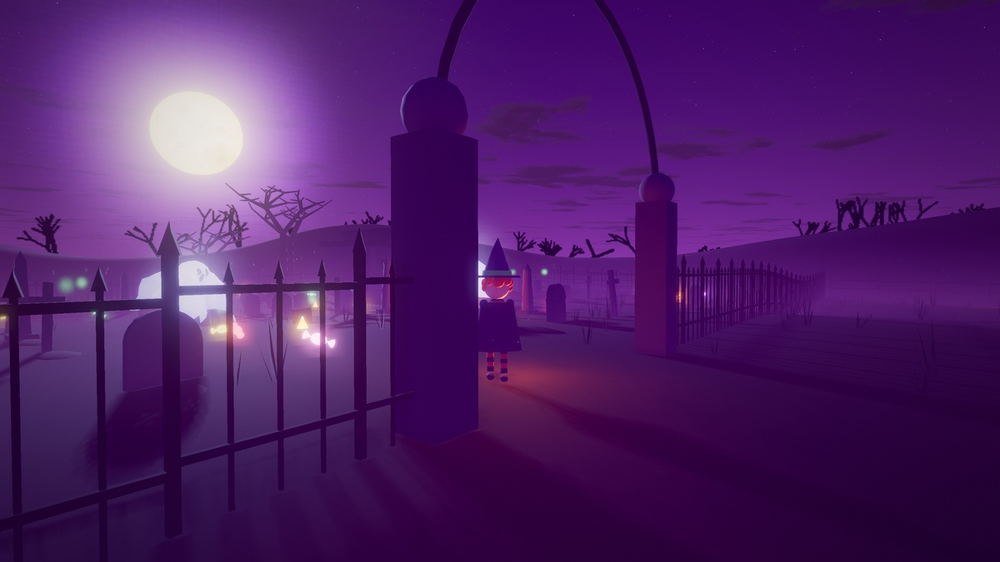
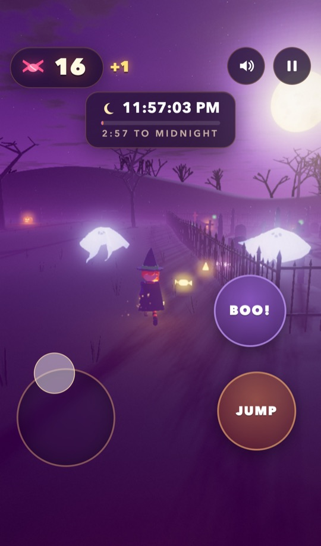
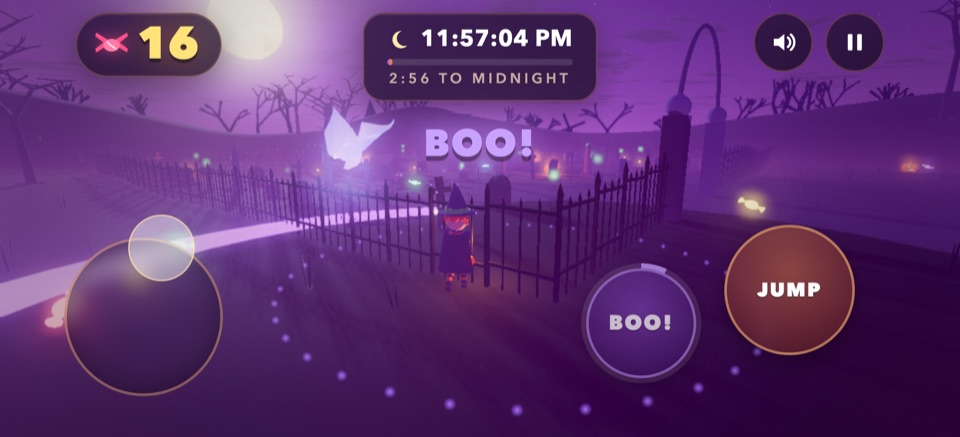

# Midnight Candy Run

<a href="https://brandeispatrick.github.io/web-engine/halloween/"></a>

## 👻 [Play it in your browser](https://brandeispatrick.github.io/web-engine/halloween/)

Phone or computer, nothing to install. The first tap starts the game and the sound.

You're a kid in a witch costume on Halloween night. Grab as much candy as you can before the clock strikes midnight.
A round lasts 3 minutes, from 11:57 to 12:00.

## How to play

**On a phone or tablet** (portrait or landscape)
- Put your left thumb anywhere on the left side to move. The stick appears under it.
- Drag on the right side to look around.
- Tap **JUMP** and **BOO!**

**On a computer:** W A S D or the arrow keys to move, the mouse to look (click the view), Space to jump, E to BOO,
Esc to pause, M for sound. A gamepad works too.

- **Candy** glows on the grass; run past it to collect it. Big swirl lollipops are worth 5.
- **Jack-o'-lanterns:** run into one to kick it apart, or jump on it for more candy.
- **Ghosts** chase you and steal candy when they touch you. Press **BOO!** when one gets close: it scares every ghost
  nearby, and each one drops 2 candies. BOO recharges in 5 s.
- Your best score is saved on your device.

<p>


</p>

<details>
<summary>All controls</summary>

| | Phone / tablet | Keyboard + mouse | Gamepad |
|---|---|---|---|
| Move | left thumb anywhere on the left side (floating stick) | W A S D / arrows | left stick |
| Look | drag on the right side | click the view (pointer lock) or hold the right mouse button; wheel zooms | right stick |
| Jump | JUMP | Space | A |
| BOO | BOO! | E (or F, B, Q) | X / B |
| Start / Play Again | TAP TO START / PLAY AGAIN | click, Enter / Space | A |
| Pause | the pause button, top right (also pauses when the tab is hidden) | Esc / P | Start |
| Sound | the speaker button (top right) or SOUND on the pause screen | M | Back / Select |
| Full screen | the corner-arrows button, where the browser allows it (Android Chrome, iPad; on iPhone use Add to Home Screen) | the same button | |

- Every button is at least 44 x 44 px and stays inside the safe area (notch, home indicator).
- On Android, short vibrations mark a candy, a smashed lantern, a BOO and a ghost's touch.
- On a laptop with a touchscreen, the touch controls appear with the first touch and hide when you press a key.
- The camera swings in behind you while you run forward, so one thumb is enough. You can turn the phone mid-round.

</details>

## How it was made

Built with Claude (AI agents) on this repository's engine, [`@vibe/engine`](../../README.md), and three.js. There are
no model, texture or sound files: the kid, the graveyard and the music are all made in code.

- **Cloth ghosts:** each ghost is a cloth sheet on the engine's XPBD physics, pinned to a moving head.
- **Fracture:** jack-o'-lanterns break into real physics pieces.
- **Synth audio:** music, ambience and effects are synthesized live. The music speeds up toward midnight.
- **Phone touch controls:** a floating stick, a cooldown ring on BOO, safe-area layout, portrait and landscape.

The engine changes this game needed are opt-in and listed in the [CHANGELOG](../../CHANGELOG.md) under
"Unreleased".

<details>
<summary>What each file does</summary>

| File | What it does |
|---|---|
| `main.js` | Wires everything up: Engine (120 Hz fixed step, render interpolation, adaptive resolution), PhysicsWorld, CharacterController, AnimationController, camera rigs, CharacterInput with the phone touch layout, the night Atmosphere, PostFX and the round flow. |
| `kid.js` | The procedural skinned kid (hat, cape, striped stockings, a glowing pumpkin pail), using the character sample's procedural clips. |
| `world.js` | The terrain, merged meshes for the static props and the glowing windows and candles, instanced pumpkins and grass, the moon, the horizon and the colliders. |
| `pumpkins.js` | The jack-o'-lanterns: lights from the `NearestLights` pool; smashing uses `fracturePieces` + `pieceGeometry`, real dynamic bodies on the `DynamicsWorld`. |
| `ghosts.js` | Each ghost is a `Cloth.grid` sheet pinned to a kinematic head sphere, drawn with `ClothMesh`, moved by a small state machine (rise, wander, chase, flee, retreat). |
| `candy.js` | The candy pool: instanced meshes, the magnet and spilled candy. |
| `effects.js` | Glow billboards, the engine `ParticleSystem` sparks and the BOO ring. |
| `audio.js` | All synth sound on `AudioBus`: a D-minor music loop, ambience, effects and the midnight bells. |
| `hud.js` | The DOM title, HUD, pause, how-to-play and results screens, and the full-screen toggle. |

</details>

## Run it locally

```sh
npm install
npm run dev     # http://localhost:5190/halloween/
```

To play on a phone on the same Wi-Fi, run `npx vite --host` and open `http://<computer-ip>:5190/halloween/` on the
phone (`npx vite --host` prints the address). On iPhone, sound also needs the silent switch off.

`npm run build` writes it to `dist/halloween/`, and `npm run preview` serves the build at
http://localhost:5191/halloween/.

URL options: `?touch=1|0` (force the touch UI), `?quality=low|high` (touch devices default to low), `?nofx=1`, `?shadows=0`,
`?round=60` (round length in seconds), `?fps=30`.

## Tests

- `test/browser/halloween.mjs` plays the game in headless Chrome on a desktop and in phone emulation (iPhone, Pixel,
  small Android, portrait, landscape, rotation, two-thumb input). It checks controls, layout, pause, results and that
  five rounds in a row don't leak resources. Run `node test/browser/halloween.mjs`.
- `test/browser/halloween-media.mjs` captures the stills and short clips used for social posts.
